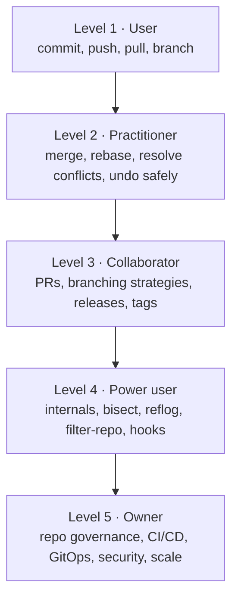

<!-- devopsshack:header -->
> 📘 **Git Mastery: Zero to Production** · by **DevOps Shack** · [YouTube](https://www.youtube.com/@devopsshack) · [Hindi channel](https://www.youtube.com/@shackverse) · [devopsshack.com](https://devopsshack.com)
<!-- /devopsshack:header -->

# 00 · The Git Mastery Roadmap

This roadmap takes you from "I've never typed `git init`" to "I can design the branching strategy and recover the repository when production is on fire." It's built for about **one to two hours a day for six weeks**. Go faster if you already know the basics. Don't skip the labs, though. Git is learned with your fingers.

## The five levels

Most job descriptions that say "strong Git skills" mean Level 3. Senior DevOps and platform roles expect Level 4 and some Level 5. In interviews, the questions that separate candidates almost always come from Levels 4 and 5: internals, recovery, and strategy.

---

## Week 1 · Foundations

You'll understand what version control solves, set Git up properly, and get fluent in the core loop of edit → stage → commit.

- Read [Module 01 · Version Control & Git Overview](../modules/01-version-control-overview.md)
- Read [Module 02 · Installation & Configuration](../modules/02-installation-and-configuration.md)
- Read [Module 03 · The Core Workflow](../modules/03-core-workflow.md)
- Labs: [01](../labs/lab-01-first-repository/README.md), [02](../labs/lab-02-staging-area/README.md), [03](../labs/lab-03-gitignore/README.md)
- Assignment: [A01 · Personal Project History](../assignments/A01-personal-project-history.md)

**You're ready to move on when** you can explain the three areas (working tree, index, repository) without notes, and you never use `git add .` blindly any more.

## Week 2 · Internals and undoing things

This is where Git stops being magic. Once you see that a branch is just a 41-byte file, everything else gets easier.

- Read [Module 04 · Git Internals](../modules/04-git-internals.md)
- Read [Module 05 · Undoing Changes](../modules/05-undoing-changes.md)
- Labs: [04](../labs/lab-04-git-objects/README.md), [05](../labs/lab-05-undo-everything/README.md), [06](../labs/lab-06-reflog-rescue/README.md)
- Assignment: [A02 · Build a Commit by Hand](../assignments/A02-build-a-commit-by-hand.md)

**You're ready when** you can recover a "deleted" branch with reflog and explain the difference between `reset --soft`, `--mixed` and `--hard`.

## Week 3 · Branching, merging and rebasing

- Read [Module 06 · Branching](../modules/06-branching.md)
- Read [Module 07 · Merging & Conflicts](../modules/07-merging-and-conflicts.md)
- Read [Module 08 · Rebasing](../modules/08-rebasing.md)
- Labs: [07](../labs/lab-07-merge-conflicts/README.md), [08](../labs/lab-08-rebase-basics/README.md), [09](../labs/lab-09-interactive-rebase/README.md), [10](../labs/lab-10-rebase-conflicts/README.md)
- Assignments: [A03](../assignments/A03-conflict-gauntlet.md), [A04](../assignments/A04-clean-history.md)

**You're ready when** you can squash, reorder and split commits with interactive rebase, and you know exactly when *not* to rebase.

## Week 4 · Collaboration and branching strategy

- Read Modules [09](../modules/09-remotes.md), [10](../modules/10-collaboration-workflows.md), [11](../modules/11-branching-strategies.md), [12](../modules/12-tags-and-releases.md)
- Study the [Branching Strategies](../branching-strategies/README.md) section in full
- Labs: [11](../labs/lab-11-remotes-and-upstream/README.md), [12](../labs/lab-12-fork-workflow/README.md), [13](../labs/lab-13-git-flow/README.md), [14](../labs/lab-14-trunk-based/README.md), [15](../labs/lab-15-tags-and-releases/README.md)
- Assignments: [A05](../assignments/A05-team-simulation.md), [A06](../assignments/A06-choose-a-branching-strategy.md), [A07](../assignments/A07-release-and-hotfix.md)

**You're ready when** you can recommend a branching strategy for a given team and defend it.

## Week 5 · Power tools

- Read Modules [13](../modules/13-stash-cherry-pick-worktrees.md) to [17](../modules/17-hooks-and-automation.md)
- Labs: [16](../labs/lab-16-stash/README.md) to [23](../labs/lab-23-hooks/README.md)
- Assignments: [A08](../assignments/A08-bisect-the-bug.md) to [A12](../assignments/A12-hooks-pipeline.md)

**You're ready when** you can find a bug-introducing commit with `git bisect run`, and purge a leaked secret from history.

## Week 6 · Production Git

- Read Modules [18](../modules/18-git-in-cicd-and-gitops.md) to [24](../modules/24-git-at-scale.md)
- Labs: [24](../labs/lab-24-signed-commits/README.md) to [30](../labs/lab-30-production-incident-drill/README.md)
- Assignments: [A13](../assignments/A13-signed-commit-policy.md) to [A20](../assignments/A20-capstone-repo-governance.md)
- Interview prep: work through all three [interview banks](../interview-questions/README.md)

**You're ready when** you can run the [production incident drill](../labs/lab-30-production-incident-drill/README.md) without looking anything up.

---

## How to study each module

Read the module once without typing anything, just to build the mental model. Then read it again with a terminal open and run every command. Then do the labs. The labs deliberately put you into broken states, because that's where real learning happens.

When a command surprises you, stop and run `git log --oneline --graph --all` and `git status`. Ninety percent of Git confusion goes away when you look at the graph.

---

## Want this with live mentoring?

This repository covers Git completely. If you want the full DevOps journey (Git, CI/CD, Docker, Kubernetes, cloud, DevSecOps, GitOps and AI) with live classes, real projects and doubt support, look at the current DevOps Shack bootcamp on [devopsshack.com](https://devopsshack.com).

<!-- devopsshack:footer -->
---

  Made with ❤️ by <b><a href="https://devopsshack.com">DevOps Shack</a></b> · Part of <b>Git Mastery: Zero to Production</b> 
  <a href="https://www.youtube.com/@devopsshack">YouTube · DevOps Shack</a> · <a href="https://www.youtube.com/@shackverse">YouTube · DevOps Shack Hindi</a> · <a href="https://devopsshack.com">devopsshack.com</a> · <a href="https://www.instagram.com/devopsshack">Instagram · @devopsshack</a> 
  © DevOps Shack. Original content created by DevOps Shack. Free to learn from and share with credit to DevOps Shack. See <a href="../LICENSE">LICENSE</a>.

<!-- /devopsshack:footer -->
