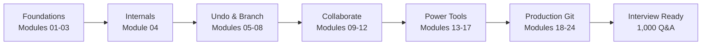

# Git Mastery: Zero to Production — by DevOps Shack

**The complete, end-to-end Git repository.** Concepts, internals, every everyday and disaster scenario, branching strategies, architecture diagrams, hands-on labs, assignments, and **1,000 interview questions**. All free.

If this repository helps you, **star it** ⭐ so it reaches more engineers.

---

## What's inside

| Section | What you get |
|---|---|
| [00 · Roadmap](00-roadmap/README.md) | A 6-week study plan, from first commit to running Git for a whole engineering org |
| [Modules](modules/README.md) | 24 learner-friendly chapters covering every Git topic end to end |
| [Branching Strategies](branching-strategies/README.md) | Git Flow, GitHub Flow, GitLab Flow, Trunk-Based, Release & Environment branching, with a decision guide |
| [Architecture Diagrams](diagrams/README.md) | 30 diagrams on internals, workflows, merges, rebases, CI/CD and GitOps |
| [Labs](labs/README.md) | 30 hands-on labs. Each has a setup script that builds the exact broken or tricky repo you need |
| [Assignments](assignments/README.md) | 20 graded assignments, from beginner to staff level |
| [Interview Questions](interview-questions/README.md) | **300 concept + 350 scenario + 350 production** questions with answers |
| [Cheat Sheets](cheatsheets/README.md) | Daily commands, undo-anything table, and a recovery cheat sheet |

---

## How to use this repository

**Starting from zero?** Follow the [Roadmap](00-roadmap/README.md) in order. Read a module, do the labs linked at its end, then attempt the assignment.

**Already use Git daily?** Jump straight to [Module 04 · Internals](modules/04-git-internals.md), [Module 08 · Rebasing](modules/08-rebasing.md) and [Module 21 · Troubleshooting & Disaster Recovery](modules/21-troubleshooting-and-recovery.md). Then do the "Advanced" labs.

**Preparing for interviews?** Read the [Branching Strategies](branching-strategies/README.md) section, then work through the [interview banks](interview-questions/README.md). Try answering each question out loud before reading the answer.

**Teaching Git to a team?** Every lab ships with a `setup.sh` that recreates the scenario, so a whole classroom starts from an identical repo.

---

## Learning path at a glance



---

## Running the labs

Every lab lives in its own folder under [`labs/`](labs/README.md) and works the same way:

```bash
cd labs/lab-07-merge-conflicts
bash setup.sh          # builds a practice repo in ./playground
cd playground
# follow the steps in README.md
bash ../verify.sh      # checks whether you solved it (where provided)
```

You only need Git 2.30 or newer and a bash shell (Linux, macOS, or Git Bash/WSL on Windows). Nothing touches your real projects. Every lab works inside its own `playground` folder that you can delete and rebuild anytime.

---

## About DevOps Shack

DevOps Shack teaches DevOps, DevSecOps, Cloud, Kubernetes, GitOps, MLOps and Platform Engineering through real production projects.

- YouTube: [DevOps Shack](https://www.youtube.com/@devopsshack)
- Hindi channel: [DevOps Shack Hindi](https://www.youtube.com/@shackverse)
- Website: [devopsshack.com](https://devopsshack.com)
- Instagram: [@devopsshack](https://www.instagram.com/devopsshack)

This repository is free to learn from and share. If you share or re-upload any part of it, please keep the DevOps Shack credit.

## License

Created by **DevOps Shack** and released under [CC BY-NC-SA 4.0](LICENSE): free for personal learning and sharing with credit to DevOps Shack. See [NOTICE](NOTICE) and [AUTHORS](AUTHORS.md).


<!-- devopsshack:footer -->
---

<p align="center">
  Made with ❤️ by <b><a href="https://devopsshack.com">DevOps Shack</a></b> · Part of <b>Git Mastery: Zero to Production</b><br/>
  <a href="https://www.youtube.com/@devopsshack">YouTube · DevOps Shack</a> · <a href="https://www.youtube.com/@shackverse">YouTube · DevOps Shack Hindi</a> · <a href="https://devopsshack.com">devopsshack.com</a> · <a href="https://www.instagram.com/devopsshack">Instagram · @devopsshack</a><br/>
  <sub>© DevOps Shack. Original content created by DevOps Shack. Free to learn from and share with credit to DevOps Shack. See <a href="LICENSE">LICENSE</a>.</sub>
</p>
<!-- /devopsshack:footer -->
