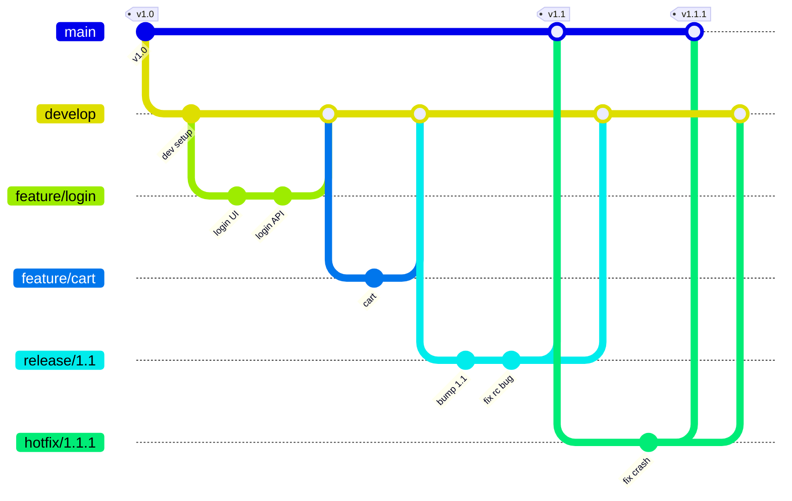

<!-- devopsshack:header -->
> 📘 **Git Mastery: Zero to Production** · by **DevOps Shack** · [YouTube](https://www.youtube.com/@devopsshack) · [Hindi channel](https://www.youtube.com/@shackverse) · [devopsshack.com](https://devopsshack.com)
<!-- /devopsshack:header -->

# 01 · Git Flow

Git Flow was published by Vincent Driessen in 2010 in a post titled "A successful Git branching model." It became the default strategy for a decade. It's still the right choice for some products, and it's still asked about in nearly every DevOps interview.

## The branches

| Branch | Lifetime | Branches from | Merges into | Purpose |
|---|---|---|---|---|
| `main` (originally `master`) | Permanent | — | — | Production-ready code only. Every commit is a release, tagged |
| `develop` | Permanent | `main` | — | Integration branch for the next release |
| `feature/*` | Days to weeks | `develop` | `develop` | New features |
| `release/*` | Days | `develop` | `main` **and** `develop` | Stabilize a release: bug fixes, version bump, docs only |
| `hotfix/*` | Hours | `main` | `main` **and** `develop` | Urgent production fixes |

## The full picture



## Step by step with plain Git

### Start a feature

```bash
git switch develop && git pull
git switch -c feature/PAY-142-upi-checkout
# ... commits ...
git push -u origin feature/PAY-142-upi-checkout
# open PR into develop, then:
git switch develop && git pull
git merge --no-ff feature/PAY-142-upi-checkout
git branch -d feature/PAY-142-upi-checkout
```

`--no-ff` keeps a merge commit, so the feature stays visible as a unit in history. That's part of the original model.

### Cut a release

```bash
git switch -c release/1.2.0 develop
# bump version files, update CHANGELOG, fix only release-blocking bugs
git commit -am "chore(release): 1.2.0"

git switch main
git merge --no-ff release/1.2.0
git tag -a v1.2.0 -m "Release 1.2.0"

git switch develop
git merge --no-ff release/1.2.0      # bring release fixes back

git branch -d release/1.2.0
git push origin main develop --follow-tags
```

While the release branch is open, new feature work continues on `develop` for the *next* release.

### Ship a hotfix

```bash
git switch -c hotfix/1.2.1 main
# fix
git commit -am "fix: null pointer on empty cart"

git switch main && git merge --no-ff hotfix/1.2.1 && git tag -a v1.2.1 -m "Hotfix 1.2.1"
git switch develop && git merge --no-ff hotfix/1.2.1
# if a release branch is currently open, merge the hotfix there instead of develop
git branch -d hotfix/1.2.1
git push origin main develop --follow-tags
```

## The git-flow CLI extension

```bash
git flow init -d
git flow feature start upi-checkout
git flow feature finish upi-checkout
git flow release start 1.2.0
git flow release finish 1.2.0
git flow hotfix start 1.2.1
git flow hotfix finish 1.2.1
```

The original `nvie/gitflow` is unmaintained. Use the maintained `git-flow-avh` fork or the newer `git-flow-next`, or just plain Git as above.

## When Git Flow fits

- You ship **versioned releases** on a schedule: desktop software, mobile apps, on-prem products, SDKs, firmware.
- Releases need a **stabilization period** with QA sign-off.
- You must **support a released version** while building the next one.
- Regulated environments that require explicit release gates.

## Where it hurts

- **Slow integration.** Features can sit on branches for weeks, then collide on `develop`.
- **Two long-lived branches** that must be kept in sync. Forgetting to merge a hotfix back to `develop` means the bug comes back in the next release (a classic incident).
- **Merge-commit-heavy history** that's harder to read and bisect.
- **Doesn't suit continuous deployment.** If every merge to main deploys, `develop` and release branches add nothing but delay.

Driessen himself added a note to the original post in 2020: for continuously delivered software like web apps, a simpler workflow such as GitHub Flow is a better fit.

> **DevOps Shack Production Tip:** The most common Git Flow production incident is a **regression after release**: a hotfix went to `main` but nobody merged it into `develop` (or the open release branch), so the next release reintroduced the bug. Automate the back-merge in CI, or at least add it to your hotfix PR checklist.

## Interview angle

Be ready to explain: why `release` merges into both `main` and `develop`, where hotfixes branch from, why `--no-ff` is used, and why Git Flow is a poor fit for a SaaS product that deploys ten times a day.

Back to [Branching Strategies](README.md) · Next: [GitHub Flow](02-github-flow.md)


<!-- devopsshack:footer -->
---

<p align="center">
  Made with ❤️ by <b><a href="https://devopsshack.com">DevOps Shack</a></b> · Part of <b>Git Mastery: Zero to Production</b><br/>
  <a href="https://www.youtube.com/@devopsshack">YouTube · DevOps Shack</a> · <a href="https://www.youtube.com/@shackverse">YouTube · DevOps Shack Hindi</a> · <a href="https://devopsshack.com">devopsshack.com</a> · <a href="https://www.instagram.com/devopsshack">Instagram · @devopsshack</a><br/>
  <sub>© DevOps Shack. Original content created by DevOps Shack. Free to learn from and share with credit to DevOps Shack. See <a href="../LICENSE">LICENSE</a>.</sub>
</p>
<!-- /devopsshack:footer -->
