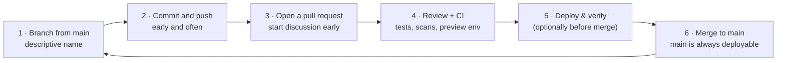
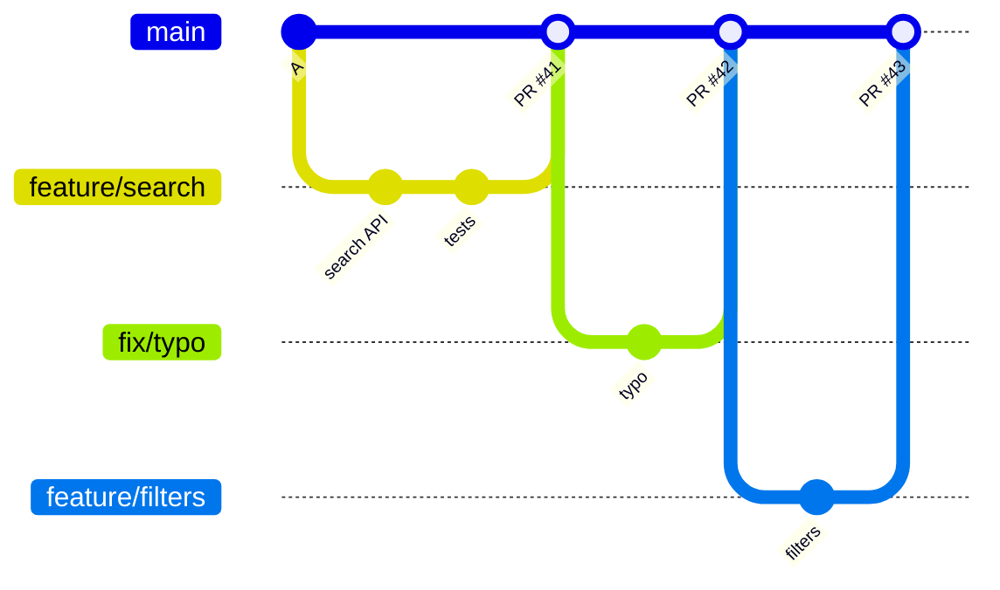

<!-- devopsshack:header -->
> 📘 **Git Mastery: Zero to Production** · by **DevOps Shack** · [YouTube](https://www.youtube.com/@devopsshack) · [Hindi channel](https://www.youtube.com/@shackverse) · [devopsshack.com](https://devopsshack.com)
<!-- /devopsshack:header -->

# 02 · GitHub Flow

GitHub Flow was described by Scott Chacon in 2011 as the workflow GitHub itself used. It has one rule above all: **anything in `main` is deployable.**

## The six steps





## Commands

```bash
git switch main && git pull
git switch -c feature/search-autocomplete
# work, commit
git push -u origin feature/search-autocomplete
gh pr create --fill --base main
# CI runs, reviewers approve
gh pr merge --squash --delete-branch
# merge to main triggers deployment
```

## Releases and hotfixes in GitHub Flow

There's no separate release or hotfix branch type. A hotfix is just a small branch with an urgent PR. A release is whatever is on main. It's usually deployed automatically, and tagged if you need version numbers.

Some teams deploy the PR branch to production *before* merging (GitHub originally did this). If it misbehaves, they redeploy `main` to roll back. More commonly, teams deploy to a **preview environment** per PR, then deploy to production after merge.

## When GitHub Flow fits

- Web apps, APIs and SaaS that deploy continuously.
- Teams of almost any size with good CI.
- Only one version is in production at a time.
- Open-source projects (combined with forks).

## Where it hurts

- **No built-in staging gate.** If you need dev → staging → production promotion with sign-offs, add environments (GitHub Environments with required reviewers) or look at GitLab Flow.
- **Supporting old versions** (v1 and v2 both in customers' hands) needs release branches on top.
- **Relies on CI quality.** If tests are weak, `main` breaks often and "always deployable" becomes fiction.
- **Long-lived feature branches still cause pain.** GitHub Flow assumes branches are short.

> **DevOps Shack Production Tip:** GitHub Flow plus **feature flags** plus **squash merge** plus **auto-delete branches** is the most common setup we see in modern product companies. It's simple enough that new joiners understand it on day one, and it scales well.

Back to [Branching Strategies](README.md) · Next: [GitLab Flow](03-gitlab-flow.md)


<!-- devopsshack:footer -->
---

<p align="center">
  Made with ❤️ by <b><a href="https://devopsshack.com">DevOps Shack</a></b> · Part of <b>Git Mastery: Zero to Production</b><br/>
  <a href="https://www.youtube.com/@devopsshack">YouTube · DevOps Shack</a> · <a href="https://www.youtube.com/@shackverse">YouTube · DevOps Shack Hindi</a> · <a href="https://devopsshack.com">devopsshack.com</a> · <a href="https://www.instagram.com/devopsshack">Instagram · @devopsshack</a><br/>
  <sub>© DevOps Shack. Original content created by DevOps Shack. Free to learn from and share with credit to DevOps Shack. See <a href="../LICENSE">LICENSE</a>.</sub>
</p>
<!-- /devopsshack:footer -->
