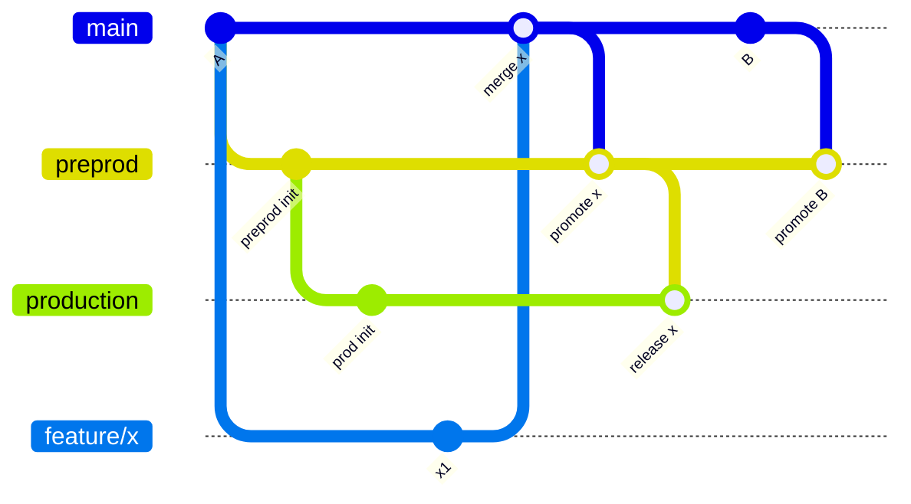
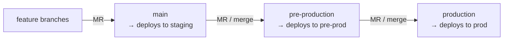
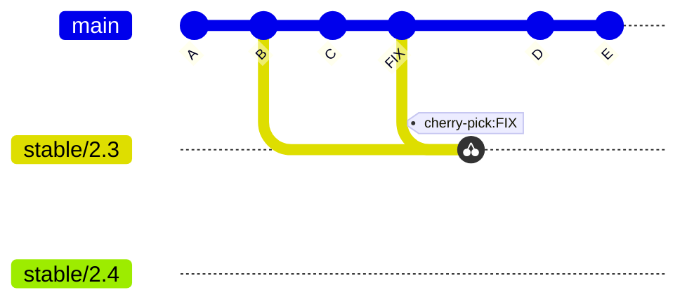

<!-- devopsshack:header -->
> 📘 **Git Mastery: Zero to Production** · by **DevOps Shack** · [YouTube](https://www.youtube.com/@devopsshack) · [Hindi channel](https://www.youtube.com/@shackverse) · [devopsshack.com](https://devopsshack.com)
<!-- /devopsshack:header -->

# 03 · GitLab Flow

GitLab Flow (introduced by GitLab in 2014) sits between Git Flow's ceremony and GitHub Flow's simplicity. It keeps feature branches merging into `main`, and adds downstream branches for cases where you **can't deploy main directly**: environments that need gates, or released versions that need maintenance.

The core principle is **upstream first**. Changes always land in `main` first, then flow *downstream* to environment or release branches. Never fix something only downstream.

## Variant A · Environment branches





Each downstream branch auto-deploys to its environment. Promotion is a merge request from one environment branch to the next, which gives you an approval gate and an audit record.

```bash
# promote what's on main to pre-production
git switch pre-production && git pull
git merge --ff-only origin/main     # or open an MR main → pre-production
git push
```

Use fast-forward merges for promotion where possible, so each environment branch is just "main, but a bit behind." That keeps environments from drifting.

## Variant B · Release branches

For software you ship to customers in versions:



- Cut a stable branch from main (GitLab names its own `2-3-stable`; the diagram shows `stable/2.3`) when 2.3 is ready, and tag releases on it (`v2.3.0`, `v2.3.1`).
- Bug fixes land on **main first**, then get cherry-picked (`-x`) into the stable branches that need them.

## When GitLab Flow fits

- You need **staged promotion** with approvals (regulated industries, enterprise customers, mobile app store review).
- You need **maintained release lines** but find Git Flow too heavy.
- Your deployment tooling deploys from branches.

## Where it hurts

- Environment branches can drift if people commit directly to them or cherry-pick instead of merging. Protect them so only promotion MRs can update them.
- For Kubernetes and GitOps, **folders per environment on one branch** are usually better than environment branches (see [Environment Branching](06-environment-branching.md)).

> **DevOps Shack Production Tip:** Enforce "upstream first" with branch protection. On `production`, allow merges only from `pre-production`, and allow nobody to push directly. Then a "quick fix straight to prod" can't happen, and that's exactly the kind of fix that gets lost in the next promotion.

Back to [Branching Strategies](README.md) · Next: [Trunk-Based Development](04-trunk-based-development.md)


<!-- devopsshack:footer -->
---

<p align="center">
  Made with ❤️ by <b><a href="https://devopsshack.com">DevOps Shack</a></b> · Part of <b>Git Mastery: Zero to Production</b><br/>
  <a href="https://www.youtube.com/@devopsshack">YouTube · DevOps Shack</a> · <a href="https://www.youtube.com/@shackverse">YouTube · DevOps Shack Hindi</a> · <a href="https://devopsshack.com">devopsshack.com</a> · <a href="https://www.instagram.com/devopsshack">Instagram · @devopsshack</a><br/>
  <sub>© DevOps Shack. Original content created by DevOps Shack. Free to learn from and share with credit to DevOps Shack. See <a href="../LICENSE">LICENSE</a>.</sub>
</p>
<!-- /devopsshack:footer -->
