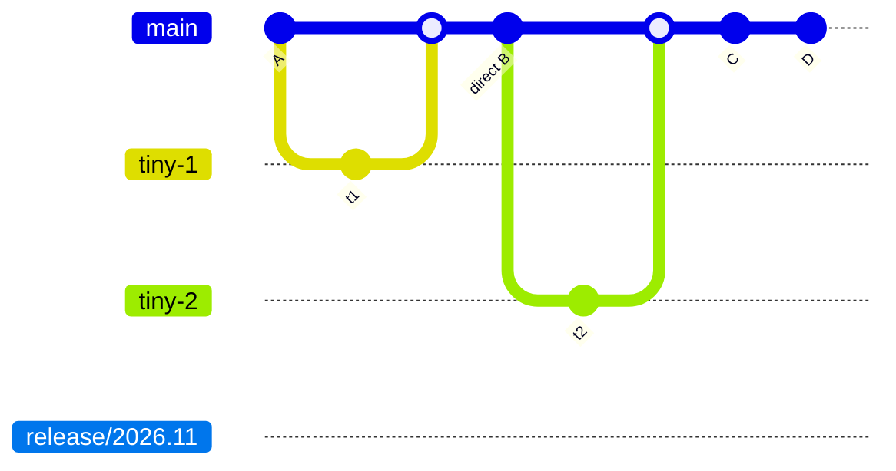
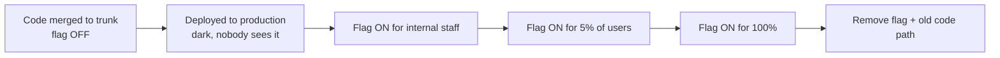

<!-- devopsshack:header -->
> 📘 **Git Mastery: Zero to Production** · by **DevOps Shack** · [YouTube](https://www.youtube.com/@devopsshack) · [Hindi channel](https://www.youtube.com/@shackverse) · [devopsshack.com](https://devopsshack.com)
<!-- /devopsshack:header -->

# 04 · Trunk-Based Development

In trunk-based development (TBD), every developer integrates their work into a single shared branch, the **trunk** (usually `main`), at least once a day. There are no long-lived feature branches and no `develop` branch. Unfinished work is hidden behind **feature flags** instead of being kept on a separate branch.

The DORA research associates TBD with elite software delivery performance. Google, Meta and many high-frequency SaaS companies work this way.

## Two styles

**Committing straight to trunk** works for small, senior, co-located teams with excellent tests. People pull, commit small changes, run tests, and push to main many times a day.

**Short-lived feature branches** suit most teams. Branches live a few hours to two days at most, go through a quick PR with CI, and merge. This is TBD as most companies practise it.



The release branch is optional. It's cut from trunk just before a release, receives only cherry-picked fixes, and is never merged back.

## Feature flags make it work

You can't merge half a feature into main unless it's switched off. Feature flags separate **deploying code** from **releasing features**.

```python
# a DevOps Shack style flag check
if flags.is_enabled("upi_checkout_v2", user=current_user):
    return new_checkout(cart)
return legacy_checkout(cart)
```



Flag tooling: LaunchDarkly, Unleash, Flagsmith, ConfigCat, AWS AppConfig, OpenFeature (vendor-neutral standard), or a simple config file for small teams.

**Flag hygiene matters.** Every flag is technical debt. Track an owner and an expiry date for each one, and remove it once fully rolled out. Stale flags (Knight Capital's 2012 incident is the famous example of reusing an old flag) have caused major outages.

## Branch by abstraction

For big refactors (swapping a database layer, replacing a payment provider), you don't create a three-month branch. Instead:

1. Introduce an abstraction (interface) in front of the old implementation. Merge.
2. Build the new implementation behind the abstraction, piece by piece. Merge each piece.
3. Switch callers over gradually with a flag.
4. Delete the old implementation and, if you want, the abstraction.

Trunk stays releasable at every step.

## Prerequisites

TBD without these is just a faster way to break production:

- **Fast, reliable CI** (under about ten minutes) running on every PR and every trunk commit.
- **High automated test coverage**, including integration tests.
- **Feature flag tooling** and discipline.
- **Small changes.** PRs that review in minutes.
- **A team agreement that a broken trunk is everyone's top priority.** Fix forward or revert immediately.
- Ideally a **merge queue** at high commit volume.

## Releasing from trunk

- **Continuous deployment**: every green commit on trunk deploys automatically.
- **Release from trunk with tags**: tag a green commit and deploy it.
- **Release branches cut late**: `release/2026.11` is cut from trunk. Fixes land on trunk first, then get cherry-picked to the release branch. Release branches never merge back.

> **DevOps Shack Production Tip:** Measure your branch lifetimes before claiming you do trunk-based development. `git for-each-ref --sort=committerdate refs/remotes/origin --format='%(committerdate:relative) %(refname:short)'` shows how old your branches really are. If many are older than a week, you're doing GitHub Flow with long branches, not TBD. That's fine, but be honest about it, especially in interviews.

## When TBD fits

- Continuous delivery or deployment.
- Strong engineering culture and test automation.
- Teams that suffer from merge conflicts and slow integration.

## Where it hurts

- Weak test suites mean a constantly broken trunk.
- Junior-heavy teams may need stronger PR gates first.
- Feature-flag sprawl if hygiene is ignored.
- Open-source projects with untrusted contributors still need fork-based PRs.

Back to [Branching Strategies](README.md) · Next: [Release Branching](05-release-branching.md)


<!-- devopsshack:footer -->
---

<p align="center">
  Made with ❤️ by <b><a href="https://devopsshack.com">DevOps Shack</a></b> · Part of <b>Git Mastery: Zero to Production</b><br/>
  <a href="https://www.youtube.com/@devopsshack">YouTube · DevOps Shack</a> · <a href="https://www.youtube.com/@shackverse">YouTube · DevOps Shack Hindi</a> · <a href="https://devopsshack.com">devopsshack.com</a> · <a href="https://www.instagram.com/devopsshack">Instagram · @devopsshack</a><br/>
  <sub>© DevOps Shack. Original content created by DevOps Shack. Free to learn from and share with credit to DevOps Shack. See <a href="../LICENSE">LICENSE</a>.</sub>
</p>
<!-- /devopsshack:footer -->
