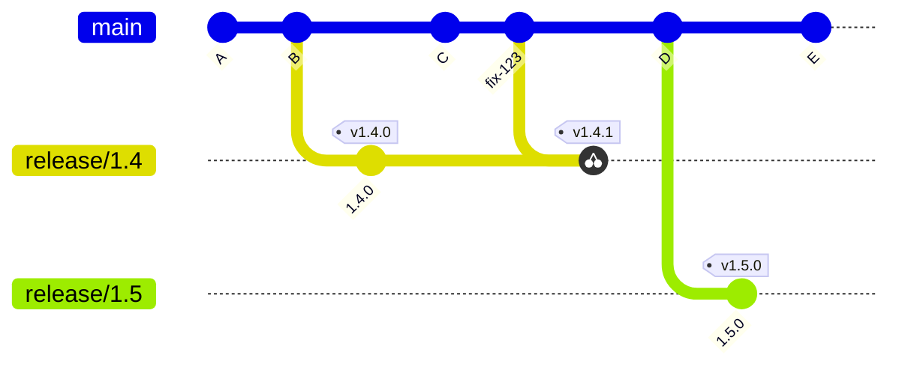

<!-- devopsshack:header -->
> 📘 **Git Mastery: Zero to Production** · by **DevOps Shack** · [YouTube](https://www.youtube.com/@devopsshack) · [Hindi channel](https://www.youtube.com/@shackverse) · [devopsshack.com](https://devopsshack.com)
<!-- /devopsshack:header -->

# 05 · Release Branching

Release branching is how you support **multiple versions in production at once**. Kubernetes, Linux, Node.js, Postgres, most SDKs and most enterprise software use it. It combines with trunk-based development or GitHub Flow for day-to-day work on `main`.

## How it works



1. Development happens on `main`.
2. When a version is feature-complete, cut `release/1.5` from main. That's the **feature freeze** for 1.5 only. Main keeps moving toward 1.6.
3. Stabilize on the release branch. Tag `v1.5.0` when ready.
4. Bugs are fixed on **main first**, then cherry-picked to every supported release branch that needs the fix. Each gets a patch tag (`v1.5.1`, `v1.4.2`).
5. When a version reaches **end of life**, stop backporting. The branch stays in place as history.

```bash
# cut the release
git switch -c release/1.5 main
git push -u origin release/1.5

# backport a fix
git switch release/1.5
git cherry-pick -x <fix-sha-on-main>
git tag -a v1.5.1 -m "1.5.1: fix login timeout"
git push origin release/1.5 --follow-tags
```

## Why "main first"?

If you fix a bug only on `release/1.5`, it reappears in 1.6, because 1.6 is cut from main, which never got the fix. Fixing on main first and cherry-picking down guarantees every future version has the fix.

Sometimes the code has diverged too much and the fix must be written differently for an old branch. That's fine. Write a separate commit on the release branch and reference the original issue.

## Automating backports

At scale, people use bots: label a merged PR `backport release/1.5` and a bot opens the cherry-pick PR automatically. Examples include the `backport` GitHub Action, Mergify backport actions, and Kubernetes' `cherry-pick` Prow plugin.

## Support policy

Publish which versions are supported, for example "the latest three minor versions" (Kubernetes' approach) or "LTS releases for 30 months" (Node.js). This decides how many branches you maintain, which directly drives engineering cost.

## When it fits

- Libraries, SDKs, operating systems, databases, on-prem and enterprise software.
- Customers who upgrade on their own schedule.
- Mobile apps, where a fix may need to ship for the version in app-store review.

## Where it hurts

- Every supported branch multiplies testing and backport effort.
- Cherry-pick conflicts grow as branches diverge.
- Needs clear ownership of release branches.

> **DevOps Shack Production Tip:** Run CI on every active release branch on a schedule, not only when someone pushes. Old branches rot: base images get removed, certificates expire, dependencies vanish from registries. You don't want to discover that while shipping an urgent security patch to `release/1.3`.

Back to [Branching Strategies](README.md) · Next: [Environment Branching](06-environment-branching.md)


<!-- devopsshack:footer -->
---

<p align="center">
  Made with ❤️ by <b><a href="https://devopsshack.com">DevOps Shack</a></b> · Part of <b>Git Mastery: Zero to Production</b><br/>
  <a href="https://www.youtube.com/@devopsshack">YouTube · DevOps Shack</a> · <a href="https://www.youtube.com/@shackverse">YouTube · DevOps Shack Hindi</a> · <a href="https://devopsshack.com">devopsshack.com</a> · <a href="https://www.instagram.com/devopsshack">Instagram · @devopsshack</a><br/>
  <sub>© DevOps Shack. Original content created by DevOps Shack. Free to learn from and share with credit to DevOps Shack. See <a href="../LICENSE">LICENSE</a>.</sub>
</p>
<!-- /devopsshack:footer -->
