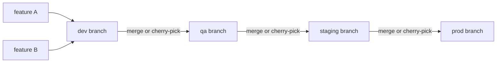

<!-- devopsshack:header -->
> 📘 **Git Mastery: Zero to Production** · by **DevOps Shack** · [YouTube](https://www.youtube.com/@devopsshack) · [Hindi channel](https://www.youtube.com/@shackverse) · [devopsshack.com](https://devopsshack.com)
<!-- /devopsshack:header -->

# 06 · Environment Branching (and Why to Avoid It)

Environment branching means one long-lived branch per environment: `dev`, `qa`, `staging`, `prod`. Code is merged or cherry-picked "upward" from branch to branch, and each branch deploys to its environment.

You'll meet this in many companies, especially those that moved from older tools or grew organically. You need to understand it, and you need to be able to explain why it causes problems and how to move away from it.

## How it typically looks



## The problems

**1 · Environments drift.** Feature B is in `qa` but not approved, while feature A is approved. To promote only A, someone cherry-picks A's commits into `staging`. Now `staging` has a combination of code that never existed together in `qa`. You tested one thing and shipped another.

**2 · Merge conflicts in promotion.** Branches diverge through cherry-picks and direct fixes, so every promotion becomes a conflict-resolution session, and conflicts get resolved differently in each branch.

**3 · "Hotfix on prod" never makes it back.** Someone fixes something directly on `prod`. It isn't merged back down. The next promotion from `staging` overwrites it, and the bug returns.

**4 · The artifact isn't the same.** Each branch builds its own binary or image. What you deploy to prod was **built separately** from what you tested in staging. Build reproducibility issues and dependency drift slip through.

**5 · No clear source of truth.** "What's in prod?" means diffing branches with messy, divergent histories.

## Better alternatives

### For application code: build once, promote the artifact


One branch (`main`). One build. The **same immutable artifact** (tagged with the commit SHA) moves through environments, with approval gates in the CD tool (GitHub Environments, GitLab protected environments, Argo CD, Spinnaker). Environment differences live in configuration, not in code branches.

### For GitOps and infrastructure: folders per environment

```
deploy/
├── base/
└── overlays/
    ├── dev/        image: app:4b2c9e1
    ├── staging/    image: app:3f9a1c2
    └── prod/       image: app:3f9a1c2
```

Promotion is a PR that changes the image tag in `overlays/prod`. `git diff` between folders shows exactly how environments differ. Everything is on `main`, reviewed and auditable.

### If you must keep environment branches

Follow GitLab Flow's rules: changes flow only one direction (upstream first), promotion uses **fast-forward merges of the whole branch** (never cherry-picks), and direct pushes to environment branches are blocked.

## Migrating away

1. Agree that `main` is the source of truth. Reconcile environment branches into it.
2. Change CI to build once from main and tag the artifact with the SHA.
3. Move environment-specific values into config (Helm values, Kustomize overlays, Terraform workspaces or tfvars).
4. Put promotion and approval in the CD tool.
5. Make old environment branches read-only, then archive them.

> **DevOps Shack Production Tip:** In interviews, when asked "how do you promote code from dev to prod?", the strong answer is "we build an immutable artifact once from main, tag it with the commit SHA, and promote that same artifact through environments with approvals. Environment differences live in config." That one sentence shows you understand both Git and CD.

Back to [Branching Strategies](README.md) · Next: [Comparison & Decision Guide](07-comparison-and-decision-guide.md)


<!-- devopsshack:footer -->
---

<p align="center">
  Made with ❤️ by <b><a href="https://devopsshack.com">DevOps Shack</a></b> · Part of <b>Git Mastery: Zero to Production</b><br/>
  <a href="https://www.youtube.com/@devopsshack">YouTube · DevOps Shack</a> · <a href="https://www.youtube.com/@shackverse">YouTube · DevOps Shack Hindi</a> · <a href="https://devopsshack.com">devopsshack.com</a> · <a href="https://www.instagram.com/devopsshack">Instagram · @devopsshack</a><br/>
  <sub>© DevOps Shack. Original content created by DevOps Shack. Free to learn from and share with credit to DevOps Shack. See <a href="../LICENSE">LICENSE</a>.</sub>
</p>
<!-- /devopsshack:footer -->
