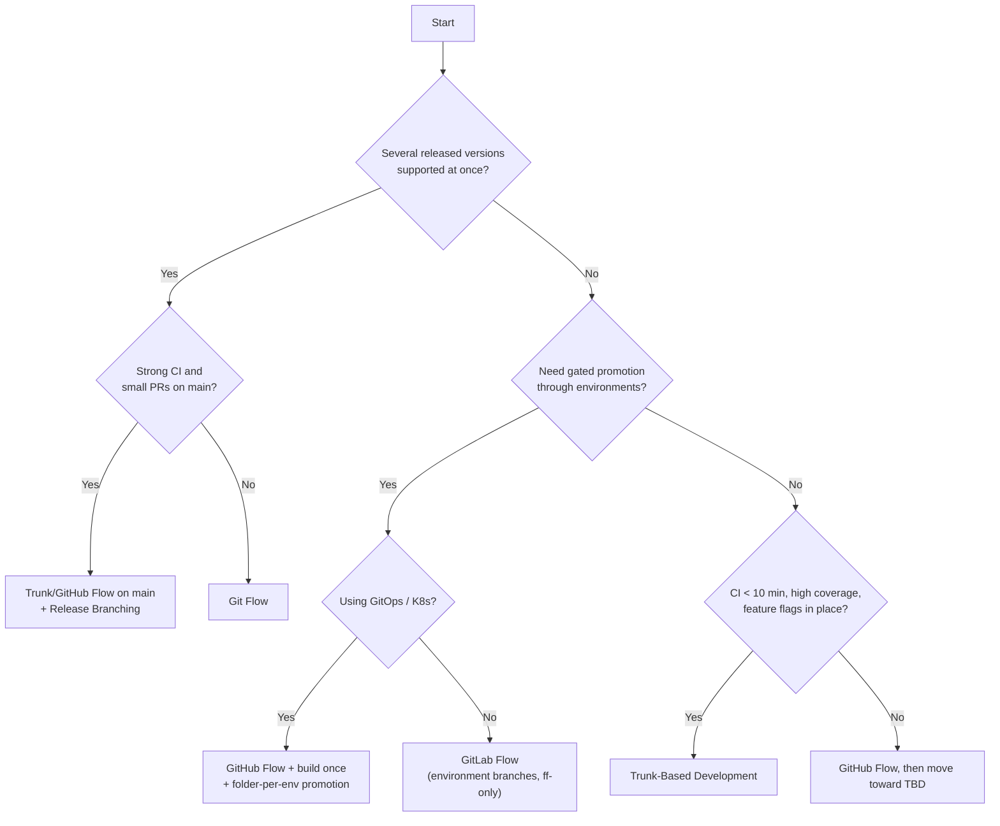

<!-- devopsshack:header -->
> 📘 **Git Mastery: Zero to Production** · by **DevOps Shack** · [YouTube](https://www.youtube.com/@devopsshack) · [Hindi channel](https://www.youtube.com/@shackverse) · [devopsshack.com](https://devopsshack.com)
<!-- /devopsshack:header -->

# 07 · Comparison & Decision Guide

## Side-by-side

| | Git Flow | GitHub Flow | GitLab Flow | Trunk-Based | Release Branching |
|---|---|---|---|---|---|
| Long-lived branches | main, develop | main | main + env/release | main | main + release/x.y |
| Feature branch life | Days to weeks | Days | Days | Hours to 2 days | Depends on base workflow |
| Release mechanism | release/* branch → main + tag | Merge to main = release | Promote to env branch or cut stable branch | Deploy trunk or cut late release branch | Cut release/x.y, tag |
| Hotfix path | hotfix/* from main → main + develop | Normal PR | Fix on main → cherry-pick downstream | Fix on trunk (cherry-pick to release branch if any) | Fix on main → cherry-pick to each release |
| Multiple versions supported | Limited | No | Yes (release variant) | With release branches | **Yes** |
| CI/test maturity needed | Medium | High | Medium-high | **Very high** | Medium-high |
| Feature flags needed | No | Helpful | Helpful | **Essential** | Helpful |
| Merge conflict risk | High | Low-medium | Medium | **Lowest** | Medium (backports) |
| Typical users | Mobile, desktop, on-prem | SaaS, web, OSS | Regulated/enterprise SaaS | High-performing product orgs | Kubernetes, Node.js, DBs, SDKs |

## Decision tree

## Example situations

**A fintech startup, 25 engineers, one web app and API, deploying daily.** GitHub Flow with squash merges, feature flags, a merge queue later. Move toward trunk-based as test coverage grows.

**A mobile banking app shipping through the App Store every two weeks, regulators require release sign-off.** Git Flow, or trunk-based with release branches cut per store submission (`release/2026.11.2`), with hotfix releases from the release branch.

**An open-source CLI tool used by thousands, supporting the last two minor versions.** Fork-based PRs into main, plus release branching with automated backport bots.

**An enterprise SaaS with dev → QA → UAT → prod and customer UAT sign-off.** Build once from main, then promote the immutable artifact through environments with CD approval gates. If tooling forces branch-based deploys, use GitLab Flow environment branches with fast-forward-only promotion.

**A platform team managing Kubernetes clusters with Argo CD.** A single main branch in the GitOps repo, folders per environment and cluster, promotion by PR that changes image tags, and protected paths for prod via CODEOWNERS.

## Questions interviewers ask about strategy

- Why might Git Flow be a bad fit for a microservice that deploys ten times a day?
- How does trunk-based development handle incomplete features?
- In release branching, why fix on main first?
- What are the risks of environment branches, and what would you use instead?
- How do hotfixes work in each strategy?
- How would you migrate a team from Git Flow to trunk-based development?

Answers to these, and hundreds more, are in the [interview question banks](../interview-questions/README.md).

Back to [Branching Strategies](README.md)

<!-- devopsshack:footer -->
---

  Made with ❤️ by <b><a href="https://devopsshack.com">DevOps Shack</a></b> · Part of <b>Git Mastery: Zero to Production</b> 
  <a href="https://www.youtube.com/@devopsshack">YouTube · DevOps Shack</a> · <a href="https://www.youtube.com/@shackverse">YouTube · DevOps Shack Hindi</a> · <a href="https://devopsshack.com">devopsshack.com</a> · <a href="https://www.instagram.com/devopsshack">Instagram · @devopsshack</a> 
  © DevOps Shack. Original content created by DevOps Shack. Free to learn from and share with credit to DevOps Shack. See <a href="../LICENSE">LICENSE</a>.

<!-- /devopsshack:footer -->
