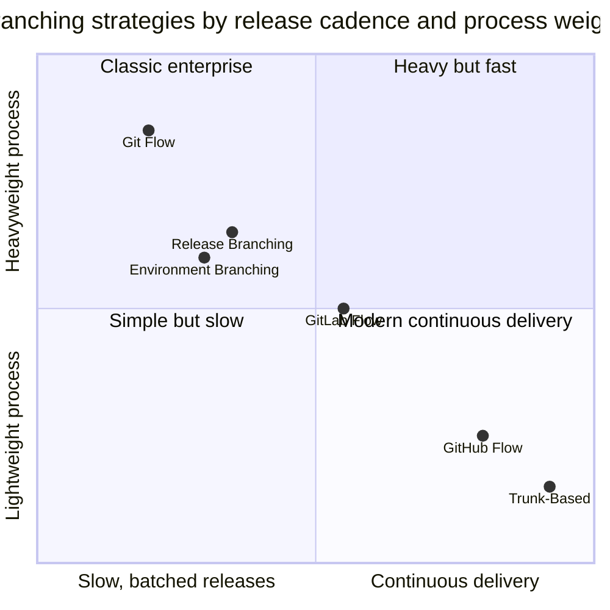

<!-- devopsshack:header -->
> 📘 **Git Mastery: Zero to Production** · by **DevOps Shack** · [YouTube](https://www.youtube.com/@devopsshack) · [Hindi channel](https://www.youtube.com/@shackverse) · [devopsshack.com](https://devopsshack.com)
<!-- /devopsshack:header -->

# Branching Strategies · The Complete Guide

Every branching strategy is a trade-off between **integration frequency**, **release control** and **process overhead**. This section explains each major strategy in depth: how it works, the exact commands, the diagram, when to use it, and where it hurts.

| # | Strategy | One-line summary |
|---|---|---|
| 01 | [Git Flow](01-git-flow.md) | `main` + `develop` + feature, release and hotfix branches. Built for versioned releases |
| 02 | [GitHub Flow](02-github-flow.md) | Branch from main, PR, merge, deploy. Simple continuous delivery |
| 03 | [GitLab Flow](03-gitlab-flow.md) | GitHub Flow plus environment or release branches for staged promotion |
| 04 | [Trunk-Based Development](04-trunk-based-development.md) | Everyone integrates into trunk at least daily, with feature flags |
| 05 | [Release Branching](05-release-branching.md) | Cut `release/x.y` from main, stabilize, ship and maintain several versions |
| 06 | [Environment Branching](06-environment-branching.md) | `dev`/`staging`/`prod` branches. Why it's usually an anti-pattern, and what to do instead |
| 07 | [Comparison & Decision Guide](07-comparison-and-decision-guide.md) | Side-by-side comparison, decision tree, and real company examples |

## The one diagram to remember

Built and maintained by **DevOps Shack**. Learn this with live projects on [YouTube](https://www.youtube.com/@devopsshack).

<!-- devopsshack:footer -->
---

  Made with ❤️ by <b><a href="https://devopsshack.com">DevOps Shack</a></b> · Part of <b>Git Mastery: Zero to Production</b> 
  <a href="https://www.youtube.com/@devopsshack">YouTube · DevOps Shack</a> · <a href="https://www.youtube.com/@shackverse">YouTube · DevOps Shack Hindi</a> · <a href="https://devopsshack.com">devopsshack.com</a> · <a href="https://www.instagram.com/devopsshack">Instagram · @devopsshack</a> 
  © DevOps Shack. Original content created by DevOps Shack. Free to learn from and share with credit to DevOps Shack. See <a href="../LICENSE">LICENSE</a>.

<!-- /devopsshack:footer -->
