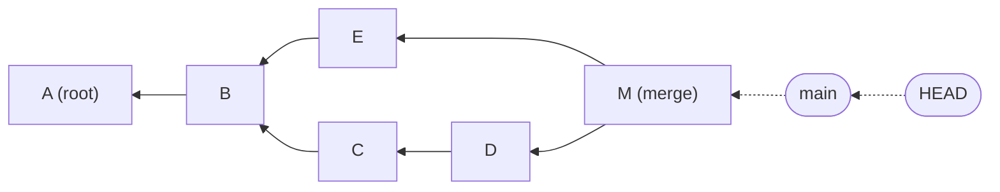

<!-- devopsshack:header -->
> 📘 **Git Mastery: Zero to Production** · by **DevOps Shack** · [YouTube](https://www.youtube.com/@devopsshack) · [Hindi channel](https://www.youtube.com/@shackverse) · [devopsshack.com](https://devopsshack.com)
<!-- /devopsshack:header -->

# History as a Directed Acyclic Graph

Git history is a DAG: each commit points back to its parent(s). Merge commits have two parents. Nothing points forward.

**What to notice:** Because arrows point backwards, a commit never knows its children. Reachability (what `git log` shows, what survives `gc`) is computed by walking backwards from refs. `HEAD~1` follows the first parent. `HEAD^2` follows the second parent of a merge.

**Related:** [04-git-internals](../modules/04-git-internals.md) · [06-branching](../modules/06-branching.md)

← [All diagrams](README.md)

<!-- devopsshack:footer -->
---

  Made with ❤️ by <b><a href="https://devopsshack.com">DevOps Shack</a></b> · Part of <b>Git Mastery: Zero to Production</b> 
  <a href="https://www.youtube.com/@devopsshack">YouTube · DevOps Shack</a> · <a href="https://www.youtube.com/@shackverse">YouTube · DevOps Shack Hindi</a> · <a href="https://devopsshack.com">devopsshack.com</a> · <a href="https://www.instagram.com/devopsshack">Instagram · @devopsshack</a> 
  © DevOps Shack. Original content created by DevOps Shack. Free to learn from and share with credit to DevOps Shack. See <a href="../LICENSE">LICENSE</a>.

<!-- /devopsshack:footer -->
