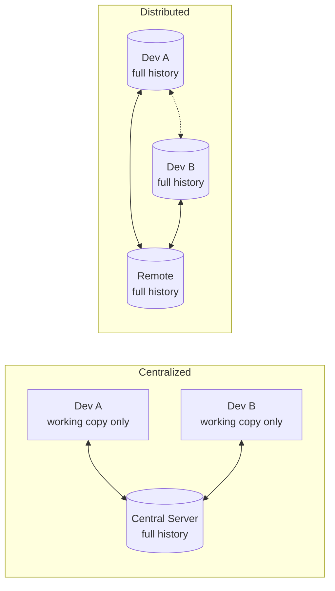
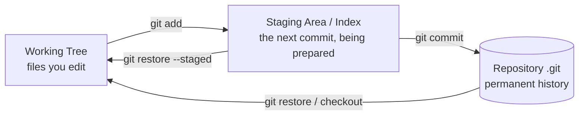
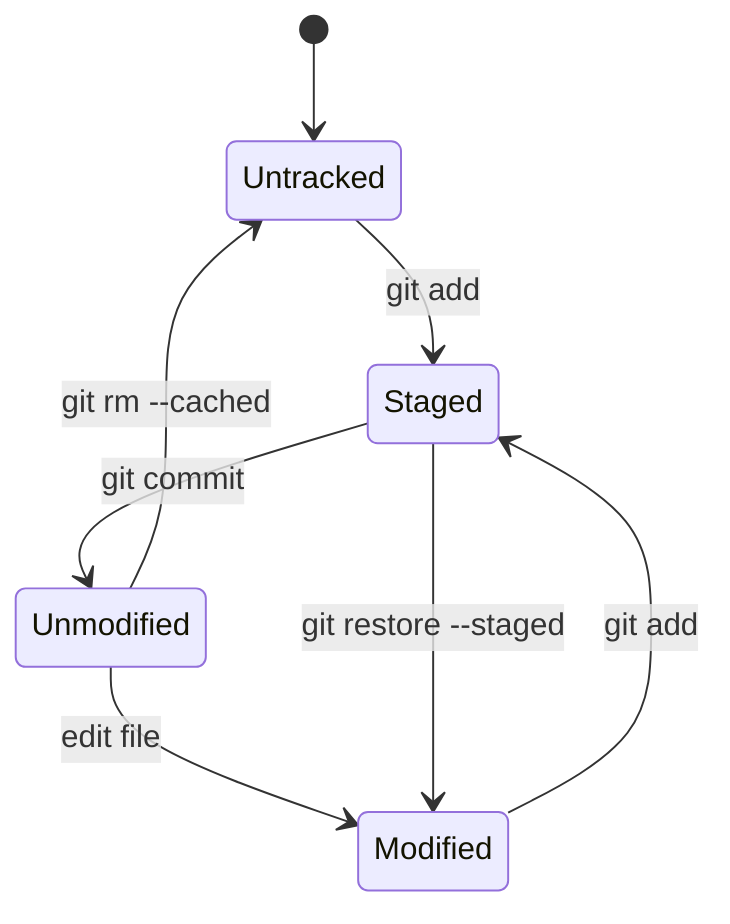

<!-- devopsshack:header -->
> 📘 **Git Mastery: Zero to Production** · by **DevOps Shack** · [YouTube](https://www.youtube.com/@devopsshack) · [Hindi channel](https://www.youtube.com/@shackverse) · [devopsshack.com](https://devopsshack.com)
<!-- /devopsshack:header -->

# Module 01 · Version Control & Git Overview

## Why version control exists

Every software team runs into the same three problems. People overwrite each other's work. Nobody can say with confidence what changed between yesterday's working build and today's broken one. And there's no safe way to try a risky idea without putting the stable code at risk.

Version control solves all three. It records every change as a snapshot with an author, a timestamp and a message, so you can go back to any point. It lets many people work at the same time and combine their work deliberately. And it lets you branch off into an isolated line of work, then throw it away or merge it back.

Before version control, teams emailed zip files, kept folders named `project_final_v2_REALLY_FINAL`, and lost days to "who changed this?" Version control turned that chaos into an auditable history.

## Three generations of version control

**Local version control** (RCS, 1982) tracked changes to single files on one machine. Useful for one person, useless for a team.

**Centralized version control** (CVS, Subversion, Perforce) put the history on one central server. Everyone checked out a working copy and committed back to the server. This made collaboration possible, but the server was a single point of failure. If it went down, nobody could commit, view history or branch. If its disk died without a backup, the history was gone.

**Distributed version control** (Git, Mercurial) gives every developer a full copy of the repository, including all history. You commit locally, offline, in milliseconds. "The server" is just another copy that the team agrees to treat as the shared one. Any clone can restore it.

## A short history of Git

In 2005, the Linux kernel project lost free access to BitKeeper, the proprietary tool it used for version control. Linus Torvalds wrote Git in roughly ten days to replace it. His design goals tell you a lot about how Git behaves today:

- **Speed.** Operations should be local and fast, even on a project with tens of thousands of files.
- **Strong integrity.** Every object is identified by a cryptographic hash of its content, so silent corruption or tampering is detectable.
- **Fully distributed.** No central server is required.
- **Non-linear development.** Thousands of parallel branches must be cheap.
- **Handle huge projects** like the kernel efficiently.

Junio Hamano took over as maintainer in July 2005 and still maintains Git today. GitHub launched in 2008 and turned Git into the default for the whole industry.

## How Git thinks: snapshots, not differences

Older systems like Subversion stored each version as a list of changes (deltas) against the previous version. Git takes a different view. Every commit is a **complete snapshot** of the project at that moment. If a file didn't change, Git doesn't store it again. The new snapshot simply points to the same stored file as before.

This is why switching branches is fast, why branches are cheap, and why Git can compare any two commits directly. (Git does compress similar objects into deltas later, inside packfiles. That's a storage optimization, not the model.)

## The three areas

Everything in Git revolves around three places your files can live.

The **working tree** is the normal folder you see and edit. The **staging area** (also called the index) is where you assemble exactly what goes into the next commit. The **repository** is the `.git` folder, which holds all commits, branches and history.

The staging area surprises newcomers. Why not just commit everything that changed? Because real work is messy. You might fix a bug and also tidy some unrelated formatting. The index lets you commit those as two clean, separate commits, which makes history readable and makes reverting safe.

## The file lifecycle

Each file in your working tree is in one of these states:

- **Untracked**: Git sees the file but has never been told to track it.
- **Unmodified**: tracked and identical to the last commit.
- **Modified**: tracked and changed since the last commit, but not staged.
- **Staged**: the change is in the index, ready for the next commit.

## Git vs GitHub, GitLab and Bitbucket

This confusion comes up in nearly every beginner interview. **Git** is the version control tool. It runs on your machine and needs no internet. **GitHub, GitLab, Bitbucket, Azure Repos and Gitea** are hosting platforms. They store a shared copy of your Git repository and add collaboration features on top: pull or merge requests, code review, issues, CI/CD pipelines, permissions and branch protection.

You can use Git without any of these platforms. You can't use any of these platforms meaningfully without Git.

## Where Git sits in DevOps

In a modern delivery pipeline, Git is the starting point and the source of truth. A push triggers CI. A merge to the main branch triggers deployment. In GitOps, the desired state of your entire infrastructure lives in Git, and tools like Argo CD or Flux continuously make the cluster match the repository. Audit questions like "who changed production, when, and who approved it?" are answered from Git history and pull request records.

That's why Git skill isn't optional for a DevOps engineer. You'll design branching strategies, write the hooks and pipelines that enforce quality, and be the person called when someone force-pushes over `main`.

## Key takeaways

- Version control gives you history, collaboration and safe experimentation.
- Git is distributed: every clone is a full backup with complete history.
- Git stores snapshots, and every object is identified by a hash of its content.
- Files move between working tree, staging area and repository.
- Git is the tool; GitHub and GitLab are platforms built around it.

## Practice

- [Lab 01 · Your First Repository](../labs/lab-01-first-repository/README.md)
- Interview questions: [Concept bank, Fundamentals](../interview-questions/01-concept-based/01-fundamentals.md)

Next: [Module 02 · Installation & Configuration](02-installation-and-configuration.md)

<!-- devopsshack:footer -->
---

  Made with ❤️ by <b><a href="https://devopsshack.com">DevOps Shack</a></b> · Part of <b>Git Mastery: Zero to Production</b> 
  <a href="https://www.youtube.com/@devopsshack">YouTube · DevOps Shack</a> · <a href="https://www.youtube.com/@shackverse">YouTube · DevOps Shack Hindi</a> · <a href="https://devopsshack.com">devopsshack.com</a> · <a href="https://www.instagram.com/devopsshack">Instagram · @devopsshack</a> 
  © DevOps Shack. Original content created by DevOps Shack. Free to learn from and share with credit to DevOps Shack. See <a href="../LICENSE">LICENSE</a>.

<!-- /devopsshack:footer -->
