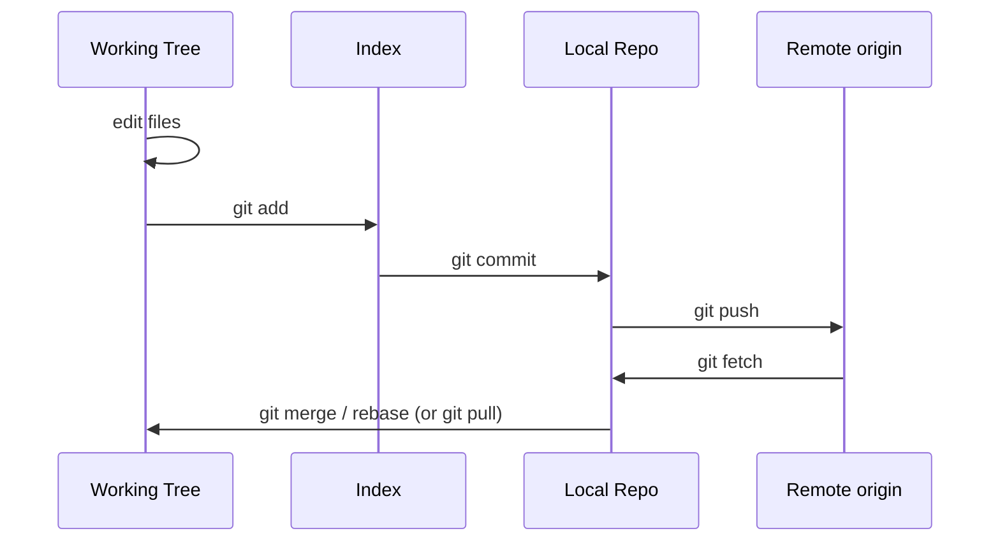

<!-- devopsshack:header -->
> 📘 **Git Mastery: Zero to Production** · by **DevOps Shack** · [YouTube](https://www.youtube.com/@devopsshack) · [Hindi channel](https://www.youtube.com/@shackverse) · [devopsshack.com](https://devopsshack.com)
<!-- /devopsshack:header -->

# Module 03 · The Core Workflow

This module covers the commands you'll type hundreds of times a week. Get these right and everything later builds on solid ground.

## Creating or getting a repository

```bash
git init my-project        # new repository in a new folder
cd my-project

git clone https://github.com/org/repo.git           # copy an existing repo
git clone git@github.com:org/repo.git my-folder     # into a custom folder name
```

`git init` creates a hidden `.git` directory. That folder *is* the repository. Delete it and the folder is just files again.

## The everyday loop



## git status: your dashboard

Run `git status` constantly. It tells you which branch you're on, whether you're ahead or behind the remote, what's staged, what's modified, and what's untracked. It also tells you what command to run next.

```bash
git status
git status -sb    # short format with branch info
```

In short format, the two columns mean index and working tree. `M ` means staged, ` M` means modified but not staged, `MM` means staged and then modified again, `??` means untracked.

## Staging precisely

```bash
git add file.txt            # one file
git add src/                # a folder
git add -A                  # everything, including deletions
git add -p                  # review hunk by hunk (use this a lot)
git add -u                  # only already-tracked files
```

`git add -p` is the habit that separates careful engineers from everyone else. It shows each change and asks whether to stage it. You'll catch leftover debug prints, accidental changes and secrets before they reach history. Inside the prompt, `y` stages, `n` skips, `s` splits a hunk into smaller pieces, and `e` lets you edit the hunk by hand.

## Committing well

```bash
git commit -m "Add retry logic to payment client"
git commit                       # opens your editor for a longer message
git commit -am "Fix typo"        # stage tracked modified files and commit
git commit --amend               # change the last commit (message or content)
```

A good commit is **one logical change** with a message that explains **why**. The diff shows *what* changed. The message is for the reason.

The widely used format:

```
Short summary in imperative mood, under 50 chars

Wrap the body at 72 characters. Explain the problem this commit
solves and why this approach was chosen. Mention side effects.

Refs: JIRA-1234
```

Many teams use **Conventional Commits**, which add a type prefix so tools can generate changelogs and version numbers automatically:

```
feat(auth): add OAuth2 login with Google
fix(api): handle null customer id in invoice export
chore(deps): bump express from 4.18 to 4.19
docs: explain local setup on Windows
refactor!: drop support for Node 16
```

The `!` (or a `BREAKING CHANGE:` footer) signals a breaking change, which bumps the major version under semantic versioning.

## Seeing what changed

```bash
git diff                 # working tree vs index (unstaged changes)
git diff --staged        # index vs last commit (what will be committed)
git diff HEAD            # working tree vs last commit (everything)
git diff main..feature   # between two branches
git diff --stat          # summary only
git diff --word-diff     # changes within lines
```

Remember the pair: `git diff` shows what you *haven't* staged, `git diff --staged` shows what you *have* staged. Always look at `git diff --staged` before committing.

## Reading history

```bash
git log
git log --oneline --graph --decorate --all
git log -p file.txt                  # history of a file with diffs
git log --follow file.txt            # follow through renames
git log --author="Aditya" --since="2 weeks ago"
git log --grep="payment"             # search messages
git log -S "API_KEY"                 # commits that added/removed this string
git show <commit>                    # one commit in full
git show HEAD~2:src/app.js           # a file as it was two commits ago
```

## Moving, renaming and deleting

```bash
git mv old.txt new.txt     # rename (same as mv + git add both paths)
git rm file.txt            # delete from disk and stage the deletion
git rm --cached file.txt   # stop tracking but keep the file on disk
```

Git doesn't actually record renames. It stores the snapshot and *detects* renames later by comparing content similarity. That's why `git log --follow` is needed to track a file across a rename.

## Ignoring files

A `.gitignore` file tells Git which untracked files to never show or add.

```gitignore
# dependencies
node_modules/
vendor/

# build output
dist/
*.class
target/

# secrets and local env
.env
*.pem
*.key

# OS and editor junk
.DS_Store
.idea/
*.swp

# but keep this one
!config/.env.example
```

Rules worth knowing. A trailing `/` matches directories only. A leading `/` anchors to the repo root. `**` matches across folders. `!` re-includes something excluded earlier, but you can't re-include a file if its parent folder is excluded.

`.gitignore` only affects **untracked** files. If you already committed `.env`, adding it to `.gitignore` does nothing. You must `git rm --cached .env`, commit, and, if it contained secrets, rotate them and purge history (Module 15).

Other ignore locations: `.git/info/exclude` for personal ignores in one repo, and `core.excludesFile` for global ignores like editor files. To debug why something is ignored: `git check-ignore -v path/to/file`.

## Syncing with a remote

```bash
git remote -v                 # list remotes
git fetch                     # download new commits, change nothing locally
git pull                      # fetch + merge (or rebase) into current branch
git push                      # upload your commits
git push -u origin feature    # first push of a new branch, set upstream
```

You'll go much deeper in Module 09. For now: `fetch` is always safe, `pull` changes your branch, and `push` is rejected if the remote has commits you don't have.

## Key takeaways

- Run `git status` often. It tells you what to do next.
- Stage with intention using `git add -p`.
- One logical change per commit, with a message explaining why.
- `git diff` is unstaged; `git diff --staged` is what you're about to commit.
- `.gitignore` doesn't untrack files that are already committed.

## Practice

- [Lab 01 · Your First Repository](../labs/lab-01-first-repository/README.md)
- [Lab 02 · Mastering the Staging Area](../labs/lab-02-staging-area/README.md)
- [Lab 03 · .gitignore Deep Dive](../labs/lab-03-gitignore/README.md)
- [Assignment A01 · Personal Project History](../assignments/A01-personal-project-history.md)

Next: [Module 04 · Git Internals](04-git-internals.md)


<!-- devopsshack:footer -->
---

<p align="center">
  Made with ❤️ by <b><a href="https://devopsshack.com">DevOps Shack</a></b> · Part of <b>Git Mastery: Zero to Production</b><br/>
  <a href="https://www.youtube.com/@devopsshack">YouTube · DevOps Shack</a> · <a href="https://www.youtube.com/@shackverse">YouTube · DevOps Shack Hindi</a> · <a href="https://devopsshack.com">devopsshack.com</a> · <a href="https://www.instagram.com/devopsshack">Instagram · @devopsshack</a><br/>
  <sub>© DevOps Shack. Original content created by DevOps Shack. Free to learn from and share with credit to DevOps Shack. See <a href="../LICENSE">LICENSE</a>.</sub>
</p>
<!-- /devopsshack:footer -->
