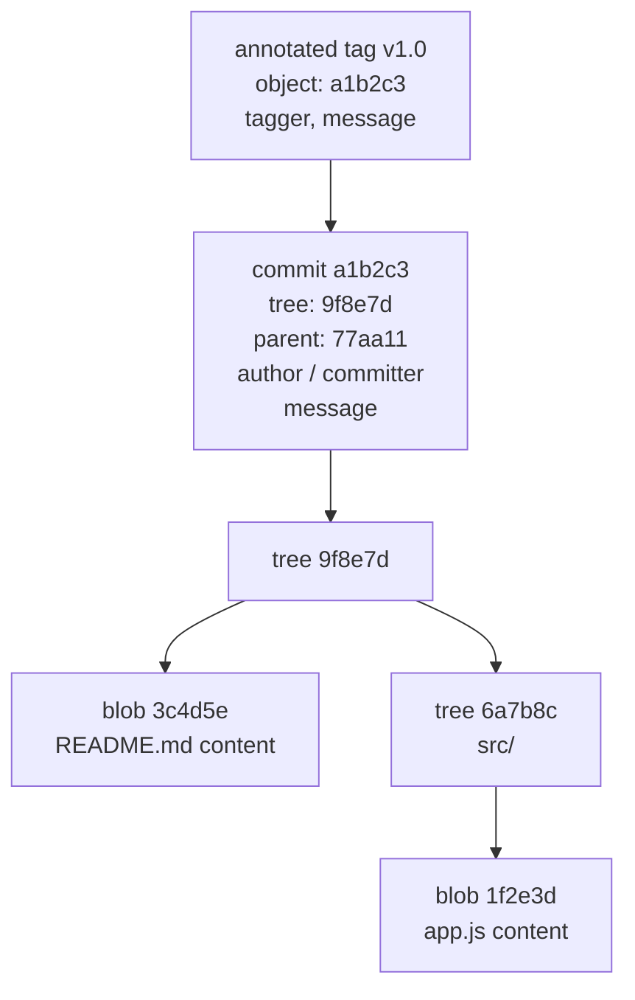

<!-- devopsshack:header -->
> 📘 **Git Mastery: Zero to Production** · by **DevOps Shack** · [YouTube](https://www.youtube.com/@devopsshack) · [Hindi channel](https://www.youtube.com/@shackverse) · [devopsshack.com](https://devopsshack.com)
<!-- /devopsshack:header -->

# Module 04 · Git Internals

> **DevOps Shack note:** This is the module that changes how you think about Git. Interviewers at senior level almost always probe internals, because candidates who understand them can reason through *any* Git problem instead of memorizing commands.

## Git is a content-addressable filesystem

Underneath all the commands, Git is a simple key-value store. You give it content and it gives you back a key: the SHA-1 hash of that content (SHA-256 in repositories created with `--object-format=sha256`). The same content always produces the same key. Change one byte and the key changes completely.

```bash
echo "DevOps Shack" | git hash-object --stdin
# prints a 40-character hash; the same text always produces the same hash
```

Everything else (commits, branches, history) is built on top of this store.

## The four object types



**Blob**: the raw content of a file. No filename, no permissions, just bytes. Two files with identical content anywhere in history share one blob.

**Tree**: a directory listing. Each entry has a mode (100644 for a normal file, 100755 for an executable, 040000 for a directory, 120000 for a symlink, 160000 for a submodule), an object type, a hash and a name.

**Commit**: points to exactly one tree (the project snapshot) plus zero or more parent commits, the author, the committer, timestamps and the message. A root commit has no parent. A merge commit has two or more.

**Annotated tag**: points to an object (usually a commit) and adds a tagger, date, message and optional signature.

## Look inside with plumbing commands

Git has two layers of commands. **Porcelain** commands like `commit` and `merge` are for humans. **Plumbing** commands expose the internals.

```bash
git cat-file -t HEAD            # type: commit
git cat-file -p HEAD            # pretty-print the commit
git cat-file -p HEAD^{tree}     # the root tree
git cat-file -p <blob-hash>     # file content
git ls-tree -r HEAD             # every file in the snapshot
git rev-parse HEAD              # resolve a name to a hash
git count-objects -vH           # how many objects and how much disk
```

Running `git cat-file -p HEAD` shows something like:

```
tree 9f8e7d6c...
parent 77aa11bb...
author Aditya <a@devopsshack.com> 1731225600 +0530
committer Aditya <a@devopsshack.com> 1731225600 +0530

Add payment retry logic
```

That's the entire commit. Because the commit includes its parent's hash, and the parent includes *its* parent's hash, changing any old commit changes every hash after it. This chain is why Git history is tamper-evident, and why rewriting history creates new commits rather than editing old ones.

## Building a commit by hand

Doing this once makes the model stick forever.

```bash
git init plumbing-demo && cd plumbing-demo

# 1. write a blob
BLOB=$(echo "Hello from DevOps Shack" | git hash-object -w --stdin)

# 2. put it in the index under a filename
git update-index --add --cacheinfo 100644 "$BLOB" hello.txt

# 3. write the index as a tree
TREE=$(git write-tree)

# 4. create a commit pointing to that tree
COMMIT=$(echo "First commit, built by hand" | git commit-tree "$TREE")

# 5. point a branch at it
git update-ref refs/heads/main "$COMMIT"

git log --oneline   # it's a real commit
```

Every `git commit` you've ever run does exactly these steps.

## Where objects live

Objects start life as **loose objects**: one zlib-compressed file each, under `.git/objects/ab/cdef...` (first two hex characters are the folder name). Over time, `git gc` packs them into **packfiles** (`.git/objects/pack/*.pack`) with an index (`.idx`). Inside a packfile, similar objects are stored as deltas against each other, which is how a repo with thousands of versions stays small.

```bash
git count-objects -v
git gc
git verify-pack -v .git/objects/pack/pack-*.idx | sort -k3 -n | tail -5   # biggest objects
```

## References: human names for hashes

Nobody remembers hashes, so Git keeps **references** (refs): small files that contain a hash.

```
.git/
├── HEAD                     → "ref: refs/heads/main"
├── refs/
│   ├── heads/main           → a1b2c3... (local branch)
│   ├── remotes/origin/main  → 77aa11... (remote-tracking branch)
│   └── tags/v1.0            → tag object or commit hash
└── packed-refs              → many refs stored in one file for speed
```

A **branch is just a file containing a commit hash.** Creating a branch writes a 41-byte file. That's why branching in Git is instant, no matter how big the project is.

**HEAD** is a symbolic reference to the branch you're on. When you commit, Git creates the commit, then moves the branch HEAD points to. When HEAD points directly at a commit instead of a branch, you're in **detached HEAD** state (Module 06).

```bash
cat .git/HEAD
cat .git/refs/heads/main
git symbolic-ref HEAD
git show-ref
```

## The index, up close

The index (`.git/index`) is a binary file listing every tracked path with its blob hash, mode, and filesystem metadata (size, modification time). The metadata lets `git status` skip reading unchanged files, which is why status is fast even on large repos.

```bash
git ls-files --stage
# 100644 3c4d5e... 0  README.md
```

The number after the hash is the **stage number**. Normally it's 0. During a merge conflict, the index holds up to three versions of a file: stage 1 (common ancestor), stage 2 (ours), stage 3 (theirs). That's where conflict information actually lives.

## Revision syntax

You'll use these everywhere:

| Syntax | Meaning |
|---|---|
| `HEAD~1`, `HEAD~3` | first parent, going back 1 or 3 generations |
| `HEAD^2` | the second parent of a merge commit |
| `main@{yesterday}` | where main pointed yesterday (from reflog) |
| `HEAD@{2}` | where HEAD was two moves ago |
| `main..feature` | commits in feature that aren't in main |
| `main...feature` | commits in either, but not both |
| `:/fix login` | newest commit whose message matches |
| `v1.0^{commit}` | peel a tag to its commit |

## The reflog: Git's safety net

Every time HEAD or a branch moves (commit, reset, checkout, rebase, merge), Git records the old and new position in the **reflog**. It's local only and expires after 90 days by default (30 days for unreachable entries).

```bash
git reflog
git reflog show feature
```

Because Git almost never deletes objects right away, the reflog lets you recover from almost any mistake: a bad reset, a botched rebase, a deleted branch. Module 05 and Lab 06 drill this.

## Garbage collection and reachability

An object is **reachable** if you can get to it by following parent and tree links from any ref, the reflog, the index or a stash. Unreachable objects are eventually removed by `git gc` after the grace period (`gc.pruneExpire`, two weeks by default). So "lost" work usually survives for weeks.

```bash
git fsck --lost-found     # find dangling commits and blobs
git fsck --unreachable
```

## SHA-1 and the move to SHA-256

SHA-1 collisions became practical in 2017 (the SHAttered attack). Git responded with a hardened SHA-1 implementation that detects known collision attacks, and added SHA-256 support (`git init --object-format=sha256`). SHA-256 repos aren't yet widely interoperable with hosting platforms, so most production repos still use SHA-1.

## Key takeaways

- Git is a key-value store of blobs, trees, commits and tags, keyed by content hash.
- A commit is a snapshot (one tree) plus parents and metadata.
- Branches and tags are tiny files pointing at hashes. HEAD points at the current branch.
- The index can hold three stages of a file during a conflict.
- The reflog and delayed garbage collection make almost everything recoverable.

## Practice

- [Lab 04 · Exploring Git Objects](../labs/lab-04-git-objects/README.md)
- [Assignment A02 · Build a Commit by Hand](../assignments/A02-build-a-commit-by-hand.md)
- Diagram: [Object model](../diagrams/02-object-model.md)
- Interview questions: [Concept bank, Internals](../interview-questions/01-concept-based/02-internals.md)

Next: [Module 05 · Undoing Changes](05-undoing-changes.md)


<!-- devopsshack:footer -->
---

<p align="center">
  Made with ❤️ by <b><a href="https://devopsshack.com">DevOps Shack</a></b> · Part of <b>Git Mastery: Zero to Production</b><br/>
  <a href="https://www.youtube.com/@devopsshack">YouTube · DevOps Shack</a> · <a href="https://www.youtube.com/@shackverse">YouTube · DevOps Shack Hindi</a> · <a href="https://devopsshack.com">devopsshack.com</a> · <a href="https://www.instagram.com/devopsshack">Instagram · @devopsshack</a><br/>
  <sub>© DevOps Shack. Original content created by DevOps Shack. Free to learn from and share with credit to DevOps Shack. See <a href="../LICENSE">LICENSE</a>.</sub>
</p>
<!-- /devopsshack:footer -->
