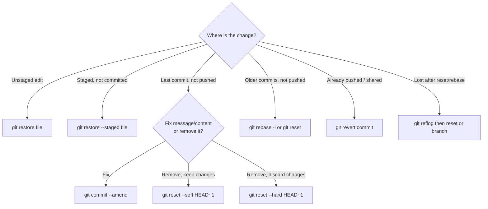
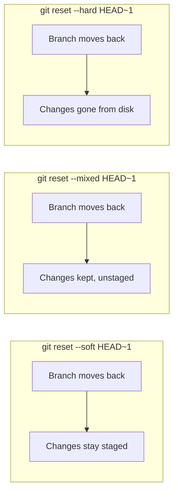

<!-- devopsshack:header -->
> 📘 **Git Mastery: Zero to Production** · by **DevOps Shack** · [YouTube](https://www.youtube.com/@devopsshack) · [Hindi channel](https://www.youtube.com/@shackverse) · [devopsshack.com](https://devopsshack.com)
<!-- /devopsshack:header -->

# Module 05 · Undoing Changes

Undoing is where people panic and where Git is most forgiving, *if* you know which tool to use. The right tool depends on two questions: **where is the change** (working tree, index, local commit, pushed commit), and **is the history shared** with anyone else?

## The decision map



> **DevOps Shack Production Tip:** The golden rule. If the commit is already on a shared branch like `main`, **revert it, don't reset it**. Rewriting shared history breaks everyone else's clones.

## Discarding working tree changes

```bash
git restore app.js          # discard unstaged changes to one file
git restore .               # discard all unstaged changes
git restore --source=HEAD~3 app.js   # bring back a file as it was 3 commits ago
```

The older equivalent is `git checkout -- app.js`. `git restore` was added in Git 2.23 to split `checkout`'s many jobs into clearer commands.

**Untracked files** aren't touched by restore. Use `git clean`, and always dry-run first:

```bash
git clean -n      # what would be deleted
git clean -fd     # delete untracked files and folders
git clean -fdx    # also delete ignored files (build output, node_modules)
```

`git clean` is one of the few truly destructive commands. Untracked files were never in Git, so there's nothing to recover.

## Unstaging

```bash
git restore --staged app.js    # unstage, keep the edits
git reset app.js               # older equivalent
```

## Fixing the last commit with amend

```bash
git commit --amend -m "Better message"
git add forgotten-file.js && git commit --amend --no-edit
git commit --amend --author="Name <email>"
git commit --amend --reset-author --no-edit   # after fixing user.email
```

Amend doesn't edit the commit. It creates a **new** commit with a new hash and moves the branch to it. The old one is still in the reflog. If you already pushed, amending means you'll need to force-push (only acceptable on your own branch).

## git reset: moving the branch pointer

`reset` moves the current branch to another commit. The mode decides what happens to the index and working tree.

| Mode | Branch moves | Index | Working tree | Use when |
|---|---|---|---|---|
| `--soft` | yes | unchanged | unchanged | Recombine last N commits into one |
| `--mixed` (default) | yes | reset to target | unchanged | Unstage and redo commits |
| `--hard` | yes | reset to target | reset to target | Throw work away completely |
| `--keep` | yes | reset | reset, but aborts if it would lose local changes | Safer hard reset |



A common real use of `--soft`: you made five messy "wip" commits and want one clean commit.

```bash
git reset --soft HEAD~5
git commit -m "feat: add invoice export"
```

## git revert: undo by adding a commit

`revert` creates a new commit that applies the inverse of an earlier commit. History is preserved and nobody's clone breaks, which makes it the right tool for anything already pushed.

```bash
git revert a1b2c3d                # undo one commit
git revert --no-edit HEAD         # undo the last commit
git revert HEAD~3..HEAD           # undo a range (one revert commit each)
git revert -n HEAD~3..HEAD && git commit -m "Revert release 2.4 changes"  # one combined commit
```

### Reverting a merge commit

A merge has two parents, so you must tell Git which side is the "mainline" to keep:

```bash
git revert -m 1 <merge-commit>    # keep parent 1 (usually main), undo the merged branch
```

There's a trap here that catches experienced engineers. After you revert a merge, Git considers those commits already merged. If you fix the feature branch and merge it again, only the *new* commits come in, and the original changes stay reverted. The fix is to **revert the revert** first, then merge the fixes:

```bash
git revert <the-revert-commit>
git merge feature
```

## The reflog: undoing your undo

You ran `git reset --hard` and lost three commits. They're not gone.

```bash
git reflog
# a1b2c3d HEAD@{0}: reset: moving to HEAD~3
# 9f8e7d6 HEAD@{1}: commit: add tests        ← this is what you want
git reset --hard 9f8e7d6
# or, safer: create a branch there and inspect
git branch rescue 9f8e7d6
```

The same works for a botched rebase (`git reset --hard ORIG_HEAD` right after, or find the pre-rebase entry in the reflog), and for a deleted branch (find its last commit in the reflog and `git branch name <hash>`).

## Recovering a dropped stash or a lost commit with no reflog entry

If the reflog doesn't help (for example, a dropped stash), look for dangling commits:

```bash
git fsck --no-reflogs --lost-found | grep commit
git show <hash>
```

## Undo cheat table

| I want to... | Command |
|---|---|
| Discard edits to a file | `git restore file` |
| Unstage a file | `git restore --staged file` |
| Change the last commit message | `git commit --amend` |
| Add a forgotten file to the last commit | `git add f && git commit --amend --no-edit` |
| Undo last commit, keep changes staged | `git reset --soft HEAD~1` |
| Undo last commit, keep changes unstaged | `git reset HEAD~1` |
| Undo last commit and discard changes | `git reset --hard HEAD~1` |
| Undo a pushed commit | `git revert <hash>` |
| Undo a pushed merge | `git revert -m 1 <merge>` |
| Recover after a bad reset or rebase | `git reflog` then `git reset --hard <hash>` |
| Restore a deleted branch | `git reflog`, then `git branch name <hash>` |
| Delete untracked files | `git clean -n` then `git clean -fd` |

## Key takeaways

- Choose your undo tool by where the change lives and whether history is shared.
- `restore` for files, `reset` for local commits, `revert` for shared commits.
- `--hard` and `git clean` are the dangerous ones. Look before you run them.
- Reverting a merge has a re-merge trap. Revert the revert before re-merging.
- The reflog can undo almost anything for about 90 days.

## Practice

- [Lab 05 · Undo Everything](../labs/lab-05-undo-everything/README.md)
- [Lab 06 · Reflog Rescue](../labs/lab-06-reflog-rescue/README.md)
- [Cheat sheet · Undo anything](../cheatsheets/undo-anything.md)

Next: [Module 06 · Branching](06-branching.md)


<!-- devopsshack:footer -->
---

<p align="center">
  Made with ❤️ by <b><a href="https://devopsshack.com">DevOps Shack</a></b> · Part of <b>Git Mastery: Zero to Production</b><br/>
  <a href="https://www.youtube.com/@devopsshack">YouTube · DevOps Shack</a> · <a href="https://www.youtube.com/@shackverse">YouTube · DevOps Shack Hindi</a> · <a href="https://devopsshack.com">devopsshack.com</a> · <a href="https://www.instagram.com/devopsshack">Instagram · @devopsshack</a><br/>
  <sub>© DevOps Shack. Original content created by DevOps Shack. Free to learn from and share with credit to DevOps Shack. See <a href="../LICENSE">LICENSE</a>.</sub>
</p>
<!-- /devopsshack:footer -->
