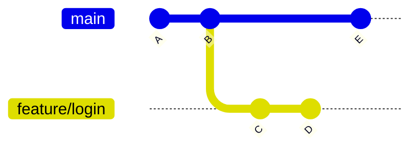
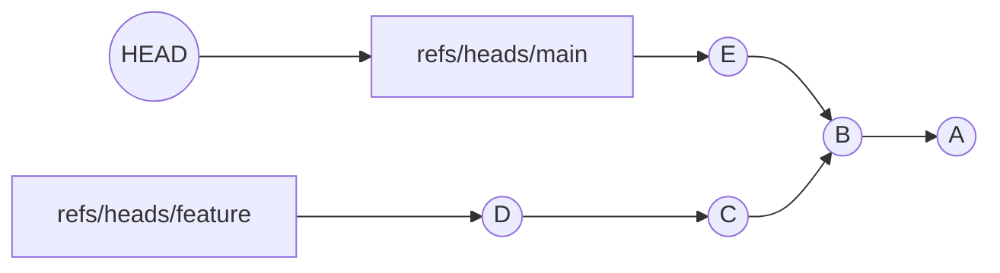

<!-- devopsshack:header -->
> 📘 **Git Mastery: Zero to Production** · by **DevOps Shack** · [YouTube](https://www.youtube.com/@devopsshack) · [Hindi channel](https://www.youtube.com/@shackverse) · [devopsshack.com](https://devopsshack.com)
<!-- /devopsshack:header -->

# Module 06 · Branching

## What a branch really is

A branch is a movable pointer to a commit. That's all. It's a file in `.git/refs/heads/` holding a hash. When you commit on a branch, Git creates the new commit with the current tip as its parent, then moves the pointer forward.



Here, `main` points at E and `feature/login` points at D. Both share history up to B. Nothing was copied. Creating `feature/login` wrote one tiny file.

## Creating and switching

```bash
git branch                       # list local branches
git branch -a                    # include remote-tracking branches
git branch -vv                   # show upstream and ahead/behind
git branch feature/login         # create, don't switch
git switch feature/login         # switch
git switch -c feature/login      # create and switch
git switch -c hotfix v1.4.2      # create from a tag or commit
git switch -                     # go back to the previous branch
```

`git checkout` does all of this too (`git checkout -b feature/login`), but `switch` was added to make branch operations clearer and safer.

When you switch, Git updates your working tree to match the target branch. If you have uncommitted changes that would be overwritten, Git refuses. Commit them, stash them (Module 13), or use a worktree.

## Renaming and deleting

```bash
git branch -m old-name new-name     # rename
git branch -m main                  # rename the current branch
git branch -d feature/login         # delete if fully merged
git branch -D feature/login         # force delete, even if unmerged
git push origin --delete feature/login   # delete on the remote
```

`-d` protects you by refusing to delete unmerged work. `-D` doesn't. If you force-delete by mistake, the reflog still has the last commit.

## Finding merged and stale branches

```bash
git branch --merged main         # safe to delete
git branch --no-merged main      # still has unique work
git branch --sort=-committerdate # most recently active first
git for-each-ref --sort=committerdate refs/heads \
  --format='%(committerdate:short) %(refname:short) %(authorname)'
```

> **DevOps Shack Production Tip:** Schedule a monthly cleanup. Repos with 2,000 stale branches slow down fetches, confuse new joiners and make CI branch filters messy. Many teams enable "automatically delete head branches" on GitHub or "delete source branch" on GitLab merge requests.

## Detached HEAD

Normally HEAD points to a branch. If you check out a commit, tag or remote branch directly, HEAD points straight at a commit. That's **detached HEAD**.

```bash
git switch --detach v1.0
git checkout a1b2c3d
```

You can look around and even commit. But those commits belong to no branch. When you switch away, nothing points to them and they'll eventually be garbage collected. Git warns you about this.

To keep work you did while detached:

```bash
git switch -c keep-this-work     # while still detached
# or, if you already switched away:
git reflog                       # find the commit
git branch keep-this-work <hash>
```

Detached HEAD is normal and useful during `git bisect`, during a rebase, when CI checks out a specific commit, and when inspecting an old release.

## Branch naming conventions

Consistent names make CI rules, automation and cleanup possible. A widely used pattern:

| Prefix | Purpose | Example |
|---|---|---|
| `feature/` | new functionality | `feature/PAY-142-upi-checkout` |
| `bugfix/` or `fix/` | non-urgent bug fixes | `fix/PAY-150-null-amount` |
| `hotfix/` | urgent production fixes | `hotfix/1.8.1-login-crash` |
| `release/` | release stabilization | `release/1.9.0` |
| `chore/`, `docs/`, `refactor/` | maintenance | `chore/bump-node-20` |

Include the ticket ID so tools can link the branch to issues automatically. Use lowercase and hyphens, and avoid spaces or characters like `~ ^ : ? * [ \`, which Git doesn't allow in ref names.

## Upstream (tracking) branches

A local branch can track a remote branch. Then `git status` shows "ahead 2, behind 1", and plain `git pull` and `git push` know where to go.

```bash
git push -u origin feature/login                  # set while pushing
git branch --set-upstream-to=origin/main main     # set explicitly
git branch -vv                                    # see tracking info
```

With `push.autoSetupRemote = true`, the first `git push` sets the upstream for you.

## Orphan branches

An orphan branch starts with no history at all. It's useful for a `gh-pages` documentation site, or for keeping something completely unrelated in the same repo.

```bash
git switch --orphan gh-pages
git rm -rf .
echo "docs" > index.html && git add . && git commit -m "Start docs site"
```

## How branches relate to HEAD and commits



Arrows from commits point to parents. Branches are labels. HEAD points to a label. Once this picture clicks, merges and rebases become easy to reason about.

## Key takeaways

- A branch is a pointer file. Creating one is instant and costs nothing.
- Use `switch` and `restore` instead of the overloaded `checkout`.
- `-d` is safe, `-D` isn't. The reflog rescues mistakes.
- Detached HEAD means commits aren't on any branch. Create a branch to keep them.
- Consistent branch names unlock automation.

## Practice

- [Lab 28 · Detached HEAD and Lost Work](../labs/lab-28-detached-head-and-lost-work/README.md)
- Diagram: [Branches, HEAD and refs](../diagrams/04-refs-and-head.md)

Next: [Module 07 · Merging & Conflicts](07-merging-and-conflicts.md)


<!-- devopsshack:footer -->
---

<p align="center">
  Made with ❤️ by <b><a href="https://devopsshack.com">DevOps Shack</a></b> · Part of <b>Git Mastery: Zero to Production</b><br/>
  <a href="https://www.youtube.com/@devopsshack">YouTube · DevOps Shack</a> · <a href="https://www.youtube.com/@shackverse">YouTube · DevOps Shack Hindi</a> · <a href="https://devopsshack.com">devopsshack.com</a> · <a href="https://www.instagram.com/devopsshack">Instagram · @devopsshack</a><br/>
  <sub>© DevOps Shack. Original content created by DevOps Shack. Free to learn from and share with credit to DevOps Shack. See <a href="../LICENSE">LICENSE</a>.</sub>
</p>
<!-- /devopsshack:footer -->
