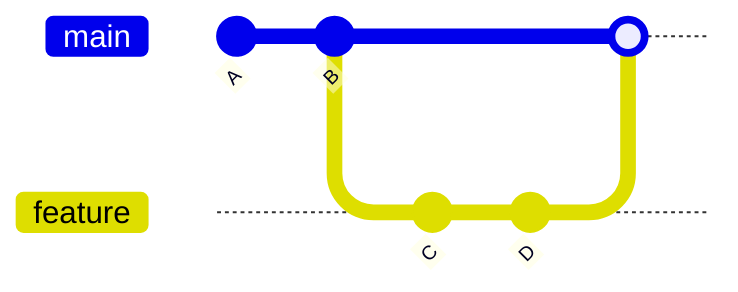
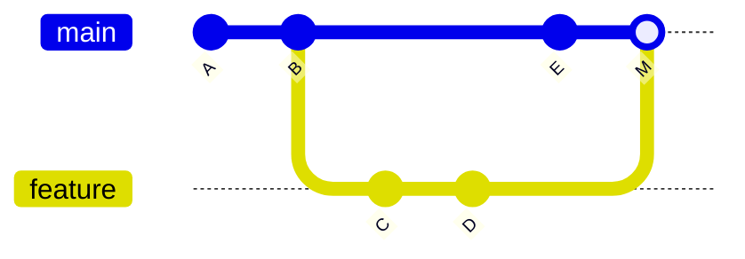

<!-- devopsshack:header -->
> 📘 **Git Mastery: Zero to Production** · by **DevOps Shack** · [YouTube](https://www.youtube.com/@devopsshack) · [Hindi channel](https://www.youtube.com/@shackverse) · [devopsshack.com](https://devopsshack.com)
<!-- /devopsshack:header -->

# Module 07 · Merging & Conflict Resolution

## What merging does

Merging takes the work from one branch and integrates it into another. Git finds the **merge base** (the best common ancestor of the two branches), compares each side's changes against it, and combines them.

```bash
git switch main
git merge feature/login
git merge-base main feature/login    # see the common ancestor
```

## Fast-forward merge

If `main` hasn't moved since `feature` branched off, there's nothing to combine. Git just slides `main` forward to `feature`'s tip. No merge commit is created.



(A true fast-forward leaves a straight line A-B-C-D with main at D. Diagram tools draw it as a merge for clarity.)

## Three-way merge

If both branches have new commits, Git creates a **merge commit** with two parents.



It's called three-way because Git uses three snapshots: the merge base (B), ours (E) and theirs (D). For each change, if only one side changed something, that side wins automatically. If both sides changed the same lines differently, that's a **conflict**.

## Controlling merge behaviour

```bash
git merge --ff-only feature     # only allow fast-forward, fail otherwise
git merge --no-ff feature       # always create a merge commit
git merge --squash feature      # stage all changes as one, you commit manually
git merge --abort               # give up and return to pre-merge state
```

| Option | History result | When teams choose it |
|---|---|---|
| Fast-forward | Linear, no merge commit | Small teams, rebased branches |
| `--no-ff` | Merge commit records the feature as a unit | Git Flow, auditability |
| `--squash` | One commit per feature, branch history discarded | Clean main, PR-centric teams |

`--squash` doesn't record the branch as merged. `git branch -d feature` will refuse afterwards, because Git can't see that its commits are in `main`. That's expected. Use `-D` once you've confirmed the squash landed.

## Merge strategies

The **strategy** is the algorithm Git uses:

- **ort** is the default since Git 2.34. It replaced `recursive`, and it's faster and handles renames better.
- **octopus** merges more than two branches at once, as long as there are no conflicts.
- **ours** creates a merge commit but keeps *our* tree entirely, ignoring the other branch's changes. It's used to mark a branch as merged without taking its content.
- **subtree** is for merging a project into a subdirectory.

**Strategy options** tune the default strategy:

```bash
git merge -X ours feature      # on conflicting hunks, prefer our side
git merge -X theirs feature    # on conflicting hunks, prefer their side
git merge -X ignore-space-change feature
```

Don't confuse `-s ours` (ignore their changes completely) with `-X ours` (take everything, but prefer ours only where hunks conflict). It's a classic interview question.

## Anatomy of a conflict

```
<<<<<<< HEAD
const timeout = 30;
||||||| merged common ancestor
const timeout = 10;
=======
const timeout = 60;
>>>>>>> feature/retry
```

The top section is ours (the branch you're on), the bottom is theirs (the branch being merged). The middle section, the common ancestor, only appears with `merge.conflictstyle = diff3` or `zdiff3`. Turn it on. Knowing the original value tells you what each side *intended*: here, one side raised the timeout to 30 and the other to 60. That's a conversation, not a guess.

## Resolving conflicts step by step

```bash
git status                       # lists "both modified" files
git diff                         # shows conflicts
# edit each file: keep the right content, delete all markers
git add resolved-file.js         # mark as resolved
git commit                       # completes the merge (message pre-filled)
```

Useful helpers:

```bash
git checkout --ours   path       # take our version of a file wholesale
git checkout --theirs path       # take their version
git mergetool                    # open a configured visual tool
git log --merge -p path          # commits on both sides that touched this file
git diff --name-only --diff-filter=U   # list conflicted files
```

> **DevOps Shack Production Tip:** During a **rebase**, "ours" and "theirs" are swapped. "Ours" is the branch you're rebasing *onto* (for example `main`), and "theirs" is your own commit being replayed. People lose work over this. When in doubt, open the file and read it instead of reaching for `--ours`/`--theirs`.

## Types of conflict you'll see

- **Content conflict**: both sides edited the same lines.
- **Modify/delete**: one side changed a file, the other deleted it. Decide whether the file should exist, then `git add` or `git rm` it.
- **Rename/rename**: both sides renamed the same file differently.
- **Add/add**: both sides created a file with the same path.
- **Binary conflict**: Git can't merge images or archives. Choose one side.
- **Lock file conflicts** (`package-lock.json`, `go.sum`, `poetry.lock`): don't hand-edit. Take one side and regenerate with the package manager.

## Semantic conflicts: the dangerous kind

Sometimes Git merges cleanly but the code is broken. One branch renames a function. Another branch adds a new call to the old name. No textual overlap, no conflict, but the build fails. Only CI catches this. That's why you should run tests on the *merge result* (GitHub's merge queue and GitLab's merged results pipelines exist for exactly this reason).

## Reducing conflicts

- Keep branches short-lived. Merge or rebase from main often.
- Make small, focused pull requests.
- Agree on formatting (Prettier, Black, gofmt) and run it in pre-commit, so formatting never conflicts.
- Avoid giant shared files that everyone edits (route tables, constants). Split them.
- Turn on `rerere` so repeated conflicts resolve themselves (Lab 27).

## Key takeaways

- Fast-forward moves a pointer. A three-way merge creates a commit with two parents.
- `ort` is the default strategy. `-s ours` and `-X ours` mean very different things.
- Enable `zdiff3` to see the common ancestor inside conflicts.
- "Ours" and "theirs" flip during a rebase.
- A clean merge isn't proof of working code. Test the merge result.

## Practice

- [Lab 07 · Merge Conflicts](../labs/lab-07-merge-conflicts/README.md)
- [Lab 27 · rerere](../labs/lab-27-rerere/README.md)
- [Assignment A03 · Conflict Gauntlet](../assignments/A03-conflict-gauntlet.md)
- Diagram: [Merge types](../diagrams/06-merge-types.md)

Next: [Module 08 · Rebasing](08-rebasing.md)


<!-- devopsshack:footer -->
---

<p align="center">
  Made with ❤️ by <b><a href="https://devopsshack.com">DevOps Shack</a></b> · Part of <b>Git Mastery: Zero to Production</b><br/>
  <a href="https://www.youtube.com/@devopsshack">YouTube · DevOps Shack</a> · <a href="https://www.youtube.com/@shackverse">YouTube · DevOps Shack Hindi</a> · <a href="https://devopsshack.com">devopsshack.com</a> · <a href="https://www.instagram.com/devopsshack">Instagram · @devopsshack</a><br/>
  <sub>© DevOps Shack. Original content created by DevOps Shack. Free to learn from and share with credit to DevOps Shack. See <a href="../LICENSE">LICENSE</a>.</sub>
</p>
<!-- /devopsshack:footer -->
