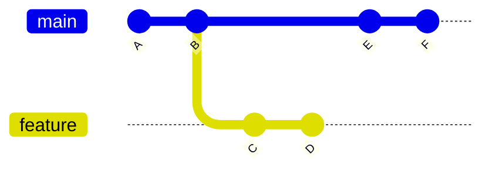

<!-- devopsshack:header -->
> 📘 **Git Mastery: Zero to Production** · by **DevOps Shack** · [YouTube](https://www.youtube.com/@devopsshack) · [Hindi channel](https://www.youtube.com/@shackverse) · [devopsshack.com](https://devopsshack.com)
<!-- /devopsshack:header -->

# Module 08 · Rebasing

## What rebase does

Rebase takes the commits on your branch and **replays them, one at a time, on top of another base**. The result looks as if you'd started your work from the latest `main`.

```bash
git switch feature
git rebase main
```

Before:



After `git rebase main`, feature contains A, B, E, F, then C' and D'. C' and D' are **new commits** with new hashes. They have the same changes as C and D, but different parents. The original C and D still exist in the reflog until garbage collection.

## Merge vs rebase

| | Merge | Rebase |
|---|---|---|
| History | True record, with merge commits | Linear, as if work happened in sequence |
| Commit hashes | Unchanged | Rewritten for replayed commits |
| Conflicts | Resolved once | Possibly resolved per replayed commit |
| Safe on shared branches | Yes | No, unless everyone coordinates |
| `git bisect` and reading log | Harder with many merges | Easier |

Neither is "better." Many teams use both: **rebase your private feature branch onto main to keep it current, then merge it (often squash-merge) through a pull request.**

## The golden rule of rebasing

> **DevOps Shack Production Tip:** Never rebase commits that other people have already based work on. If you rebase a branch that's been pushed and shared, everyone else's copy now has the "old" commits, and the histories diverge. Their next pull duplicates commits or produces confusing conflicts.

Rebasing your own feature branch that only you work on is fine, even if it's pushed. You'll then need to force-push. Use the safe version:

```bash
git push --force-with-lease
```

`--force-with-lease` refuses to overwrite the remote if someone else pushed in the meantime. Plain `--force` silently destroys their work. Add `--force-if-includes` (Git 2.30+) for extra safety when background fetches update your remote-tracking refs.

## Handling conflicts during a rebase

Because commits are replayed one by one, you might hit a conflict on commit 3 of 7.

```bash
# fix the conflicted files
git add <files>
git rebase --continue      # move on to the next commit
git rebase --skip          # drop this commit entirely
git rebase --abort         # go back to exactly how things were
```

If you finish and realize it went wrong, `git reset --hard ORIG_HEAD` (immediately after) or the reflog will take you back.

## Interactive rebase: rewriting your own history

Interactive rebase is the tool for turning a messy series of commits into a clean, reviewable story before you open a PR.

```bash
git rebase -i HEAD~5        # edit the last 5 commits
git rebase -i main          # edit everything since you branched from main
```

Your editor opens with a todo list, oldest first:

```
pick a1b2c3 Add invoice model
pick d4e5f6 wip
pick 789abc fix typo
pick 0def12 Add invoice export endpoint
pick 345678 address review comments
```

Change the commands, save and close:

| Command | Effect |
|---|---|
| `pick` | keep as is |
| `reword` (r) | keep, but edit the message |
| `edit` (e) | stop here so you can amend or split it |
| `squash` (s) | meld into the previous commit, combining messages |
| `fixup` (f) | meld into the previous commit, discard this message |
| `drop` (d) | delete the commit |
| `exec` (x) | run a shell command, stop if it fails |
| `break` | pause here |

Reordering lines reorders commits.

### Autosquash: the professional workflow

When review feedback arrives, commit fixes as fixups that target the right commit:

```bash
git commit --fixup=a1b2c3      # creates "fixup! Add invoice model"
git rebase -i --autosquash main
```

Git automatically moves each fixup under its target and marks it `fixup`. Set `git config --global rebase.autoSquash true` to make this the default.

### Splitting a commit

```bash
git rebase -i HEAD~3       # mark the commit as "edit"
git reset HEAD~1           # undo the commit, keep changes unstaged
git add -p && git commit -m "Part 1"
git add -p && git commit -m "Part 2"
git rebase --continue
```

### Run the tests on every commit

```bash
git rebase -i --exec "npm test" main
```

This guarantees every commit in your branch passes tests, which keeps `git bisect` reliable later.

## rebase --onto: moving a branch to a new base

`--onto` lets you transplant a range of commits. The classic case: you branched `feature-b` off `feature-a`, but `feature-a` was abandoned (or squash-merged), and you want `feature-b` to sit directly on `main`.

```bash
# take commits in feature-b that aren't in feature-a, put them on main
git rebase --onto main feature-a feature-b
```

Read it as: `git rebase --onto <new-base> <old-base> <branch>`.

Another use: remove commits from the middle of a branch. `git rebase --onto HEAD~5 HEAD~3` drops the two commits between HEAD~5 and HEAD~3.

## Stacked branches and --update-refs

If you work with stacked PRs (branch B on A, C on B), rebasing A would normally leave B and C pointing at the old commits. Git 2.38+ can update them all at once:

```bash
git rebase -i --update-refs main
```

## Rebasing merges

By default, rebase flattens merge commits. To keep the branch structure, use `--rebase-merges`. It's useful when a feature branch contains intentional merges of sub-branches.

## pull --rebase

`git pull` defaults to fetch + merge, which creates a useless "Merge branch 'main' of origin" commit every time your local branch is behind. `git pull --rebase` replays your local commits on top of the fetched ones instead.

```bash
git config --global pull.rebase true
git config --global rebase.autoStash true   # stash and restore uncommitted work automatically
```

## Key takeaways

- Rebase replays commits on a new base and creates new hashes.
- Don't rebase shared history. Use `--force-with-lease` when you must force-push your own branch.
- Interactive rebase cleans history: reword, squash, fixup, edit, drop, reorder.
- `--autosquash` with `commit --fixup` is the cleanest review workflow.
- `--onto` transplants commit ranges. `--update-refs` keeps stacked branches in sync.

## Practice

- [Lab 08 · Rebase Basics](../labs/lab-08-rebase-basics/README.md)
- [Lab 09 · Interactive Rebase](../labs/lab-09-interactive-rebase/README.md)
- [Lab 10 · Rebase Conflicts](../labs/lab-10-rebase-conflicts/README.md)
- [Assignment A04 · Clean History](../assignments/A04-clean-history.md)
- Diagram: [Merge vs rebase](../diagrams/07-merge-vs-rebase.md)

Next: [Module 09 · Remotes](09-remotes.md)


<!-- devopsshack:footer -->
---

<p align="center">
  Made with ❤️ by <b><a href="https://devopsshack.com">DevOps Shack</a></b> · Part of <b>Git Mastery: Zero to Production</b><br/>
  <a href="https://www.youtube.com/@devopsshack">YouTube · DevOps Shack</a> · <a href="https://www.youtube.com/@shackverse">YouTube · DevOps Shack Hindi</a> · <a href="https://devopsshack.com">devopsshack.com</a> · <a href="https://www.instagram.com/devopsshack">Instagram · @devopsshack</a><br/>
  <sub>© DevOps Shack. Original content created by DevOps Shack. Free to learn from and share with credit to DevOps Shack. See <a href="../LICENSE">LICENSE</a>.</sub>
</p>
<!-- /devopsshack:footer -->
