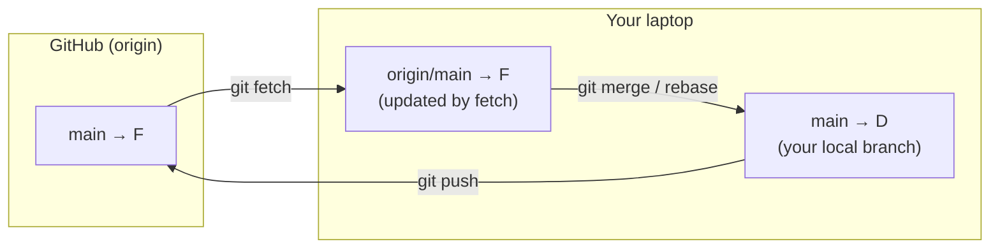

<!-- devopsshack:header -->
> 📘 **Git Mastery: Zero to Production** · by **DevOps Shack** · [YouTube](https://www.youtube.com/@devopsshack) · [Hindi channel](https://www.youtube.com/@shackverse) · [devopsshack.com](https://devopsshack.com)
<!-- /devopsshack:header -->

# Module 09 · Working with Remotes

## What a remote is

A remote is a named URL pointing to another copy of the repository. When you clone, Git creates a remote called `origin`. In a fork workflow, you usually add a second one called `upstream`.

```bash
git remote -v
git remote add upstream https://github.com/devopsshack/original.git
git remote rename origin old-origin
git remote set-url origin git@github.com:you/repo.git
git remote remove old-origin
git remote show origin        # detailed info, including stale branches
```

## Remote-tracking branches

When you fetch, Git stores the remote's branch positions locally as **remote-tracking branches** like `origin/main`. They're read-only bookmarks of "where main was on origin last time I checked." You can't commit to them directly.



This explains a very common confusion: `git status` says "up to date with origin/main," yet a teammate just pushed. Status compares against your *last fetched* copy, not the live server. Run `git fetch` first.

## fetch, pull and push

```bash
git fetch                    # update all remote-tracking branches for origin
git fetch --all --prune      # every remote, and remove deleted branches
git fetch upstream main      # one branch from one remote

git pull                     # fetch + integrate into current branch
git pull --rebase            # fetch + rebase
git pull --ff-only           # refuse if a merge would be needed

git push                     # push current branch to its upstream
git push origin feature      # explicit
git push -u origin feature   # and set upstream
git push origin --tags       # push all tags
git push origin v1.2.0       # push one tag
git push origin --delete old-branch
```

`fetch` never changes your working files or local branches. It's always safe. Make "fetch, then look" your default instead of blindly pulling.

```bash
git fetch
git log --oneline main..origin/main    # what they did that you don't have
git log --oneline origin/main..main    # what you did that they don't have
```

## Why a push gets rejected

```
! [rejected]        main -> main (non-fast-forward)
```

The remote has commits you don't have. Git refuses because accepting your push would discard them. The fix is to integrate first:

```bash
git pull --rebase
git push
```

Never "fix" a rejected push on a shared branch with `--force`. That deletes your teammates' commits from the remote.

## Force pushing safely

On your own feature branch after a rebase:

```bash
git push --force-with-lease
git push --force-with-lease=feature:expected-sha   # strictest form
```

Protected branches on GitHub and GitLab can block force pushes entirely. Turn that on for `main` and release branches.

## Refspecs: how Git maps branches

A refspec defines which refs are fetched or pushed and where they land. Your clone has this in `.git/config`:

```ini
[remote "origin"]
    url = git@github.com:devopsshack/app.git
    fetch = +refs/heads/*:refs/remotes/origin/*
```

Read it as "take every branch on the remote and store it under `refs/remotes/origin/`." The `+` allows non-fast-forward updates of the tracking refs.

Practical uses:

```bash
# fetch a GitHub pull request locally
git fetch origin pull/123/head:pr-123
# GitLab merge request
git fetch origin merge-requests/45/head:mr-45
# push local branch to a differently named remote branch
git push origin local-name:remote-name
# delete a remote branch (empty source)
git push origin :old-branch
```

## Cloning options worth knowing

```bash
git clone --depth 1 <url>               # shallow: only latest commit (fast CI)
git clone --branch release/2.0 <url>    # specific branch
git clone --single-branch <url>         # only one branch's history
git clone --filter=blob:none <url>      # partial clone: fetch file contents on demand
git clone --mirror <url>                # bare copy of all refs, for backups/migration
git clone --bare <url>                  # bare repo with no working tree
git clone --recurse-submodules <url>
```

A **bare repository** has no working tree, just the contents of `.git`. Servers store bare repos, because nobody edits files there.

## Multiple remotes

Real setups often have more than one:

- `origin` (your fork) and `upstream` (the original project)
- Mirroring: pushing the same repo to GitHub and an internal GitLab
- Migrating from Bitbucket to GitHub

```bash
# push to two URLs with one command
git remote set-url --add --push origin git@github.com:org/app.git
git remote set-url --add --push origin git@gitlab.internal:org/app.git
```

## Migrating a repository with full history

```bash
git clone --mirror git@bitbucket.org:old/app.git
cd app.git
git remote set-url origin git@github.com:new/app.git
git push --mirror
```

`--mirror` copies all branches, tags and refs exactly. Check the target is empty first, because `push --mirror` also deletes remote refs that don't exist locally.

## Key takeaways

- `origin/main` is your local snapshot of the remote, updated only by fetch.
- `fetch` is always safe. `pull` changes your branch.
- A rejected push means integrate first, not force.
- Use `--force-with-lease`, and protect shared branches.
- Refspecs let you fetch PRs, rename on push, and mirror repos.

## Practice

- [Lab 11 · Remotes and Upstream](../labs/lab-11-remotes-and-upstream/README.md)
- [Lab 12 · Fork Workflow](../labs/lab-12-fork-workflow/README.md)
- Diagram: [Local vs remote](../diagrams/05-local-vs-remote.md)

Next: [Module 10 · Collaboration Workflows](10-collaboration-workflows.md)


<!-- devopsshack:footer -->
---

<p align="center">
  Made with ❤️ by <b><a href="https://devopsshack.com">DevOps Shack</a></b> · Part of <b>Git Mastery: Zero to Production</b><br/>
  <a href="https://www.youtube.com/@devopsshack">YouTube · DevOps Shack</a> · <a href="https://www.youtube.com/@shackverse">YouTube · DevOps Shack Hindi</a> · <a href="https://devopsshack.com">devopsshack.com</a> · <a href="https://www.instagram.com/devopsshack">Instagram · @devopsshack</a><br/>
  <sub>© DevOps Shack. Original content created by DevOps Shack. Free to learn from and share with credit to DevOps Shack. See <a href="../LICENSE">LICENSE</a>.</sub>
</p>
<!-- /devopsshack:footer -->
