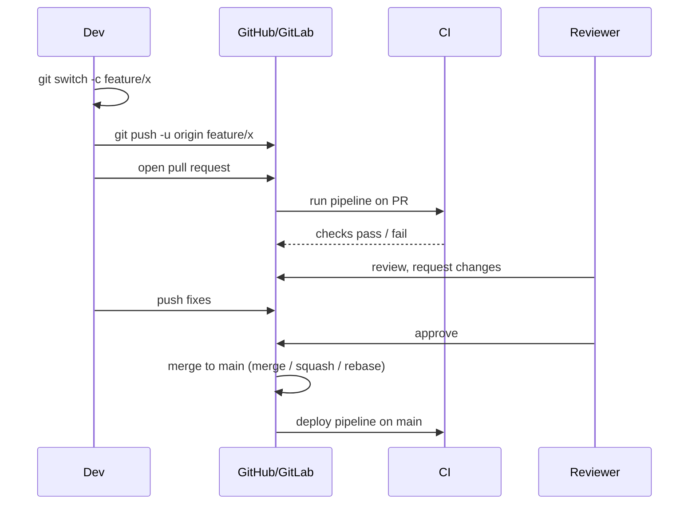

<!-- devopsshack:header -->
> 📘 **Git Mastery: Zero to Production** · by **DevOps Shack** · [YouTube](https://www.youtube.com/@devopsshack) · [Hindi channel](https://www.youtube.com/@shackverse) · [devopsshack.com](https://devopsshack.com)
<!-- /devopsshack:header -->

# Module 10 · Collaboration Workflows

Git gives you the mechanics. A **workflow** is the agreement a team makes about how to use them: who pushes where, how code gets reviewed, and how it reaches `main`.

## Centralized workflow

Everyone clones one repository and pushes directly to `main`. It's simple, and it's how many teams moving off Subversion start. It works for one to three people. Beyond that, it leads to broken builds and no review.

## Feature branch workflow

Every change happens on its own branch. Changes reach `main` only through a **pull request** (GitHub, Bitbucket) or **merge request** (GitLab). This is the baseline for almost every professional team.



## Forking workflow

Contributors don't have write access to the main repo. Each creates a **fork** (a server-side copy under their own account), pushes there, and opens a PR back to the original. This is the open-source model, and it's also used inside companies for strict separation.

```bash
git clone git@github.com:you/project.git
cd project
git remote add upstream git@github.com:devopsshack/project.git

# keep your fork current
git fetch upstream
git switch main
git rebase upstream/main      # or merge
git push origin main

# work
git switch -c fix/typo
git push -u origin fix/typo   # then open a PR to upstream
```

## Pull requests done well

A PR isn't just a merge button. It's the team's quality gate and its audit trail.

**For authors:**

- Keep PRs small. Under about 400 changed lines gets real review. A 3,000-line PR gets "LGTM."
- Write a description covering what changed, why, how it was tested, and any risk or rollout notes.
- Self-review the diff before requesting review.
- Clean your commits with interactive rebase, or plan to squash-merge.
- Link the ticket.

**For reviewers:**

- Review for correctness, security, readability and test coverage, in that order.
- Ask questions instead of making demands.
- Approve when it's good enough. "Different from how I'd do it" isn't a blocker.

## Merge button options

GitHub, GitLab and Bitbucket offer three ways to land a PR:

| Option | What happens | Result on main |
|---|---|---|
| **Create a merge commit** | `git merge --no-ff` | All branch commits plus a merge commit |
| **Squash and merge** | All commits squashed into one | One commit per PR, very clean |
| **Rebase and merge** | Commits replayed onto main | Linear, every branch commit kept |

> **DevOps Shack Production Tip:** Most product teams pick **squash and merge** as the default. One PR equals one commit on main, which makes reverts trivial (`git revert <sha>` undoes the whole feature) and changelogs readable. Allow merge commits only where history of the individual commits matters, such as long-lived release branches.

## Branch protection rules

Protection rules turn your workflow from a suggestion into an enforced policy. On `main`, typical settings are:

- Require a pull request before merging.
- Require at least one or two approvals, and dismiss stale approvals on new pushes.
- Require review from **CODEOWNERS**.
- Require status checks (CI, security scans) to pass.
- Require branches to be up to date before merging (or use a merge queue).
- Require signed commits.
- Require linear history.
- Block force pushes and branch deletion.
- Apply to administrators too.

GitHub now offers **rulesets**, which apply these rules across many repositories and branch patterns at once.

## CODEOWNERS

A `CODEOWNERS` file (in the root, `.github/` or `docs/`) automatically requests reviews from the right people based on which files changed.

```
# Default owners for everything
*                       @devopsshack/platform-team

# Infrastructure
/terraform/             @devopsshack/infra
/k8s/                   @devopsshack/infra @devopsshack/sre

# CI definitions must be approved by DevOps
/.github/workflows/     @devopsshack/devops
/.gitlab-ci.yml         @devopsshack/devops

# Payments code needs payments team
/services/payments/     @devopsshack/payments
```

The last matching pattern wins, just like `.gitignore`.

## Merge queues

When many PRs merge per hour, "require up to date with main" turns into an endless rebase race. A **merge queue** (GitHub merge queue, GitLab merge trains, Mergify, Bors) takes approved PRs, builds each on top of main plus the PRs ahead of it, and merges them in order only if the combined result passes CI. That's how large teams keep `main` green.

## Pair and mob programming in Git

When two people write a commit together, credit both with a trailer. GitHub and GitLab recognise it:

```
Add rate limiting to login endpoint

Co-authored-by: Priya Sharma <priya@devopsshack.com>
```

## Key takeaways

- The feature branch workflow with PRs is the professional baseline. Forks are for contributors without write access.
- Small PRs with good descriptions get real reviews.
- Squash-merge gives one revertable commit per feature.
- Branch protection and CODEOWNERS enforce the workflow.
- Merge queues keep main green at high merge volume.

## Practice

- [Lab 12 · Fork Workflow](../labs/lab-12-fork-workflow/README.md)
- [Assignment A05 · Team Simulation](../assignments/A05-team-simulation.md)
- Diagram: [Pull request lifecycle](../diagrams/10-pull-request-lifecycle.md)

Next: [Module 11 · Branching Strategies](11-branching-strategies.md)


<!-- devopsshack:footer -->
---

<p align="center">
  Made with ❤️ by <b><a href="https://devopsshack.com">DevOps Shack</a></b> · Part of <b>Git Mastery: Zero to Production</b><br/>
  <a href="https://www.youtube.com/@devopsshack">YouTube · DevOps Shack</a> · <a href="https://www.youtube.com/@shackverse">YouTube · DevOps Shack Hindi</a> · <a href="https://devopsshack.com">devopsshack.com</a> · <a href="https://www.instagram.com/devopsshack">Instagram · @devopsshack</a><br/>
  <sub>© DevOps Shack. Original content created by DevOps Shack. Free to learn from and share with credit to DevOps Shack. See <a href="../LICENSE">LICENSE</a>.</sub>
</p>
<!-- /devopsshack:footer -->
