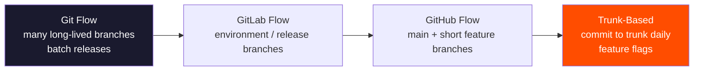
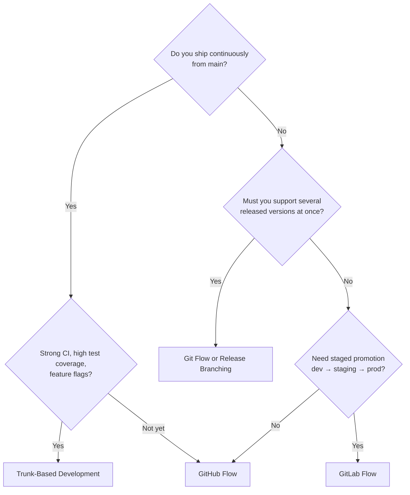

<!-- devopsshack:header -->
> 📘 **Git Mastery: Zero to Production** · by **DevOps Shack** · [YouTube](https://www.youtube.com/@devopsshack) · [Hindi channel](https://www.youtube.com/@shackverse) · [devopsshack.com](https://devopsshack.com)
<!-- /devopsshack:header -->

# Module 11 · Branching Strategies

A branching strategy answers four questions for a team. Where does new work start? Where does it merge? How does code get released? How do urgent fixes reach production? Pick the wrong strategy and you get merge hell, slow releases or broken production. Pick the right one and Git almost disappears into the background.

This module gives you the overview and the decision framework. Each strategy has its own deep-dive page, with diagrams and full command walkthroughs, in the [Branching Strategies](../branching-strategies/README.md) section.

## The main strategies at a glance

| Strategy | Long-lived branches | Release style | Best for |
|---|---|---|---|
| [Git Flow](../branching-strategies/01-git-flow.md) | `main`, `develop` | Scheduled, versioned releases | Packaged software, mobile apps, multiple supported versions |
| [GitHub Flow](../branching-strategies/02-github-flow.md) | `main` | Deploy on every merge | Web apps and SaaS with continuous deployment |
| [GitLab Flow](../branching-strategies/03-gitlab-flow.md) | `main` plus environment or release branches | Promote through environments | Teams that need staging/pre-prod gates |
| [Trunk-Based Development](../branching-strategies/04-trunk-based-development.md) | `main` (trunk) only | Continuous, often several times a day | High-performing teams with strong CI and feature flags |
| [Release Branching](../branching-strategies/05-release-branching.md) | `main` plus `release/x.y` | Cut, stabilize, ship, maintain | Products supporting several versions at once |
| [Environment Branching](../branching-strategies/06-environment-branching.md) | `dev`, `staging`, `prod` | Merge up through environments | Legacy setups. Usually an anti-pattern today |

## The spectrum

Moving right means fewer long-lived branches, smaller and more frequent integration, faster delivery, and more reliance on automated testing and feature flags.

## How to choose

Questions to ask the team:

1. How often do we want to deploy? Monthly releases suit Git Flow. Daily or hourly needs GitHub Flow or trunk-based.
2. Do customers run old versions we must patch? If yes, you need release branches.
3. How good is our automated testing? Trunk-based without solid CI is just breaking main faster.
4. Are we deploying a service or shipping an artifact (app store, on-prem installer, library)?
5. How big is the team, and how experienced?
6. Do regulators or auditors require explicit release gates?

## What the DORA research says

The DORA (DevOps Research and Assessment) research behind the *Accelerate* book consistently found that elite performers practise trunk-based development: three or fewer active branches, branches living less than a day, and no code freezes. That's a correlation with delivery performance, not a rule for every product. A mobile app that ships through app store review has legitimately different needs than a SaaS backend.

> **DevOps Shack Production Tip:** In interviews, never just say "we used Git Flow." Say *why*: "We shipped an on-prem product with quarterly releases and supported the last two versions, so we needed release branches and hotfix branches. For our internal SaaS services, we used GitHub Flow with feature flags." That answer shows judgement, which is what the question is really testing.

## Supporting practices that make any strategy work

- **Feature flags** let you merge unfinished code safely by hiding it behind a toggle (LaunchDarkly, Unleash, Flagsmith, OpenFeature, or simple config).
- **Branch by abstraction** lets you replace a large component gradually on trunk, behind an interface, instead of in a months-long branch.
- **Short-lived branches**: aim for merging within one or two days.
- **Branch protection and CI on every PR.**
- **Semantic versioning and tags** for every release (Module 12).
- **Automated changelogs** from Conventional Commits.

## Anti-patterns to recognise

- **Long-running feature branches** that live for months and end in a week-long "merge hell."
- **Environment branches** with code cherry-picked between them. Environments drift apart, and "works in staging" stops meaning anything.
- **Merge commits that say "merge main into feature" twenty times.** Rebase or merge main less noisily.
- **Personal branches** (`aditya-branch`) used for everything.
- **Code freezes** lasting weeks, which signal low confidence in testing.

## Key takeaways

- A branching strategy defines where work starts, merges, releases and gets hotfixed.
- Choose based on deploy frequency, version support, test maturity and compliance needs.
- Trunk-based and GitHub Flow suit continuous delivery. Git Flow and release branching suit versioned products.
- Feature flags and strong CI are what make short-lived branches possible.

## Practice

- [Lab 13 · Git Flow End to End](../labs/lab-13-git-flow/README.md)
- [Lab 14 · Trunk-Based with Feature Flags](../labs/lab-14-trunk-based/README.md)
- [Assignment A06 · Choose a Branching Strategy](../assignments/A06-choose-a-branching-strategy.md)

Next: [Module 12 · Tags, Releases & Versioning](12-tags-and-releases.md)

<!-- devopsshack:footer -->
---

  Made with ❤️ by <b><a href="https://devopsshack.com">DevOps Shack</a></b> · Part of <b>Git Mastery: Zero to Production</b> 
  <a href="https://www.youtube.com/@devopsshack">YouTube · DevOps Shack</a> · <a href="https://www.youtube.com/@shackverse">YouTube · DevOps Shack Hindi</a> · <a href="https://devopsshack.com">devopsshack.com</a> · <a href="https://www.instagram.com/devopsshack">Instagram · @devopsshack</a> 
  © DevOps Shack. Original content created by DevOps Shack. Free to learn from and share with credit to DevOps Shack. See <a href="../LICENSE">LICENSE</a>.

<!-- /devopsshack:footer -->
