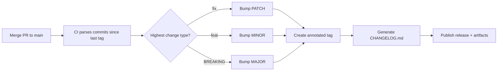

<!-- devopsshack:header -->
> 📘 **Git Mastery: Zero to Production** · by **DevOps Shack** · [YouTube](https://www.youtube.com/@devopsshack) · [Hindi channel](https://www.youtube.com/@shackverse) · [devopsshack.com](https://devopsshack.com)
<!-- /devopsshack:header -->

# Module 12 · Tags, Releases & Versioning

## Tags mark meaningful points in history

A tag is a name that points at a specific commit and, unlike a branch, isn't supposed to move. Tags mark releases: `v1.0.0`, `v2.3.1`.

There are two kinds.

**Lightweight tags** are just a ref pointing at a commit, like a branch that doesn't move.

```bash
git tag v1.0.0-rc1
```

**Annotated tags** are full Git objects with a tagger, date, message, and optionally a GPG or SSH signature. Use these for releases.

```bash
git tag -a v1.0.0 -m "Release 1.0.0: UPI checkout, invoice export"
git tag -s v1.0.0 -m "Signed release 1.0.0"     # signed
git tag -a v0.9.0 9fceb02 -m "Retroactive tag"  # tag an older commit
```

`git describe` only uses annotated tags by default, and many release tools expect them. That's another reason to prefer annotated.

## Working with tags

```bash
git tag                        # list
git tag -l "v1.*"              # filter
git show v1.0.0                # tag details and the commit
git describe --tags            # e.g. v1.4.2-7-g3f9a1c2 (7 commits after v1.4.2)
git push origin v1.0.0         # tags are NOT pushed by default
git push origin --tags         # push all tags
git push --follow-tags         # push annotated tags reachable from pushed commits
git tag -d v1.0.0              # delete locally
git push origin --delete v1.0.0   # delete on remote
git switch --detach v1.0.0     # inspect a release
git switch -c hotfix/1.0.1 v1.0.0   # branch from a release
```

Set `git config --global push.followTags true` so annotated tags go up with your commits automatically.

> **DevOps Shack Production Tip:** Never move or re-use a published release tag. If `v2.1.0` was wrong, release `v2.1.1`. Anyone who already fetched the old tag won't get the new one automatically, so the same version name ends up meaning two different builds on different machines. That's a nightmare to debug. Many platforms support **protected tags** so `v*` tags can only be created by release managers or CI.

## Semantic versioning

Semantic Versioning (SemVer) uses `MAJOR.MINOR.PATCH`:

- **MAJOR** for incompatible API changes: `1.9.3` → `2.0.0`
- **MINOR** for new backward-compatible features: `1.9.3` → `1.10.0`
- **PATCH** for backward-compatible bug fixes: `1.9.3` → `1.9.4`

Pre-release and build metadata: `2.0.0-beta.2`, `2.0.0-rc.1`, `2.0.0+build.417`.

Under 1.0.0, anything can change at any time.

## Automating versions from commits

With Conventional Commits, tools read your commit messages and decide the next version:

- `fix:` → patch
- `feat:` → minor
- `feat!:` or a `BREAKING CHANGE:` footer → major

Popular tools: **semantic-release**, **release-please** (Google), **standard-version** (deprecated, but still widely seen), **GitVersion** (.NET world), **commitizen**.



## Platform releases

A tag is a Git concept. A **release** on GitHub or GitLab is a platform object built on a tag. It adds release notes, attached binaries and links. CI pipelines usually create them:

```yaml
# GitHub Actions: build and release when a v* tag is pushed
on:
  push:
    tags: ["v*.*.*"]
jobs:
  release:
    runs-on: ubuntu-latest
    permissions:
      contents: write
    steps:
      - uses: actions/checkout@v4
      - run: make build
      - uses: softprops/action-gh-release@v2
        with:
          files: dist/*
          generate_release_notes: true
```

## Changelogs

A changelog tells users what changed between versions. Generate it from history instead of writing it by hand:

```bash
git log --oneline v1.3.0..v1.4.0
git log --pretty=format:"- %s (%h)" v1.3.0..v1.4.0 --no-merges
git shortlog v1.3.0..v1.4.0       # grouped by author
```

## Tag naming and versions in builds

Pick one convention and enforce it, usually `v` + SemVer (`v1.4.0`). In CI, embed the version in the artifact:

```bash
VERSION=$(git describe --tags --always --dirty)
docker build -t registry.devopsshack.com/app:${VERSION} .
```

`--dirty` appends `-dirty` if the working tree has uncommitted changes, which flags builds that don't correspond exactly to a commit.

## Key takeaways

- Use annotated (ideally signed) tags for releases. Lightweight tags are for private bookmarks.
- Tags aren't pushed by default. Use `--follow-tags`.
- Never move a published tag. Release a new version instead.
- SemVer and Conventional Commits enable fully automated versioning and changelogs.
- A platform "release" wraps a Git tag with notes and artifacts.

## Practice

- [Lab 15 · Tags and Releases](../labs/lab-15-tags-and-releases/README.md)
- [Assignment A07 · Release and Hotfix](../assignments/A07-release-and-hotfix.md)

Next: [Module 13 · Stash, Cherry-pick & Worktrees](13-stash-cherry-pick-worktrees.md)


<!-- devopsshack:footer -->
---

<p align="center">
  Made with ❤️ by <b><a href="https://devopsshack.com">DevOps Shack</a></b> · Part of <b>Git Mastery: Zero to Production</b><br/>
  <a href="https://www.youtube.com/@devopsshack">YouTube · DevOps Shack</a> · <a href="https://www.youtube.com/@shackverse">YouTube · DevOps Shack Hindi</a> · <a href="https://devopsshack.com">devopsshack.com</a> · <a href="https://www.instagram.com/devopsshack">Instagram · @devopsshack</a><br/>
  <sub>© DevOps Shack. Original content created by DevOps Shack. Free to learn from and share with credit to DevOps Shack. See <a href="../LICENSE">LICENSE</a>.</sub>
</p>
<!-- /devopsshack:footer -->
