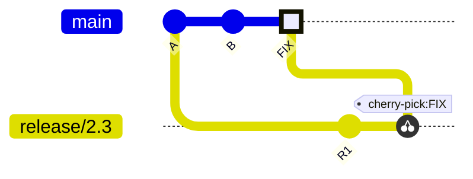
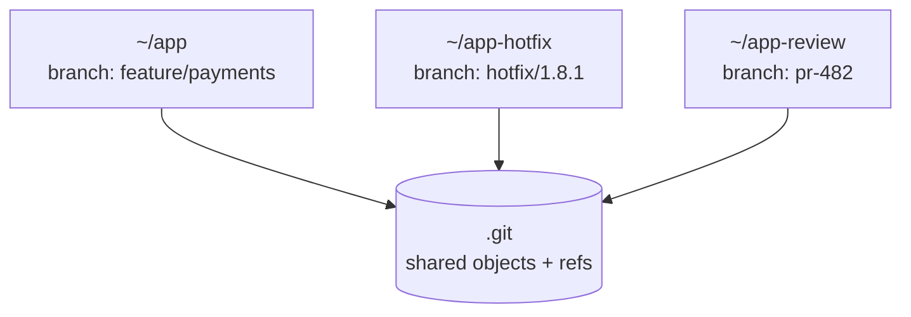

<!-- devopsshack:header -->
> 📘 **Git Mastery: Zero to Production** · by **DevOps Shack** · [YouTube](https://www.youtube.com/@devopsshack) · [Hindi channel](https://www.youtube.com/@shackverse) · [devopsshack.com](https://devopsshack.com)
<!-- /devopsshack:header -->

# Module 13 · Stash, Cherry-pick & Worktrees

Three tools for juggling work: stash parks unfinished changes, cherry-pick copies specific commits between branches, and worktrees let you have several branches checked out at the same time.

## git stash

You're halfway through a feature when production breaks. Your changes aren't ready to commit, and Git won't let you switch branches because they'd be overwritten. Stash saves them aside and gives you a clean working tree.

```bash
git stash                          # stash tracked changes (staged and unstaged)
git stash push -m "WIP: invoice filters"
git stash -u                       # include untracked files
git stash -a                       # include ignored files too
git stash push -p                  # choose hunks interactively
git stash push -- src/api.js       # stash specific paths
git stash --staged                 # stash only what's staged (Git 2.35+)

git stash list
git stash show -p stash@{1}        # see what's in it
git stash pop                      # apply the latest and remove it
git stash apply stash@{2}          # apply, keep it in the list
git stash drop stash@{0}
git stash clear                    # delete all (careful)
git stash branch fix-filters stash@{0}   # new branch from where the stash was made, then apply
```

A stash is actually a set of commits (stored under `refs/stash`): one for the working tree, one for the index, and optionally one for untracked files. That's why a dropped stash can often be recovered:

```bash
git fsck --no-reflogs | awk '/dangling commit/ {print $3}' | \
  xargs -I{} git log -1 --format="%h %s" {} | grep -i "WIP"
git stash apply <hash>
```

**When pop conflicts**, the stash isn't dropped. Resolve the conflict, `git add`, then `git stash drop` yourself.

> **DevOps Shack Production Tip:** Stashes are easy to forget. A stash list with 14 entries named "WIP on main" is a common sight, and nobody knows what's in them. Always use `-m` with a message. For anything that'll last more than a day, make a WIP commit on a branch instead. Branches get pushed and backed up. Stashes stay on your laptop.

## git cherry-pick

Cherry-pick applies the changes from one or more existing commits onto your current branch, as new commits.

```bash
git cherry-pick a1b2c3d
git cherry-pick a1b2c3d e4f5a6b       # several
git cherry-pick main~4..main~1        # a range (excludes main~4)
git cherry-pick -x a1b2c3d            # append "(cherry picked from commit ...)"
git cherry-pick -n a1b2c3d            # apply without committing
git cherry-pick -m 1 <merge-commit>   # cherry-pick a merge, relative to parent 1
git cherry-pick --continue | --skip | --abort
```

### When cherry-pick is the right tool

- **Backporting a fix** to a release branch: the fix lands on `main`, then gets cherry-picked to `release/2.3` and `release/2.2`.
- **Hotfix forward-port**: a hotfix made on a release branch also needs to land on `main`.
- **Rescuing a commit** made on the wrong branch.



Always use `-x` when backporting. The note in the message tells future engineers where the change originally came from.

### When it's the wrong tool

Using cherry-pick as your normal way to move work between long-lived branches leads to duplicate commits (same change, different hashes), confusing conflicts later and drift between branches. If you find yourself cherry-picking dozens of commits a week between `dev` and `prod`, the branching strategy is the problem.

## git worktree

A worktree is an additional working directory attached to the same repository. Each worktree has its own checked-out branch, index and HEAD, but they all share one object database.

```bash
git worktree add ../app-hotfix hotfix/1.8.1        # existing branch
git worktree add -b feature/new ../app-new main    # new branch from main
git worktree list
git worktree remove ../app-hotfix
git worktree prune                                 # clean up stale entries
```

Why it's useful:

- Fix a production bug in a second folder without stashing or disturbing your feature work.
- Run a long test suite on one branch while coding on another.
- Review a colleague's PR in its own folder.
- Compare two versions side by side.
- Run several AI coding agents in parallel, each on its own branch.

A branch can only be checked out in one worktree at a time. Git prevents two worktrees on the same branch because their indexes would conflict.



## Key takeaways

- Stash parks work temporarily. Always add a message. Prefer WIP commits for anything long-lived.
- Stashes are commits, so dropped stashes can usually be recovered.
- Cherry-pick is for backports and rescues, not for routine branch syncing. Use `-x`.
- Worktrees give you multiple simultaneous checkouts from one repo.

## Practice

- [Lab 16 · Stash Scenarios](../labs/lab-16-stash/README.md)
- [Lab 17 · Cherry-pick and Backports](../labs/lab-17-cherry-pick/README.md)
- [Lab 18 · Worktrees](../labs/lab-18-worktrees/README.md)

Next: [Module 14 · Investigating History](14-history-investigation.md)


<!-- devopsshack:footer -->
---

<p align="center">
  Made with ❤️ by <b><a href="https://devopsshack.com">DevOps Shack</a></b> · Part of <b>Git Mastery: Zero to Production</b><br/>
  <a href="https://www.youtube.com/@devopsshack">YouTube · DevOps Shack</a> · <a href="https://www.youtube.com/@shackverse">YouTube · DevOps Shack Hindi</a> · <a href="https://devopsshack.com">devopsshack.com</a> · <a href="https://www.instagram.com/devopsshack">Instagram · @devopsshack</a><br/>
  <sub>© DevOps Shack. Original content created by DevOps Shack. Free to learn from and share with credit to DevOps Shack. See <a href="../LICENSE">LICENSE</a>.</sub>
</p>
<!-- /devopsshack:footer -->
