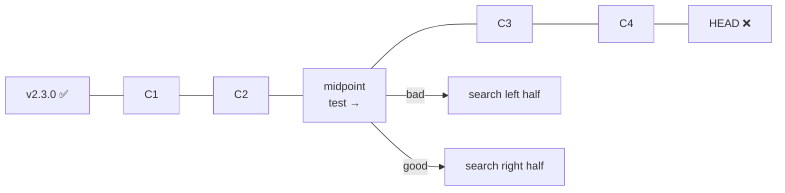

<!-- devopsshack:header -->
> 📘 **Git Mastery: Zero to Production** · by **DevOps Shack** · [YouTube](https://www.youtube.com/@devopsshack) · [Hindi channel](https://www.youtube.com/@shackverse) · [devopsshack.com](https://devopsshack.com)
<!-- /devopsshack:header -->

# Module 14 · Investigating History

Git history is a database of every decision the team ever made. These tools turn it into answers: who changed this, why, when did it break, and what else changed with it.

## Advanced git log

```bash
git log --oneline --graph --decorate --all
git log --stat                         # files changed per commit
git log -p -- path/to/file             # full diffs for one file
git log --follow -- path/to/file       # across renames
git log --since="2026-10-01" --until="2026-10-31"
git log --author="priya" --author="rahul"   # either author
git log --no-merges                    # skip merge commits
git log --merges                       # only merges
git log --first-parent main            # main's own timeline (one entry per merged PR)
git log main..feature                  # in feature, not in main
git log --left-right --oneline main...feature   # < main only, > feature only
git log --diff-filter=D --name-only    # commits that deleted files
```

### Custom formats

```bash
git log --pretty=format:"%h %ad %an %s" --date=short
git log --pretty=format:"%C(yellow)%h%Creset %C(blue)%an%Creset %s %C(green)(%cr)%Creset"
```

Placeholders: `%H` full hash, `%h` short hash, `%an` author name, `%ae` author email, `%ad` author date, `%cn` committer name, `%cr` relative commit date, `%s` subject, `%b` body, `%d` ref names.

## The pickaxe: searching code history

```bash
git log -S "MAX_RETRIES"           # commits where the count of this string changed
git log -G "timeout\s*=\s*\d+"     # commits whose diff matches a regex
git log -S "API_KEY" --all -p      # check every branch for a leaked key
git log -L :processPayment:src/payments.js   # history of one function
git log -L 40,60:src/app.js        # history of a line range
```

`-S` finds where a string was **added or removed**. `-G` finds any commit whose diff lines match. `-L` follows the evolution of a specific function or line range, which is perfect for "how did this function get like this?"

## git blame

```bash
git blame src/payments.js
git blame -L 120,140 src/payments.js
git blame -w                 # ignore whitespace changes
git blame -C -C -C           # detect code moved or copied from other files
git blame --ignore-rev <sha>
git blame --ignore-revs-file .git-blame-ignore-revs
```

Big reformatting commits (switching to Prettier, for example) make blame useless, because every line points at "Apply formatting." Put those commit hashes in `.git-blame-ignore-revs` and configure:

```bash
git config blame.ignoreRevsFile .git-blame-ignore-revs
```

GitHub honours this file automatically.

> **DevOps Shack Production Tip:** Blame is for finding context, not people to blame. The goal is "which PR introduced this, and what was the reasoning?" Open the commit, find the PR link, read the discussion. That's usually where the real answer is.

## git bisect: binary search for the bad commit

Something worked in `v2.3.0` and is broken now, with 600 commits in between. Testing each would take forever. Bisect uses binary search, so 600 commits take about 10 tests (log₂ 600 ≈ 9.2).

```bash
git bisect start
git bisect bad                 # current commit is broken
git bisect good v2.3.0         # this one worked
# Git checks out a middle commit. Test it, then:
git bisect good                # or
git bisect bad
# repeat until Git prints "<sha> is the first bad commit"
git bisect reset               # return to where you started
```



### Fully automated bisect

If you can write a script that exits 0 for good and non-zero for bad, Git does everything:

```bash
git bisect start HEAD v2.3.0
git bisect run ./scripts/check-login.sh
```

Exit code 125 means "can't test this commit, skip it" (for example, it doesn't build). Codes 1 to 127 (except 125) mean bad.

Other useful bits:

```bash
git bisect skip                # current commit can't be tested
git bisect log > bisect.log    # save session
git bisect replay bisect.log
git bisect terms --term-old=fast --term-new=slow   # for performance regressions
git bisect start --first-parent   # only test merges on main (Git 2.29+)
```

## Other investigation tools

```bash
git shortlog -sn                    # commits per author, ranked
git shortlog -sn --since="1 year ago" -- services/payments
git grep "TODO" $(git rev-list --all | head -50)   # search old snapshots
git grep -n "featureFlag" v1.9.0    # search a tag's snapshot
git show v1.2.0:config/app.yaml     # file content at a release
git diff v1.2.0 v1.3.0 --stat       # what changed between releases
git range-diff main@{1} main        # compare two versions of a rebased branch
git whatchanged                     # older log variant
git log --format='%H' | wc -l       # total commits
```

`git range-diff` is underused. After a colleague rebases their PR, it shows what actually changed between the old and new versions of the branch.

## Key takeaways

- `log` with `-S`, `-G`, `-L`, `--follow` and `--first-parent` answers most history questions.
- Configure `.git-blame-ignore-revs` to keep blame useful after formatting commits.
- `bisect` finds a regression in log₂(N) steps, and `bisect run` automates it completely.
- `range-diff` compares two versions of a rebased branch.

## Practice

- [Lab 19 · Bisect](../labs/lab-19-bisect/README.md)
- [Lab 20 · Blame and Log Forensics](../labs/lab-20-blame-and-log-forensics/README.md)
- [Assignment A08 · Bisect the Bug](../assignments/A08-bisect-the-bug.md)

Next: [Module 15 · Rewriting History](15-rewriting-history.md)


<!-- devopsshack:footer -->
---

<p align="center">
  Made with ❤️ by <b><a href="https://devopsshack.com">DevOps Shack</a></b> · Part of <b>Git Mastery: Zero to Production</b><br/>
  <a href="https://www.youtube.com/@devopsshack">YouTube · DevOps Shack</a> · <a href="https://www.youtube.com/@shackverse">YouTube · DevOps Shack Hindi</a> · <a href="https://devopsshack.com">devopsshack.com</a> · <a href="https://www.instagram.com/devopsshack">Instagram · @devopsshack</a><br/>
  <sub>© DevOps Shack. Original content created by DevOps Shack. Free to learn from and share with credit to DevOps Shack. See <a href="../LICENSE">LICENSE</a>.</sub>
</p>
<!-- /devopsshack:footer -->
