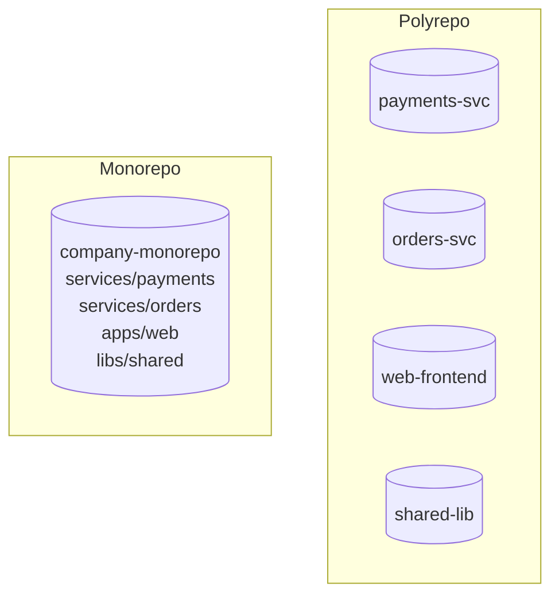

<!-- devopsshack:header -->
> 📘 **Git Mastery: Zero to Production** · by **DevOps Shack** · [YouTube](https://www.youtube.com/@devopsshack) · [Hindi channel](https://www.youtube.com/@shackverse) · [devopsshack.com](https://devopsshack.com)
<!-- /devopsshack:header -->

# Module 16 · Submodules, Subtrees & Monorepos

How do you share code between repositories, or structure a company with 200 services? Git offers two mechanisms (submodules and subtrees), and the industry has two overall approaches (polyrepo and monorepo).

## Submodules

A submodule embeds another repository at a fixed commit inside yours. The parent repo stores only a pointer: a special tree entry (mode `160000`) with the submodule's commit hash, plus a `.gitmodules` file with the URL.

```bash
git submodule add https://github.com/devopsshack/shared-lib.git libs/shared
git commit -m "Add shared-lib submodule"

cat .gitmodules
# [submodule "libs/shared"]
#     path = libs/shared
#     url = https://github.com/devopsshack/shared-lib.git
```

### Cloning a repo with submodules

```bash
git clone --recurse-submodules <url>
# or, if you already cloned
git submodule update --init --recursive
```

Forgetting this is the number one submodule problem: the folder exists but it's empty.

### Updating

```bash
# move the submodule to the latest commit on its tracked branch
git submodule update --remote libs/shared
git add libs/shared && git commit -m "Bump shared-lib"

# work inside a submodule
cd libs/shared
git switch main        # submodules check out in detached HEAD by default
# edit, commit, push inside the submodule first
cd ../..
git add libs/shared && git commit -m "Point to new shared-lib commit"
```

Useful settings:

```bash
git config --global submodule.recurse true         # pull/switch also updates submodules
git config --global push.recurseSubmodules check   # refuse to push parent if submodule commit isn't pushed
git config -f .gitmodules submodule.libs/shared.branch main
```

### Removing a submodule

```bash
git submodule deinit -f libs/shared
git rm -f libs/shared
rm -rf .git/modules/libs/shared
git commit -m "Remove shared-lib submodule"
```

### Submodule pros and cons

Pros: exact version pinning, the sub-project keeps its own history, and the parent stays small.
Cons: extra commands that people forget, detached HEAD confusion, the "pushed parent but not submodule" failure (teammates get a commit that doesn't exist), and CI must be configured to fetch them.

## Subtrees

A subtree copies another repository's content (and optionally its history) into a subdirectory of yours. To everyone who clones, it's just normal files. There's no special command for consumers.

```bash
git subtree add --prefix=libs/shared https://github.com/devopsshack/shared-lib.git main --squash
git subtree pull --prefix=libs/shared https://github.com/devopsshack/shared-lib.git main --squash
git subtree push --prefix=libs/shared https://github.com/devopsshack/shared-lib.git main
git subtree split --prefix=libs/shared -b shared-only   # extract history of a folder
```

## Submodule vs subtree

| | Submodule | Subtree |
|---|---|---|
| What's stored in parent | A pointer (commit hash) | The actual files |
| Clone experience | Needs `--recurse-submodules` | Just works |
| Pinning | Exact commit | Whatever you last pulled |
| Contributing back | Commit inside the submodule | `git subtree push` (slower) |
| Repo size | Small | Larger |
| Best for | Large or independently versioned deps | Small shared code, vendored deps, simplicity |

Many teams avoid both and publish shared code as **packages** (npm, PyPI, Maven, Go modules, Helm charts) instead. Versioned packages are usually the cleanest way to share code between repos.

## Monorepo vs polyrepo



| | Monorepo | Polyrepo |
|---|---|---|
| Atomic cross-project changes | Yes, one PR | No, coordinated PRs across repos |
| Code sharing | Direct imports | Packages or submodules |
| Dependency versions | One version everywhere (easier upgrades) | Each repo chooses |
| CI | Needs "affected only" builds | Simple per repo |
| Access control | Harder (CODEOWNERS, path rules) | Natural per-repo permissions |
| Git performance at scale | Needs sparse checkout, partial clone, maintenance | Fine |
| Who uses it | Google, Meta, Microsoft (Windows), Uber | Most companies, Netflix, Amazon |

Monorepo tooling: Nx, Turborepo, Bazel, Pants, Rush, Lerna. They detect which projects changed and only build and test those.

> **DevOps Shack Production Tip:** In a monorepo, CI must not rebuild everything on every commit. Use path filters (`paths:` in GitHub Actions, `rules: changes:` in GitLab CI) or a build tool's "affected" command, otherwise a one-line README fix triggers 45 minutes of pipelines.

## Making a large monorepo usable

```bash
# clone without file contents, then only check out what you need
git clone --filter=blob:none --sparse git@github.com:devopsshack/monorepo.git
cd monorepo
git sparse-checkout set services/payments libs/shared
git sparse-checkout add apps/web
git sparse-checkout list
git sparse-checkout disable
```

Module 20 covers partial clone, sparse checkout, and `scalar` in depth.

## Key takeaways

- Submodules pin another repo by commit. Powerful, but people forget the extra commands.
- Subtrees copy content in. Easier for consumers, heavier for the repo.
- Versioned packages are often the best way to share code across repos.
- Monorepos enable atomic changes but need affected-only CI and Git scaling features.

## Practice

- [Lab 22 · Submodules and Subtrees](../labs/lab-22-submodules-subtrees/README.md)
- [Lab 26 · Sparse and Partial Clone](../labs/lab-26-sparse-and-partial-clone/README.md)
- [Assignment A11 · Submodule to Subtree](../assignments/A11-submodule-to-subtree.md)

Next: [Module 17 · Hooks & Automation](17-hooks-and-automation.md)


<!-- devopsshack:footer -->
---

<p align="center">
  Made with ❤️ by <b><a href="https://devopsshack.com">DevOps Shack</a></b> · Part of <b>Git Mastery: Zero to Production</b><br/>
  <a href="https://www.youtube.com/@devopsshack">YouTube · DevOps Shack</a> · <a href="https://www.youtube.com/@shackverse">YouTube · DevOps Shack Hindi</a> · <a href="https://devopsshack.com">devopsshack.com</a> · <a href="https://www.instagram.com/devopsshack">Instagram · @devopsshack</a><br/>
  <sub>© DevOps Shack. Original content created by DevOps Shack. Free to learn from and share with credit to DevOps Shack. See <a href="../LICENSE">LICENSE</a>.</sub>
</p>
<!-- /devopsshack:footer -->
