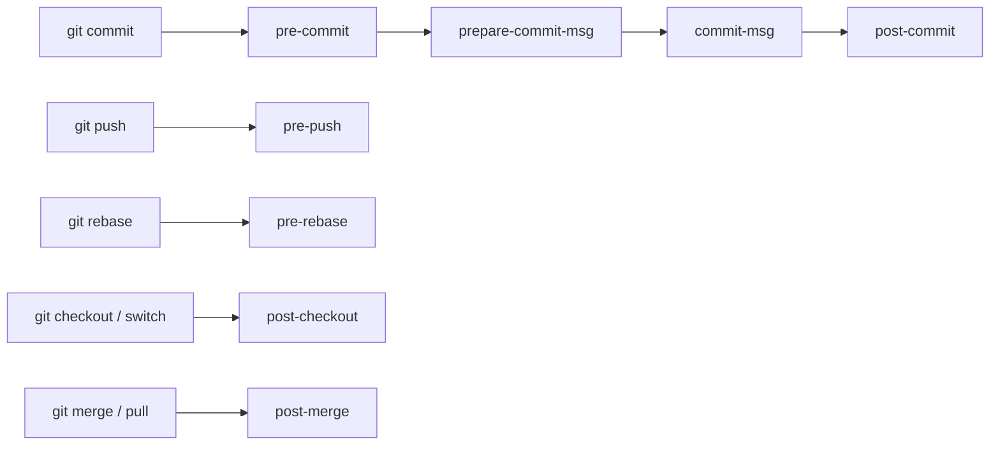

<!-- devopsshack:header -->
> 📘 **Git Mastery: Zero to Production** · by **DevOps Shack** · [YouTube](https://www.youtube.com/@devopsshack) · [Hindi channel](https://www.youtube.com/@shackverse) · [devopsshack.com](https://devopsshack.com)
<!-- /devopsshack:header -->

# Module 17 · Hooks & Automation

Hooks are scripts Git runs automatically at specific moments: before a commit, after a checkout, before a push, when a server receives a push. They let you enforce quality and automate chores right inside the Git workflow.

## Where hooks live

Hooks are executable files in `.git/hooks/`, named after the event (`pre-commit`, `commit-msg`, and so on). Git creates sample files ending in `.sample`. Remove the suffix and make the file executable to activate one.

`.git/hooks` isn't version-controlled, so hooks don't travel with a clone. To share them, commit them to a folder and point Git at it:

```bash
mkdir .githooks
git config core.hooksPath .githooks
```

Or use a hook manager (below), which is what most teams do.

## Client-side hooks



| Hook | Runs | Can block? | Typical use |
|---|---|---|---|
| `pre-commit` | Before the commit is created | Yes | Lint, format, detect secrets, block large files |
| `prepare-commit-msg` | Before the editor opens | Yes | Insert ticket ID from branch name |
| `commit-msg` | After message is written | Yes | Enforce Conventional Commits |
| `post-commit` | After commit | No | Notifications |
| `pre-push` | Before push | Yes | Run tests, block pushes to main |
| `pre-rebase` | Before rebase | Yes | Block rebasing published branches |
| `post-checkout` | After checkout/switch | No | Install deps, clear caches |
| `post-merge` | After merge | No | `npm install` if lockfile changed |

Any hook that exits non-zero blocks the operation (for the blocking ones). Everyone can bypass client hooks with `--no-verify`, so **they're a convenience, not a security control**. Enforce anything critical on the server or in CI too.

## Example: commit-msg enforcing Conventional Commits

```bash
#!/usr/bin/env bash
# .githooks/commit-msg — DevOps Shack Git Mastery
msg_file="$1"
pattern='^(feat|fix|docs|style|refactor|perf|test|build|ci|chore|revert)(\([a-z0-9-]+\))?!?: .{1,72}$'
first_line=$(head -n1 "$msg_file")

if [[ "$first_line" =~ ^(Merge|Revert|fixup!|squash!) ]]; then exit 0; fi

if ! [[ "$first_line" =~ $pattern ]]; then
  echo "✖ Commit message must follow Conventional Commits:"
  echo "    feat(auth): add Google login"
  echo "  Got: $first_line"
  exit 1
fi
```

## Example: prepare-commit-msg adding the ticket ID

```bash
#!/usr/bin/env bash
# turns branch feature/PAY-142-upi into a message prefix "PAY-142: "
branch=$(git symbolic-ref --short HEAD 2>/dev/null)
ticket=$(echo "$branch" | grep -oE '[A-Z]+-[0-9]+')
if [[ -n "$ticket" && "$2" != "merge" ]] && ! grep -q "$ticket" "$1"; then
  sed -i.bak "1s/^/$ticket: /" "$1"
fi
```

## Example: pre-commit blocking secrets and big files

```bash
#!/usr/bin/env bash
# block files over 5 MB
max=$((5*1024*1024))
for f in $(git diff --cached --name-only --diff-filter=ACM); do
  [ -f "$f" ] || continue
  size=$(wc -c < "$f")
  if [ "$size" -gt "$max" ]; then echo "✖ $f is larger than 5 MB. Use Git LFS."; exit 1; fi
done

# block obvious AWS keys
if git diff --cached -U0 | grep -E '^\+.*AKIA[0-9A-Z]{16}' >/dev/null; then
  echo "✖ Possible AWS access key in staged changes."; exit 1
fi
```

## Hook managers

**pre-commit (Python framework, language-agnostic)** is the most common choice in DevOps teams:

```yaml
# .pre-commit-config.yaml
repos:
  - repo: https://github.com/pre-commit/pre-commit-hooks
    rev: v4.6.0
    hooks:
      - id: trailing-whitespace
      - id: end-of-file-fixer
      - id: check-yaml
      - id: check-added-large-files
        args: ["--maxkb=5000"]
      - id: detect-private-key
      - id: check-merge-conflict
  - repo: https://github.com/gitleaks/gitleaks
    rev: v8.18.4
    hooks:
      - id: gitleaks
  - repo: https://github.com/antonbabenko/pre-commit-terraform
    rev: v1.92.0
    hooks:
      - id: terraform_fmt
      - id: terraform_validate
```

```bash
pip install pre-commit
pre-commit install                 # installs the git hook
pre-commit install --hook-type commit-msg
pre-commit run --all-files         # run on everything (do this in CI too)
pre-commit autoupdate
```

Other managers: **Husky** + **lint-staged** (JavaScript projects), **Lefthook** (fast, Go-based, any language), **Overcommit** (Ruby).

> **DevOps Shack Production Tip:** Run the exact same pre-commit config in CI with `pre-commit run --all-files`. Local hooks catch problems early and cheaply. CI catches everyone who used `--no-verify` or never installed the hooks. You need both.

## Server-side hooks

These run on the server that receives the push, and they **can't be bypassed** by the developer.

| Hook | Runs | Use |
|---|---|---|
| `pre-receive` | Once per push, before any ref updates | Reject pushes that violate policy |
| `update` | Once per ref being updated | Per-branch rules |
| `post-receive` | After all refs update | Trigger CI, notify chat, deploy |

On self-hosted GitLab, server hooks are configured per repository or globally. GitHub Enterprise Server supports pre-receive hooks. On GitHub.com and GitLab.com you don't get raw server hooks. You get the same outcomes through **branch protection, rulesets, push rules, required status checks and webhooks**.

## Git attributes as automation

`.gitattributes` can also automate behaviour per path:

```gitattributes
*.sh       text eol=lf
*.psd      filter=lfs diff=lfs merge=lfs -text
package-lock.json  merge=ours linguist-generated=true
docs/**    linguist-documentation
*.secret   filter=git-crypt diff=git-crypt
```

Custom **clean/smudge filters** transform files on the way into and out of the repository. Git LFS and git-crypt are both built on them.

## Key takeaways

- Client hooks (`pre-commit`, `commit-msg`, `pre-push`) give fast feedback but can be bypassed with `--no-verify`.
- Share hooks with `core.hooksPath` or a manager like pre-commit, Husky or Lefthook.
- Server hooks and platform rules are the enforcement layer.
- Always mirror local hooks in CI.

## Practice

- [Lab 23 · Hooks](../labs/lab-23-hooks/README.md)
- [Assignment A12 · Hooks Pipeline](../assignments/A12-hooks-pipeline.md)

Next: [Module 18 · Git in CI/CD & GitOps](18-git-in-cicd-and-gitops.md)


<!-- devopsshack:footer -->
---

<p align="center">
  Made with ❤️ by <b><a href="https://devopsshack.com">DevOps Shack</a></b> · Part of <b>Git Mastery: Zero to Production</b><br/>
  <a href="https://www.youtube.com/@devopsshack">YouTube · DevOps Shack</a> · <a href="https://www.youtube.com/@shackverse">YouTube · DevOps Shack Hindi</a> · <a href="https://devopsshack.com">devopsshack.com</a> · <a href="https://www.instagram.com/devopsshack">Instagram · @devopsshack</a><br/>
  <sub>© DevOps Shack. Original content created by DevOps Shack. Free to learn from and share with credit to DevOps Shack. See <a href="../LICENSE">LICENSE</a>.</sub>
</p>
<!-- /devopsshack:footer -->
