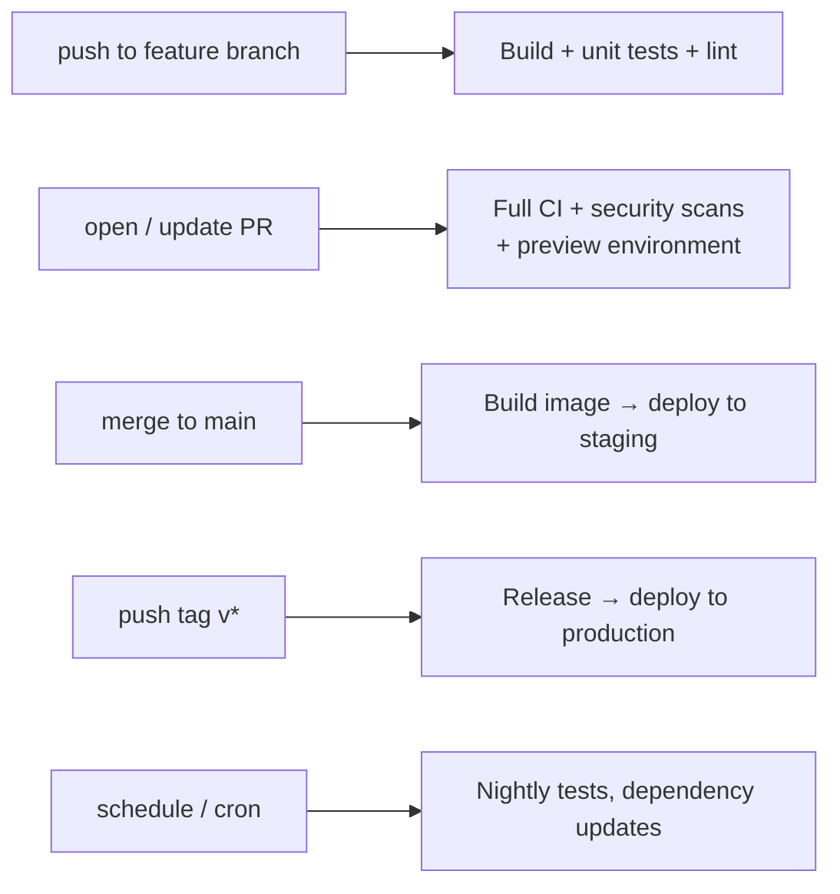
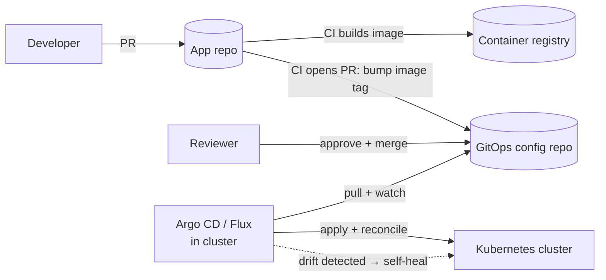

<!-- devopsshack:header -->
> 📘 **Git Mastery: Zero to Production** · by **DevOps Shack** · [YouTube](https://www.youtube.com/@devopsshack) · [Hindi channel](https://www.youtube.com/@shackverse) · [devopsshack.com](https://devopsshack.com)
<!-- /devopsshack:header -->

# Module 18 · Git in CI/CD & GitOps

In a modern DevOps setup, Git events drive everything. A push starts a build. A merge to main starts a deployment. A tag starts a release. In GitOps, a commit literally *is* the deployment. This module connects Git to the rest of your pipeline.

## Git events that trigger pipelines



**GitHub Actions**

```yaml
on:
  push:
    branches: [main]
    tags: ["v*.*.*"]
    paths: ["services/payments/**"]   # only when this service changes
  pull_request:
    branches: [main]
```

**GitLab CI**

```yaml
build:
  script: make build
  rules:
    - if: $CI_PIPELINE_SOURCE == "merge_request_event"
    - if: $CI_COMMIT_BRANCH == $CI_DEFAULT_BRANCH
    - if: $CI_COMMIT_TAG =~ /^v\d+\.\d+\.\d+$/
    - changes: ["services/payments/**/*"]
```

## How CI checks out code

CI runners clone your repo on every job, so checkout settings affect speed and correctness.

```yaml
- uses: actions/checkout@v4
  with:
    fetch-depth: 0        # full history; needed for git describe, changelogs, Sonar blame
    # fetch-depth: 1      # default: shallow, fastest
    submodules: recursive
    lfs: true
```

GitLab equivalents: `GIT_DEPTH: "10"`, `GIT_STRATEGY: fetch` (reuse the workspace) or `clone`, and `GIT_SUBMODULE_STRATEGY: recursive`.

> **DevOps Shack Production Tip:** A classic "works locally, fails in CI" bug: a step runs `git describe --tags` or computes a changelog, and fails with "No names found" because the CI clone was shallow and has no tags. Set `fetch-depth: 0`, or `git fetch --tags --unshallow` in that job only.

Another classic: on a `pull_request` event, GitHub checks out a **temporary merge commit** of your PR into the base branch, not your branch's head. That's deliberate (it tests the merge result), but it means `git rev-parse HEAD` isn't your commit. Use `github.event.pull_request.head.sha` when you need it.

## Tagging builds with Git metadata

Every artifact should trace back to the exact commit that produced it.

```bash
GIT_SHA=$(git rev-parse --short=8 HEAD)
GIT_BRANCH=$(git rev-parse --abbrev-ref HEAD)
VERSION=$(git describe --tags --always)

docker build \
  --label org.opencontainers.image.revision=$GIT_SHA \
  --label org.opencontainers.image.source=https://github.com/devopsshack/app \
  -t registry.devopsshack.com/app:$GIT_SHA \
  -t registry.devopsshack.com/app:$VERSION .
```

Tag images with the commit SHA (immutable) rather than only `latest` (mutable and ambiguous).

## Bots that commit back to Git

Pipelines often write to Git: version bumps, changelog updates, image tag updates in a GitOps repo.

- Use a dedicated bot identity and a token with minimal scope.
- Avoid infinite loops. Skip CI on bot commits with `[skip ci]` in the message, or filter by actor.
- Protected branches may need a bypass rule for the bot, or have the bot open a PR instead of pushing directly.

## GitOps: Git as the source of truth for infrastructure

GitOps applies Git workflows to operations. The desired state of your system (Kubernetes manifests, Helm values, Terraform) lives in Git. An agent continuously compares the live system to Git and fixes any difference.

The four OpenGitOps principles:

1. **Declarative**: the system's desired state is described declaratively.
2. **Versioned and immutable**: that state is stored in a way that keeps full version history.
3. **Pulled automatically**: agents pull the desired state from the source.
4. **Continuously reconciled**: agents observe actual state and correct drift.



### Why Git suits operations

- **Audit trail**: every production change is a commit with an author, a reviewer and a timestamp.
- **Rollback**: `git revert` the commit and the agent rolls the cluster back.
- **Review**: infrastructure changes go through the same PR process as code.
- **Disaster recovery**: rebuild a cluster by pointing a new agent at the repo.
- **Security**: CI no longer needs cluster credentials. The agent inside the cluster pulls.

### Repository layout patterns

Most teams separate **application source** from **deployment config**, so a config change doesn't trigger an app build and the two have different reviewers.

```
gitops-config/
├── apps/
│   └── payments/
│       ├── base/              # common manifests (kustomize)
│       └── overlays/
│           ├── dev/
│           ├── staging/
│           └── prod/
└── clusters/
    ├── dev-cluster/
    └── prod-cluster/
```

**Promote environments with folders, not branches.** A `dev` branch, a `staging` branch and a `prod` branch drift apart, and diffing environments becomes painful. With one `main` branch and a folder per environment, promotion is a PR that copies an image tag from `overlays/staging` to `overlays/prod`, and `git diff` shows exactly how environments differ.

> **DevOps Shack Production Tip:** In GitOps, never `kubectl edit` in production "just this once." The agent will revert it within minutes (good), or, if self-heal is off, Git and the cluster silently disagree (bad). Every change goes through a commit.

## Git for Terraform

- Commit `.terraform.lock.hcl`. Never commit `.terraform/`, `*.tfstate` or `*.tfvars` containing secrets.
- Run `terraform fmt -check` and `validate` in pre-commit and CI.
- Post `terraform plan` output to the PR for review. Run `apply` only from main after merge (or use Atlantis or Terraform Cloud with PR-driven applies).

## Key takeaways

- Git events (push, PR, merge, tag) are the triggers for CI/CD.
- Mind shallow clones, missing tags, and PR merge commits in CI.
- Label every artifact with the commit SHA.
- GitOps makes Git the source of truth, with agents that pull and reconcile.
- Promote environments with folders and PRs, not long-lived environment branches.

## Practice

- [Assignment A14 · Git in CI](../assignments/A14-git-in-ci.md)
- [Assignment A15 · GitOps Promotion](../assignments/A15-gitops-promotion.md)
- Diagram: [GitOps flow](../diagrams/20-gitops-flow.md)

Next: [Module 19 · Git Security](19-security.md)


<!-- devopsshack:footer -->
---

<p align="center">
  Made with ❤️ by <b><a href="https://devopsshack.com">DevOps Shack</a></b> · Part of <b>Git Mastery: Zero to Production</b><br/>
  <a href="https://www.youtube.com/@devopsshack">YouTube · DevOps Shack</a> · <a href="https://www.youtube.com/@shackverse">YouTube · DevOps Shack Hindi</a> · <a href="https://devopsshack.com">devopsshack.com</a> · <a href="https://www.instagram.com/devopsshack">Instagram · @devopsshack</a><br/>
  <sub>© DevOps Shack. Original content created by DevOps Shack. Free to learn from and share with credit to DevOps Shack. See <a href="../LICENSE">LICENSE</a>.</sub>
</p>
<!-- /devopsshack:footer -->
