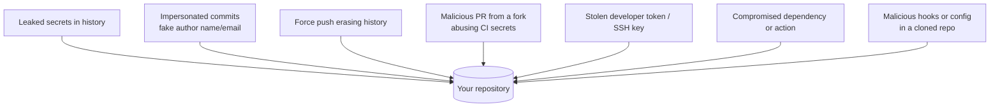

<!-- devopsshack:header -->
> 📘 **Git Mastery: Zero to Production** · by **DevOps Shack** · [YouTube](https://www.youtube.com/@devopsshack) · [Hindi channel](https://www.youtube.com/@shackverse) · [devopsshack.com](https://devopsshack.com)
<!-- /devopsshack:header -->

# Module 19 · Git Security

Your Git repositories hold your source code, your infrastructure definitions, and often (by accident) your secrets. Attackers know this. Supply-chain attacks increasingly target source control and CI. This module covers the controls every DevOps engineer should be able to set up and explain.

## The threat model



## 1 · Commit signing

`user.name` and `user.email` are just text. Anyone can make a commit that claims to be from your CTO. **Signing** proves who created a commit or tag cryptographically.

### Signing with SSH (simplest, Git 2.34+)

```bash
git config --global gpg.format ssh
git config --global user.signingkey ~/.ssh/id_ed25519.pub
git config --global commit.gpgsign true
git config --global tag.gpgsign true
```

Upload the same public key to GitHub or GitLab as a **signing key**. Commits then show as "Verified."

To verify locally, create an allowed-signers file:

```bash
echo "you@devopsshack.com $(cat ~/.ssh/id_ed25519.pub)" > ~/.ssh/allowed_signers
git config --global gpg.ssh.allowedSignersFile ~/.ssh/allowed_signers
git log --show-signature -1
git verify-commit HEAD
git verify-tag v1.0.0
```

### Signing with GPG

```bash
gpg --full-generate-key
gpg --list-secret-keys --keyid-format=long
git config --global user.signingkey <KEYID>
git config --global commit.gpgsign true
gpg --armor --export <KEYID>     # upload to GitHub/GitLab
```

### Keyless signing with Sigstore gitsign

`gitsign` signs commits with short-lived certificates tied to your OIDC identity (Google, GitHub, Microsoft), recorded in the Rekor transparency log. There are no long-lived keys to manage.

Then enable **"Require signed commits"** in branch protection. Note: squash and rebase merges done by the platform are signed by the platform's key, so they remain verified.

## 2 · Keeping secrets out

Prevention in layers:

1. **`.gitignore`** for `.env`, `*.pem`, `*.tfvars`, credentials files.
2. **Pre-commit scanning** with gitleaks, detect-secrets or trufflehog (Module 17).
3. **Platform push protection**: GitHub secret scanning push protection and GitLab secret push protection block pushes that contain known token formats.
4. **CI scanning** of full history on a schedule: `gitleaks detect --log-opts="--all"`.
5. **Use a secrets manager** (Vault, AWS Secrets Manager, SOPS, Sealed Secrets, External Secrets Operator) so secrets never need to be in a repo at all.

To store encrypted secrets in Git deliberately, use **SOPS** (encrypts values in YAML/JSON with KMS, age or PGP), **Sealed Secrets** (Kubernetes) or **git-crypt** (transparent file encryption).

If a secret leaks: rotate first, then purge (Module 15).

## 3 · Branch protection and rulesets

The controls that stop accidents and insider risk:

- Require PRs and approvals on `main` and `release/*`.
- Require CODEOWNERS review for sensitive paths (CI configs, Terraform, auth code).
- Require status checks, including security scans.
- Block force pushes and deletions.
- Require signed commits and linear history where appropriate.
- Don't exempt admins.
- Protect release tags (`v*`).

## 4 · Access control and authentication

- Enforce **SSO and MFA** at the organization level.
- Prefer **fine-grained personal access tokens** with expiry and per-repo scope over classic tokens with full access.
- Use **deploy keys** (single repo, read-only by default) or **GitHub Apps** for automation instead of a person's token.
- In CI, use **OIDC federation** to cloud providers instead of storing long-lived cloud keys as secrets.
- Review collaborators and outside contributors regularly. Remove leavers on day one.
- Audit-log streaming to your SIEM.

## 5 · CI security for Git-triggered pipelines

- **Fork PRs**: never expose secrets to workflows triggered by untrusted forks. On GitHub, be extremely careful with `pull_request_target`, because it runs with the base repo's secrets. Never check out and run the PR's code inside it.
- Set `permissions:` to the minimum in GitHub Actions (for example `contents: read`).
- **Pin third-party actions to a full commit SHA**, not a tag. Tags can be moved to malicious code, which is exactly what happened in the 2025 compromise of the `tj-actions/changed-files` action.
- Require approval before running workflows from first-time contributors.

> **DevOps Shack Production Tip:** `uses: some/action@v3` trusts whoever controls that tag forever. `uses: some/action@8f4b7f84864484a7bf31766abe9204da3cbe65b3 # v3.1.0` pins exact code. Dependabot and Renovate can still update the SHA through PRs, so you don't lose updates.

## 6 · Dangerous repository content

Cloning a repo is safe. Running things inside it may not be:

- Hooks in `.git/hooks` are **not** transferred by clone, but a repo can ask you to run a setup script that installs them, or set `core.hooksPath`. Read before you run.
- Git has had vulnerabilities around submodule paths, symlinks and case-insensitive filesystems. **Keep Git updated**, especially on CI runners and developer laptops.
- `safe.directory`: Git refuses to work in a repository owned by another user (the "dubious ownership" error) to prevent malicious config execution. Add trusted paths explicitly: `git config --global --add safe.directory /path/to/repo`. Avoid `safe.directory '*'` on shared machines.

## 7 · Supply-chain integrity

- Sign release tags, and verify signatures in your release pipeline.
- Generate build provenance (SLSA, GitHub artifact attestations) that links artifacts to the exact commit and workflow.
- Use OpenSSF Scorecard to assess your repos' security practices.

## Key takeaways

- Sign commits and tags (SSH signing is the easiest), and require signatures on protected branches.
- Layer secret prevention: gitignore, pre-commit scanning, push protection, CI scanning, secrets managers.
- Protect branches and tags, enforce SSO/MFA, use scoped tokens, deploy keys and OIDC.
- Treat fork PRs and third-party actions as untrusted. Pin actions to SHAs.
- Keep Git itself updated.

## Practice

- [Lab 24 · Signed Commits](../labs/lab-24-signed-commits/README.md)
- [Lab 21 · Remove a Secret from History](../labs/lab-21-remove-secrets/README.md)
- [Assignment A13 · Signed Commit Policy](../assignments/A13-signed-commit-policy.md)

Next: [Module 20 · Large Files & Performance](20-large-files-and-performance.md)


<!-- devopsshack:footer -->
---

<p align="center">
  Made with ❤️ by <b><a href="https://devopsshack.com">DevOps Shack</a></b> · Part of <b>Git Mastery: Zero to Production</b><br/>
  <a href="https://www.youtube.com/@devopsshack">YouTube · DevOps Shack</a> · <a href="https://www.youtube.com/@shackverse">YouTube · DevOps Shack Hindi</a> · <a href="https://devopsshack.com">devopsshack.com</a> · <a href="https://www.instagram.com/devopsshack">Instagram · @devopsshack</a><br/>
  <sub>© DevOps Shack. Original content created by DevOps Shack. Free to learn from and share with credit to DevOps Shack. See <a href="../LICENSE">LICENSE</a>.</sub>
</p>
<!-- /devopsshack:footer -->
