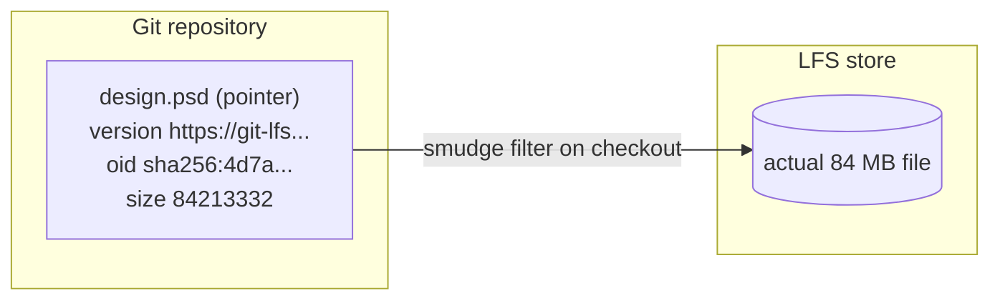
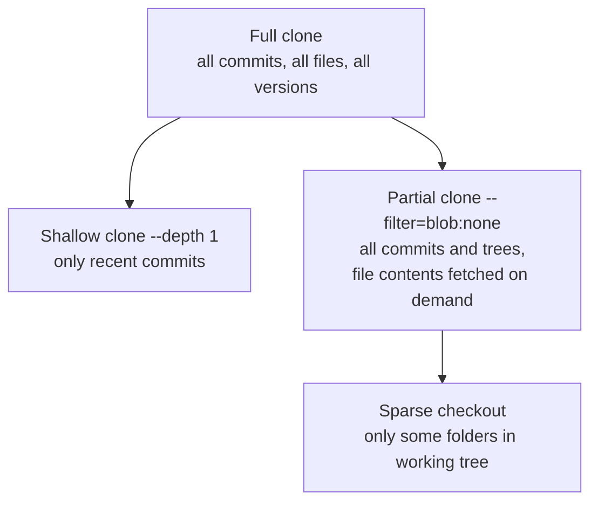

<!-- devopsshack:header -->
> 📘 **Git Mastery: Zero to Production** · by **DevOps Shack** · [YouTube](https://www.youtube.com/@devopsshack) · [Hindi channel](https://www.youtube.com/@shackverse) · [devopsshack.com](https://devopsshack.com)
<!-- /devopsshack:header -->

# Module 20 · Large Files & Performance

Git was designed for source code: many small text files. Put large binaries in it, or let a repo grow to millions of files and years of history, and clones take an hour and `git status` takes ten seconds. This module covers how to keep Git fast.

## Why large files hurt

Every version of every file is stored forever. Commit a 200 MB video, then update it ten times, and every clone downloads 2 GB, even after you delete the file, because it's still in history. Binaries also don't delta-compress well and can't be merged.

## Git LFS (Large File Storage)

LFS replaces large files in Git with small **pointer files**. The real content is stored on an LFS server (GitHub, GitLab, Bitbucket and Artifactory all provide one) and downloaded only for the commits you check out.



```bash
git lfs install                       # once per machine
git lfs track "*.psd" "*.zip" "models/**"
git add .gitattributes                # tracking rules live here, commit them
git add design.psd && git commit -m "Add design file"
git lfs ls-files
git lfs pull                          # fetch LFS content for current checkout
GIT_LFS_SKIP_SMUDGE=1 git clone <url> # clone without downloading LFS files
```

### Migrating existing files into LFS

```bash
git lfs migrate info --everything                 # what's big?
git lfs migrate import --include="*.psd,*.zip" --everything   # rewrites history
git push --force --all && git push --force --tags
```

This rewrites history, so the same coordination rules as Module 15 apply.

Things to know about LFS: storage and bandwidth quotas cost money on hosted platforms, CI needs `lfs: true` on checkout, and file locking (`git lfs lock`) is available for unmergeable binaries.

## Maintenance and garbage collection

```bash
git gc                       # pack objects, prune old unreachable objects
git gc --aggressive          # slower, tighter packing (rarely needed)
git prune                    # remove unreachable loose objects
git repack -ad               # repack everything into one pack
git count-objects -vH
git maintenance start        # schedule background maintenance (Git 2.31+)
git maintenance run --task=commit-graph --task=prefetch
```

`git maintenance start` registers the repo for hourly prefetch, a commit-graph refresh, loose-object cleanup and incremental repacking. It's the modern replacement for manually running `gc`.

## Features that speed up big repos

| Feature | What it does | Enable |
|---|---|---|
| **Commit-graph** | Precomputed file of commit relationships. Makes `log --graph`, merge-base and reachability much faster | `git commit-graph write --reachable` (or maintenance) |
| **Multi-pack index** | One index across many packfiles | `git multi-pack-index write` |
| **Bitmap index** | Speeds up clone and fetch serving | `git repack -adb` |
| **FSMonitor** | Filesystem watcher, so status doesn't scan every file | `git config core.fsmonitor true` |
| **Untracked cache** | Caches untracked-file scan results | `git config core.untrackedCache true` |
| **Many-files feature** | Bundle of index and status speedups | `git config feature.manyFiles true` |

## Downloading less: shallow, partial and sparse



**Shallow clone** (`--depth 1`) is perfect for CI that builds once and throws the clone away. It's poor for development: history-based commands (`log`, `blame`, `merge-base`) are limited, and some operations need `git fetch --unshallow`.

**Partial clone** (`--filter=blob:none`) downloads every commit and tree but fetches file contents only when needed. It's the best choice for developers on big repos, because history commands work and you skip gigabytes of old file versions. `--filter=tree:0` goes even further (good for CI, slow for development).

**Sparse checkout** limits which directories appear in your working tree. Combined with partial clone, it makes huge monorepos usable:

```bash
git clone --filter=blob:none --sparse git@github.com:devopsshack/monorepo.git
cd monorepo
git sparse-checkout set --cone services/payments libs/shared
```

**Scalar** (built into Git since 2.38) applies all the recommended big-repo settings in one step: partial clone, sparse checkout, FSMonitor, commit-graph and background maintenance.

```bash
scalar clone https://github.com/devopsshack/monorepo.git
scalar register    # apply to an existing clone
```

> **DevOps Shack Production Tip:** For CI on big repos, the fastest combination is usually `--depth 1` (or `--filter=tree:0`) plus a sparse checkout of just the service being built, plus caching the `.git` folder between runs where the runner supports it. We've seen checkout times drop from eight minutes to under thirty seconds with this.

## Diagnosing slowness

```bash
GIT_TRACE=1 git status
GIT_TRACE_PERFORMANCE=1 git status
GIT_TRACE_PACKET=1 git fetch          # network-level
git status --untracked-files=no       # if untracked scan is the problem
git count-objects -vH                 # many loose objects? run gc
```

Common causes: a huge untracked `node_modules` (add it to `.gitignore`), thousands of loose objects (run `git gc`), antivirus scanning `.git` on Windows, a network filesystem, or a missing commit-graph.

## Key takeaways

- Large binaries live forever in history. Use Git LFS for them, set up from day one.
- `git maintenance start` keeps repos tuned automatically.
- Shallow clones suit CI. Partial clones suit developers. Sparse checkout trims the working tree.
- Scalar applies all big-repo optimizations at once.
- Use `GIT_TRACE_PERFORMANCE` to find out what's actually slow.

## Practice

- [Lab 25 · Git LFS](../labs/lab-25-git-lfs/README.md)
- [Lab 26 · Sparse and Partial Clone](../labs/lab-26-sparse-and-partial-clone/README.md)
- [Assignment A16 · Large Repo Tuning](../assignments/A16-large-repo-tuning.md)

Next: [Module 21 · Troubleshooting & Disaster Recovery](21-troubleshooting-and-recovery.md)


<!-- devopsshack:footer -->
---

<p align="center">
  Made with ❤️ by <b><a href="https://devopsshack.com">DevOps Shack</a></b> · Part of <b>Git Mastery: Zero to Production</b><br/>
  <a href="https://www.youtube.com/@devopsshack">YouTube · DevOps Shack</a> · <a href="https://www.youtube.com/@shackverse">YouTube · DevOps Shack Hindi</a> · <a href="https://devopsshack.com">devopsshack.com</a> · <a href="https://www.instagram.com/devopsshack">Instagram · @devopsshack</a><br/>
  <sub>© DevOps Shack. Original content created by DevOps Shack. Free to learn from and share with credit to DevOps Shack. See <a href="../LICENSE">LICENSE</a>.</sub>
</p>
<!-- /devopsshack:footer -->
