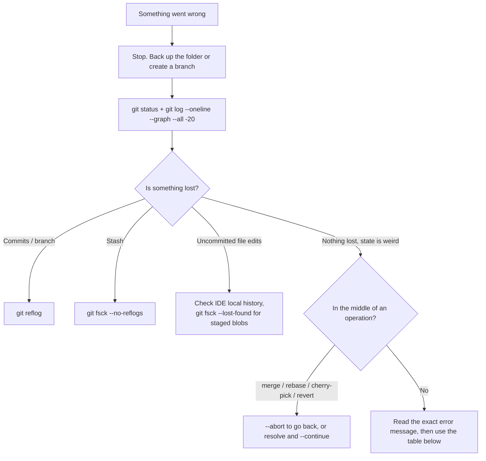

<!-- devopsshack:header -->
> 📘 **Git Mastery: Zero to Production** · by **DevOps Shack** · [YouTube](https://www.youtube.com/@devopsshack) · [Hindi channel](https://www.youtube.com/@shackverse) · [devopsshack.com](https://devopsshack.com)
<!-- /devopsshack:header -->

# Module 21 · Troubleshooting & Disaster Recovery

This is the module you'll come back to when something is on fire. Each scenario gives you the symptom, what's actually going on, and the fix.

> **DevOps Shack rule for every Git emergency:** Before fixing anything, **stop and back up**. Copy the whole folder (`cp -r repo repo-backup`) or at least create a branch at the current position (`git branch backup-$(date +%s)`). Most Git disasters get worse because of the panicked second command, not the first mistake.

## Triage flow



## Scenario table

### "I committed to main instead of my feature branch" (not pushed)

```bash
git branch feature/oops          # new branch keeps the commits
git reset --hard origin/main     # move main back
git switch feature/oops
```

### "I pushed a bad commit to main"

```bash
git revert <bad-sha>
git push
```

Don't reset and force-push a shared branch.

### "I force-pushed and overwrote a teammate's commits"

The commits still exist on your teammate's machine and probably in your own reflog.

```bash
# on a machine that had the old remote state:
git reflog show origin/main      # find the old tip
git push --force-with-lease origin <old-sha>:main
```

On GitHub, the repository's activity view (or the Events API) shows the before and after SHAs of pushes. GitLab shows them in the push events. Restore from that SHA if no local copy has it. Afterwards, protect the branch against force pushes.

### "I ran git reset --hard and lost commits"

```bash
git reflog
git reset --hard HEAD@{1}       # or the specific SHA
```

### "I ran git reset --hard and lost *uncommitted* changes"

Changes that were never staged are gone from Git's perspective. Check your editor's local history (VS Code Timeline, JetBrains Local History). If you'd run `git add` on them at any point, the blobs exist:

```bash
git fsck --lost-found
ls .git/lost-found/other/       # blobs; inspect with cat
```

### "I deleted a branch"

```bash
git reflog | grep "feature/payments"   # or look for the last commit
git branch feature/payments <sha>
```

If it was deleted on the remote only, someone's local clone or `origin/feature/payments` (if not yet pruned) still has it.

### "My rebase went horribly wrong"

```bash
git rebase --abort              # if still in progress
git reset --hard ORIG_HEAD      # right after it finished
git reflog                      # find "rebase (start)" and take the entry before it
```

### "Detached HEAD and I made commits"

```bash
git switch -c save-my-work      # if still detached
git reflog                      # if already switched away; then git branch save <sha>
```

### "Merge conflict and I'm lost"

```bash
git merge --abort               # back to before the merge
git status                      # if you want to continue: see which files conflict
```

### "fatal: refusing to merge unrelated histories"

Two repos with no common commit. Happens when you `git init` locally, then try to pull a remote that was created with a README.

```bash
git pull origin main --allow-unrelated-histories
```

Only do this if you really intend to combine them.

### "error: failed to push some refs ... (fetch first)"

The remote has commits you don't. `git pull --rebase`, then push.

### "fatal: detected dubious ownership in repository"

The repo folder is owned by a different user (common in Docker containers and CI).

```bash
git config --global --add safe.directory /path/to/repo
```

### "Permission denied (publickey)"

```bash
ssh -vT git@github.com          # verbose: which keys are tried?
ssh-add -l                      # is your key loaded in the agent?
ssh-add ~/.ssh/id_ed25519
git remote -v                   # is it an SSH URL or HTTPS?
```

### "error: RPC failed; curl 92 HTTP/2 stream was not closed cleanly" or "early EOF" on clone

Usually large repos over flaky networks or proxies.

```bash
git clone --filter=blob:none <url>       # download less
git clone --depth 1 <url> && git fetch --unshallow   # in stages
git config --global http.version HTTP/1.1
```

### "Your branch and 'origin/main' have diverged"

Both sides have unique commits. Decide: `git pull --rebase` (replay yours on top) or `git pull --no-rebase` (merge). If your local commits are junk: `git reset --hard origin/main`.

### "I committed a huge file and now push fails (file exceeds 100 MB)"

If it's only in local unpushed commits:

```bash
git rm --cached big.zip
git commit --amend --no-edit     # if it's in the last commit
# or interactive rebase to remove it from an earlier commit
```

If it's deeper in history, use `git filter-repo --strip-blobs-bigger-than 100M`, then track such files with LFS.

### "The file is in .gitignore but still shows as changed"

It's already tracked. `git rm --cached file`, then commit.

### "Line endings: every line shows as changed"

Add `.gitattributes` with `* text=auto eol=lf`, then:

```bash
git add --renormalize .
git commit -m "Normalize line endings"
```

### "fatal: Unable to create '.git/index.lock': File exists"

A Git process crashed or is still running. Make sure no Git process (or IDE background task) is running, then:

```bash
rm -f .git/index.lock
```

### "Filename too long" on Windows

```bash
git config --global core.longpaths true
```

### "Case-only rename isn't detected" (macOS/Windows)

```bash
git mv readme.md README.md       # works with git mv
# or in two steps if needed:
git mv readme.md tmp.md && git mv tmp.md README.md
```

## Repository corruption

Symptoms: `error: object file ... is empty`, `fatal: loose object ... is corrupt`, `bad object HEAD`. Usually caused by a disk filling up, a crash or power loss mid-write, or a sync tool (Dropbox, OneDrive) fighting with Git.

```bash
cp -r repo repo-corrupt-backup     # first!
git fsck --full                    # list problems
```

Recovery options, from easiest:

1. **Re-clone** from the remote and copy over any unpushed work (files from the working tree, or branches you can still read).
2. **Fetch the missing objects** from a healthy remote: delete the empty or corrupt object files, then `git fetch origin` and `git fsck` again.
3. **Recover from another clone**: `git fetch /path/to/teammates/clone` or copy their packfiles in.
4. **Rebuild the index** if only the index is broken: `rm .git/index && git reset`.
5. **Fix a broken HEAD ref**: `echo "ref: refs/heads/main" > .git/HEAD`, or write a known good SHA into `.git/refs/heads/main`.

Never keep a Git repository inside Dropbox, OneDrive or Google Drive sync folders.

## Remote disaster recovery

If the remote repository is deleted or corrupted:

- **Any full clone is a complete backup.** Push it to a new remote with `git push --mirror` from a `git clone --mirror`.
- What's *not* in Git and won't come back from a clone: PRs, issues, reviews, wikis (separate repos), CI settings, branch protection, webhooks. Back these up with platform export tools or API scripts.
- GitHub can restore recently deleted repositories for a limited window. Contact support quickly.

> **DevOps Shack Production Tip:** Run a scheduled mirror backup job (`git clone --mirror` then `git remote update` on a schedule, pushed to object storage or a second platform) for business-critical repos. Test restoring it. A backup you've never restored is just a hope.

## Key takeaways

- Back up first, then fix.
- `reflog`, `ORIG_HEAD`, `--abort` and `fsck` solve nearly every "lost" problem.
- Revert on shared branches. Reset only locally.
- Corruption is usually fixed by fetching objects again from a healthy copy.
- Git clones back up code, not the platform's PRs, issues and settings.

## Practice

- [Lab 06 · Reflog Rescue](../labs/lab-06-reflog-rescue/README.md)
- [Lab 28 · Detached HEAD and Lost Work](../labs/lab-28-detached-head-and-lost-work/README.md)
- [Lab 29 · Repository Corruption Recovery](../labs/lab-29-repo-corruption-recovery/README.md)
- [Lab 30 · Production Incident Drill](../labs/lab-30-production-incident-drill/README.md)
- [Cheat sheet · Recovery](../cheatsheets/recovery.md)

Next: [Module 22 · Hosting Platforms](22-hosting-platforms.md)


<!-- devopsshack:footer -->
---

<p align="center">
  Made with ❤️ by <b><a href="https://devopsshack.com">DevOps Shack</a></b> · Part of <b>Git Mastery: Zero to Production</b><br/>
  <a href="https://www.youtube.com/@devopsshack">YouTube · DevOps Shack</a> · <a href="https://www.youtube.com/@shackverse">YouTube · DevOps Shack Hindi</a> · <a href="https://devopsshack.com">devopsshack.com</a> · <a href="https://www.instagram.com/devopsshack">Instagram · @devopsshack</a><br/>
  <sub>© DevOps Shack. Original content created by DevOps Shack. Free to learn from and share with credit to DevOps Shack. See <a href="../LICENSE">LICENSE</a>.</sub>
</p>
<!-- /devopsshack:footer -->
