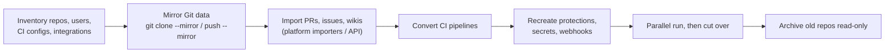

<!-- devopsshack:header -->
> 📘 **Git Mastery: Zero to Production** · by **DevOps Shack** · [YouTube](https://www.youtube.com/@devopsshack) · [Hindi channel](https://www.youtube.com/@shackverse) · [devopsshack.com](https://devopsshack.com)
<!-- /devopsshack:header -->

# Module 22 · Hosting Platforms: GitHub, GitLab, Bitbucket & More

Git is the same everywhere. The platforms differ in how they handle reviews, CI/CD, permissions and enterprise features. As a DevOps engineer you'll often administer one of these, migrate between them, or integrate pipelines with them.

## The platforms

| | GitHub | GitLab | Bitbucket | Azure Repos | Gitea / Forgejo |
|---|---|---|---|---|---|
| Review unit | Pull request | Merge request | Pull request | Pull request | Pull request |
| Built-in CI/CD | GitHub Actions | GitLab CI/CD | Bitbucket Pipelines | Azure Pipelines | Gitea/Forgejo Actions |
| Self-hosted option | GitHub Enterprise Server | GitLab CE/EE (very common) | Data Center | Azure DevOps Server | Yes (lightweight) |
| Strengths | Ecosystem, open source, Actions marketplace, Copilot | Complete DevSecOps platform in one app, self-hosting | Jira integration | Microsoft/Azure shops | Small, simple self-hosting |

## Terminology map

| Concept | GitHub | GitLab | Bitbucket |
|---|---|---|---|
| Code review request | Pull Request | Merge Request | Pull Request |
| Grouping of repos | Organization | Group / Subgroup | Workspace / Project |
| Required approvers by path | CODEOWNERS | CODEOWNERS (Code Owners) | Default reviewers / Code owners |
| Branch rules | Branch protection / Rulesets | Protected branches / Push rules | Branch permissions |
| Serialized merging | Merge queue | Merge trains | — |
| Machine access, one repo | Deploy key | Deploy key / Deploy token | Access key |
| App-based automation | GitHub App | Group/Project access token | — |
| Pages hosting | GitHub Pages | GitLab Pages | — |

## GitHub essentials for DevOps

- **Rulesets** apply branch and tag protections across many repos from the org level.
- **Required workflows and status checks** enforce CI.
- **Environments** with required reviewers and wait timers for deployment approvals.
- **GitHub Advanced Security**: secret scanning, push protection, code scanning (CodeQL), Dependabot.
- **OIDC** from Actions to AWS, Azure and GCP, with no stored cloud keys.
- `gh` CLI for scripting: `gh pr create`, `gh pr checkout 123`, `gh repo clone`, `gh api`.

```bash
gh pr create --fill --base main
gh pr checks
gh pr merge --squash --delete-branch
gh api repos/devopsshack/app/branches/main/protection
```

## GitLab essentials for DevOps

- **Groups and subgroups** with inherited permissions. Roles: Guest, Reporter, Developer, Maintainer, Owner.
- **Protected branches** ("allowed to merge" and "allowed to push and merge" per role) and **push rules** (commit message regex, reject unsigned commits, prevent secrets, max file size).
- **Merge request approval rules**, Code Owners, and merged results pipelines.
- **Merge trains** for serialized merging.
- **Environments and deployments**, protected environments, and the built-in container registry.
- `glab` CLI.

```bash
glab mr create --fill --target-branch main
glab mr merge --squash --remove-source-branch
glab ci status
```

## Migrating between platforms



- Git history moves perfectly with `--mirror`. Everything else needs importers: GitHub Importer and GitHub Enterprise Importer, GitLab's GitHub/Bitbucket importers.
- CI is the biggest effort. GitHub Actions Importer can help convert from Jenkins, GitLab CI, Azure Pipelines and others.
- Update every place that hardcodes the old URL: submodules, Terraform module sources, Helm repos, Argo CD apps, docs.

## Mirroring

- **GitLab pull/push mirroring** keeps a repo synced to or from another platform automatically.
- On GitHub, run a scheduled workflow or external job: `git fetch --prune origin && git push --mirror backup`.

## Webhooks

Platforms send HTTP callbacks on events (push, PR opened, tag created) to external systems: Jenkins, Argo CD, Slack and chat-ops bots. Verify webhook signatures (`X-Hub-Signature-256` on GitHub, `X-Gitlab-Token` on GitLab) so attackers can't forge events.

> **DevOps Shack Production Tip:** Whichever platform you use, manage org settings, repo settings and branch protections **as code**: the Terraform GitHub provider, the Terraform GitLab provider, or Probot Settings. Then a new repo gets the right protections automatically, and changes to protections go through review like everything else.

## Key takeaways

- The platforms share concepts under different names. Learn the terminology map.
- GitHub leads on ecosystem. GitLab leads on all-in-one DevSecOps and self-hosting.
- Git data migrates with `--mirror`. PRs, issues and CI need importers and rework.
- Manage platform settings as code with Terraform.

Next: [Module 23 · Advanced Configuration](23-advanced-configuration.md)


<!-- devopsshack:footer -->
---

<p align="center">
  Made with ❤️ by <b><a href="https://devopsshack.com">DevOps Shack</a></b> · Part of <b>Git Mastery: Zero to Production</b><br/>
  <a href="https://www.youtube.com/@devopsshack">YouTube · DevOps Shack</a> · <a href="https://www.youtube.com/@shackverse">YouTube · DevOps Shack Hindi</a> · <a href="https://devopsshack.com">devopsshack.com</a> · <a href="https://www.instagram.com/devopsshack">Instagram · @devopsshack</a><br/>
  <sub>© DevOps Shack. Original content created by DevOps Shack. Free to learn from and share with credit to DevOps Shack. See <a href="../LICENSE">LICENSE</a>.</sub>
</p>
<!-- /devopsshack:footer -->
