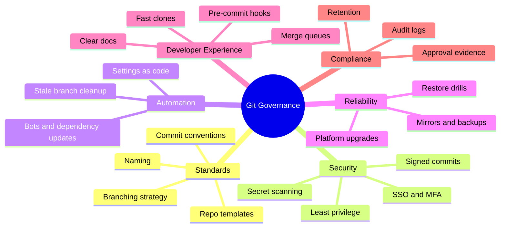

<!-- devopsshack:header -->
> 📘 **Git Mastery: Zero to Production** · by **DevOps Shack** · [YouTube](https://www.youtube.com/@devopsshack) · [Hindi channel](https://www.youtube.com/@shackverse) · [devopsshack.com](https://devopsshack.com)
<!-- /devopsshack:header -->

# Module 24 · Git at Scale & Repository Governance

The final module is about owning Git for an entire engineering organization: hundreds of repositories, thousands of developers, auditors, and the platform team that holds it all together.

## What "owning Git" means



## Standard repository template

Every new repo should start with:

```
.
├── README.md                 # what it is, how to run it, how to contribute
├── CONTRIBUTING.md           # branching, commit and PR conventions
├── CODEOWNERS                # or .github/CODEOWNERS
├── SECURITY.md               # how to report vulnerabilities
├── LICENSE
├── .gitignore
├── .gitattributes
├── .editorconfig
├── .pre-commit-config.yaml
├── .github/
│   ├── pull_request_template.md
│   ├── ISSUE_TEMPLATE/
│   ├── dependabot.yml
│   └── workflows/ci.yml
└── .git-blame-ignore-revs
```

GitHub template repositories and GitLab project templates make this one click. Enforce it with Terraform-managed repos.

## Settings as code

```hcl
# Terraform: create a repo with protection, maintained by the platform team
resource "github_repository" "payments" {
  name                   = "payments-service"
  visibility             = "private"
  delete_branch_on_merge = true
  allow_merge_commit     = false
  allow_squash_merge     = true
  allow_rebase_merge     = false
  vulnerability_alerts   = true
  template {
    owner      = "devopsshack"
    repository = "service-template"
  }
}

resource "github_branch_protection" "main" {
  repository_id                   = github_repository.payments.node_id
  pattern                         = "main"
  enforce_admins                  = true
  require_signed_commits          = true
  required_linear_history         = true
  allows_force_pushes             = false
  required_status_checks {
    strict   = true
    contexts = ["ci/build", "ci/test", "security/gitleaks"]
  }
  required_pull_request_reviews {
    required_approving_review_count = 2
    require_code_owner_reviews      = true
    dismiss_stale_reviews           = true
  }
}
```

## Compliance and audit

Auditors (SOC 2, ISO 27001, PCI DSS, HIPAA) typically ask you to show:

- **Change management**: every production change was reviewed and approved by someone other than its author. Show protected branches, required reviews and PR records.
- **Traceability**: each deployment links to a commit, and each commit links to a ticket. Use branch names and commit messages with ticket IDs, and image labels with SHAs.
- **Access control**: who has write and admin access, with periodic access reviews.
- **Integrity**: signed commits, and protected history with no force pushes.
- **Audit logs** retained and exported to a SIEM.

Git and the platform give you most of this evidence for free, *if* protections are on from the start.

## Developer experience at scale

- **Fast clones**: partial clone defaults, Scalar, regional mirrors or caching proxies for CI.
- **Merge queues** to keep main green at high PR volume.
- **Dependency bots** (Dependabot, Renovate), with grouping so they don't flood teams with PRs.
- **Automated stale branch and PR cleanup.**
- **Good docs**: a single internal "How we use Git" page linked from every CONTRIBUTING.md.

## Running self-hosted Git

If you run GitLab, GitHub Enterprise Server, Gitea or Gerrit yourself:

- Plan for **high availability** (GitLab uses Gitaly Cluster/Praefect for replicated Git storage) and regular **backup and restore testing**.
- Keep up with **security releases**. Git server vulnerabilities are actively exploited.
- Monitor disk, packfile maintenance, Gitaly or storage latency, and CI runner queue times.
- Use **geo-replication** for distributed teams.

## Inner source

Inner source applies open-source practices inside a company: any team can read any repo and propose changes through PRs, while owning teams review. It needs default-read visibility, good CONTRIBUTING docs, CODEOWNERS and a culture of accepting outside contributions.

## Measuring Git and delivery health

- **DORA metrics**: deployment frequency, lead time for changes (commit to production), change failure rate, and time to restore service. Lead time is computed straight from Git and deployment timestamps.
- PR metrics: time to first review, time to merge, PR size distribution.
- Branch age: how many branches are older than 30 days.

> **DevOps Shack Production Tip:** If you only fix one thing in an organization's Git setup, make it **PR size**. Teams that keep PRs small get faster reviews, fewer conflicts, fewer bugs and easier rollbacks. Almost every other Git metric improves as a side effect.

## Key takeaways

- Governance covers standards, security, automation, reliability, developer experience and compliance.
- Start every repo from a template, and manage settings and protections with Terraform.
- Protected branches and PR records are your audit evidence.
- At scale, invest in fast clones, merge queues and dependency automation.
- Measure delivery with DORA metrics, starting from Git data.

## Practice

- [Assignment A20 · Capstone: Repository Governance](../assignments/A20-capstone-repo-governance.md)
- [Lab 30 · Production Incident Drill](../labs/lab-30-production-incident-drill/README.md)

**You've completed the Git Mastery curriculum.** Now test yourself with the [1,000 interview questions](../interview-questions/README.md).


<!-- devopsshack:footer -->
---

<p align="center">
  Made with ❤️ by <b><a href="https://devopsshack.com">DevOps Shack</a></b> · Part of <b>Git Mastery: Zero to Production</b><br/>
  <a href="https://www.youtube.com/@devopsshack">YouTube · DevOps Shack</a> · <a href="https://www.youtube.com/@shackverse">YouTube · DevOps Shack Hindi</a> · <a href="https://devopsshack.com">devopsshack.com</a> · <a href="https://www.instagram.com/devopsshack">Instagram · @devopsshack</a><br/>
  <sub>© DevOps Shack. Original content created by DevOps Shack. Free to learn from and share with credit to DevOps Shack. See <a href="../LICENSE">LICENSE</a>.</sub>
</p>
<!-- /devopsshack:footer -->
